# TipsBank — Evidências

Registro dos comandos e saídas que comprovam cada critério de aceite do `docs/MANUAL-ALUNO.md`.

---

# SEMANA 1 — Fundações

## Etapa 1.1 — Entender a aplicação localmente

**Data**: 2026-11-02 · **Ambiente**: Zorin OS, Docker Engine + `docker-compose-v2`, `docker compose up --build`

### Visão geral dos serviços (explicação de 2 minutos)

| Serviço | Porta local | O que faz |
|---|---|---|
| `postgres` | 5432 | Banco `tipsbank`, com as tabelas `contas` e `transacoes`. Inicializado por `sql/init.sql`, que cria as 2 contas seed com `senha_hash` bcrypt pré-computado (senha `giropops`). |
| `api-contas` | 8081 | CRUD de contas, `POST /login` (valida CPF + senha com bcrypt) e `POST /contas/{id}/saldo` (débito/crédito). Nunca devolve `senha_hash`, porque o modelo de saída `ContaOut` não tem esse campo. |
| `api-transacoes` | 8082 | `POST /transferencias` **debita** a origem e **credita** o destino chamando a `api-contas` via HTTP. Se o crédito falha, faz um estorno compensatório. Depois grava a transação na tabela `transacoes` (Postgres) e **publica o evento** na `auditoria`. Também tem `GET /extrato/{conta_id}`. |
| `auditoria` | 8083 | Recebe eventos em `POST /eventos` e anexa uma linha JSON em `/data/eventos-YYYY-MM-DD.jsonl`. Em produção esse diretório será um PV NFS RWX. |
| `web` | 8080 | SPA estática servida por `nginx-unprivileged` (UID 101). Faz proxy reverso de `/api/contas/`, `/api/transacoes/` e `/api/auditoria/` para as 3 APIs. |

**Fluxo de uma transferência**: SPA → `web` (nginx) → `api-transacoes` → `api-contas` (débito + crédito) → Postgres (grava a transação) → `auditoria` (linha no `.jsonl`).

**Observações da leitura do código** (pontos a considerar nas próximas semanas):
- Débito e crédito são duas chamadas HTTP separadas, sem transação distribuída. A consistência depende do estorno compensatório.
- Se a `auditoria` estiver fora do ar, a transferência **conclui mesmo assim** e o evento se perde. A `api-transacoes` só registra `auditoria indisponivel` no log. Isso reforça a importância das probes e do monitoramento da `auditoria` (Semana 3).
- A `api-transacoes` também acessa o Postgres (`DB_URL`). Isso vai importar nas NetworkPolicies (Semana 2).
- O nome do arquivo de auditoria usa a data em **UTC**. Depois das 21h no horário de Brasília, os eventos já caem no arquivo do dia seguinte.

### Containers rodando

```console
$ docker compose ps --format 'table {{.Name}}\t{{.Image}}\t{{.Status}}\t{{.Ports}}'
NAME                      IMAGE                         STATUS                    PORTS
tipsbank-api-contas       tipsbank/api-contas:dev       Up 36 minutes             0.0.0.0:8081->8080/tcp
tipsbank-api-transacoes   tipsbank/api-transacoes:dev   Up 36 minutes             0.0.0.0:8082->8080/tcp
tipsbank-auditoria        tipsbank/auditoria:dev        Up 36 minutes             0.0.0.0:8083->8080/tcp
tipsbank-postgres         postgres:16-alpine            Up 36 minutes (healthy)   0.0.0.0:5432->5432/tcp
tipsbank-web              tipsbank/web:dev              Up 36 minutes             0.0.0.0:8080->8080/tcp
```

```console
$ for p in 8081 8082 8083; do echo "$p -> $(curl -s localhost:$p/health/live)"; done
8081 -> {"status":"ok"}
8082 -> {"status":"ok","version":"v1"}
8083 -> {"status":"ok"}
$ curl -s localhost:8080/healthz
ok
```

### Critério 1 — `GET /contas` retorna as contas seed sem `senha_hash`

```console
$ curl -s localhost:8081/contas | jq
[
  { "id": "11111111-1111-1111-1111-111111111111", "titular": "Jeferson Fernando", "documento": "12345678901", "saldo": "10099.98" },
  { "id": "22222222-2222-2222-2222-222222222222", "titular": "LinuxTips SA",      "documento": "98765432100", "saldo": "600.00" },
  { "id": "7f0abc12-f7d3-4613-a575-bfe286f41711", "titular": "Descomplicador",    "documento": "11122233344", "saldo": "900.00" },
  { "id": "bfdc6562-27d7-4971-a728-25409b4445c1", "titular": "Luiz Caetano",      "documento": "13513660847", "saldo": "900.02" }
]

$ curl -s localhost:8081/contas | grep -c senha_hash
0
```

As 2 contas seed estão presentes. As outras duas foram criadas durante os testes: "Descomplicador" pelo `curl` do README e "Luiz Caetano" pela SPA. Nenhuma resposta contém `senha_hash`.

### Critério 2 — Login: 200 com a senha certa, 401 com a errada

```console
$ curl -s -w '\nHTTP %{http_code}\n' -X POST localhost:8081/login \
    -H 'content-type: application/json' \
    -d '{"documento":"12345678901","senha":"giropops"}'
{"id":"11111111-1111-1111-1111-111111111111","titular":"Jeferson Fernando","documento":"12345678901","saldo":"10099.98"}
HTTP 200

$ curl -s -w '\nHTTP %{http_code}\n' -X POST localhost:8081/login \
    -H 'content-type: application/json' \
    -d '{"documento":"12345678901","senha":"senhaerrada"}'
{"detail":"credenciais invalidas"}
HTTP 401
```

### Critério 3 — Transferência de R$ 100 muda o saldo de ambas as contas

Saldo **antes**:
```console
$ curl -s localhost:8081/contas | jq -r '.[] | select(.documento=="12345678901" or .documento=="98765432100") | "\(.titular): \(.saldo)"'
Jeferson Fernando: 10099.98
LinuxTips SA: 600.00
```

Transferência:
```console
$ curl -s -w '\nHTTP %{http_code}\n' -X POST localhost:8082/transferencias \
    -H 'content-type: application/json' \
    -d '{"origem_id":"11111111-1111-1111-1111-111111111111","destino_id":"22222222-2222-2222-2222-222222222222","valor":"100.00"}'
{"id":"be2b3fa4-a52f-4e7f-aa1c-59832b6ad731","origem_id":"11111111-1111-1111-1111-111111111111","destino_id":"22222222-2222-2222-2222-222222222222","valor":"100.00","status":"concluida"}
HTTP 201
```

Saldo **depois**:
```console
Jeferson Fernando: 9999.98    # -100,00
LinuxTips SA: 700.00          # +100,00
```

### Critério 4 — Uma linha no `/data/eventos-YYYY-MM-DD.jsonl` por transferência

O container `auditoria` é **Distroless** (sem shell nem `cat`), então `docker exec ... cat` não funciona. O arquivo foi lido com `docker cp` para stdout, que gera um tar, extraído com `tar -xO`:

```console
$ curl -s localhost:8083/arquivos
["eventos-2026-11-02.jsonl"]

$ docker cp tipsbank-auditoria:/data/eventos-2026-11-02.jsonl - | tar -xO | wc -l
5

$ docker exec tipsbank-postgres psql -U tipsbank -d tipsbank -t \
    -c "select count(*) from transacoes where status='concluida'"
     5
```

5 transferências concluídas no Postgres e 5 linhas no `.jsonl`. A última linha corresponde à transferência do critério 3 (mesmo `transacao_id`):

```console
$ docker cp tipsbank-auditoria:/data/eventos-2026-11-02.jsonl - | tar -xO | tail -1 | jq
{
  "id": "06b179af-6d98-4db3-a648-92ffc04b482f",
  "recebido_em": "2026-11-02T20:47:09.447375+00:00",
  "tipo": "transferencia",
  "transacao_id": "be2b3fa4-a52f-4e7f-aa1c-59832b6ad731",
  "origem_id": "11111111-1111-1111-1111-111111111111",
  "destino_id": "22222222-2222-2222-2222-222222222222",
  "valor": "100.00",
  "versao_app": "v1"
}
```

### Critério 5 — SPA em `localhost:8080` funciona ponta a ponta

Testado no navegador com uma conta nova, "Teste Evidencia", criada só para os prints: abrir conta → login → dashboard → transferir R$ 100 para "Luiz Caetano" → extrato → auditoria. Essa foi a 6ª transferência do ambiente.

**1. Abrir conta** (`#/abrir`): titular, CPF, senha com confirmação e depósito inicial de R$ 1.000.

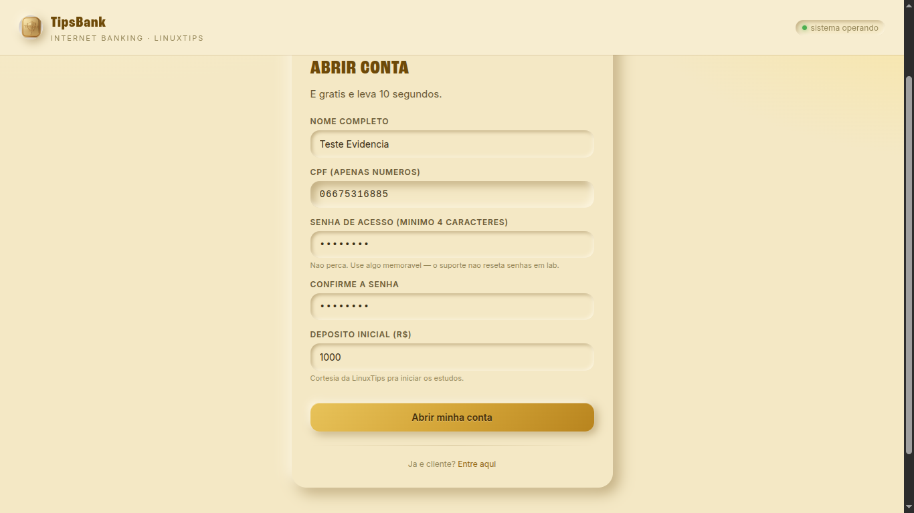

**2. Login** (`#/entrar`): CPF + senha da conta recém-criada.

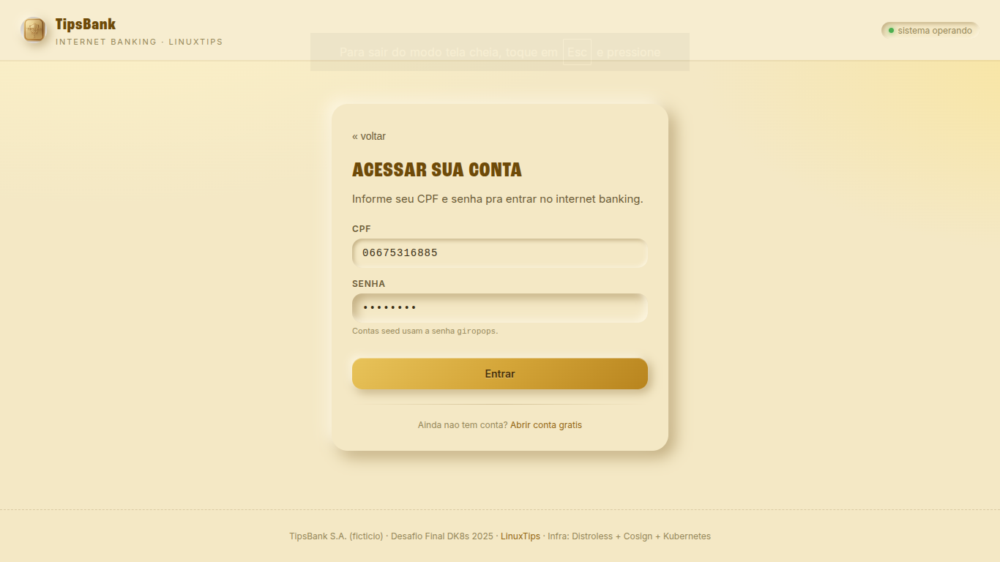

**3. Dashboard** (`#/conta`): conta autenticada, saldo de R$ 1.000,00 e nenhuma movimentação.

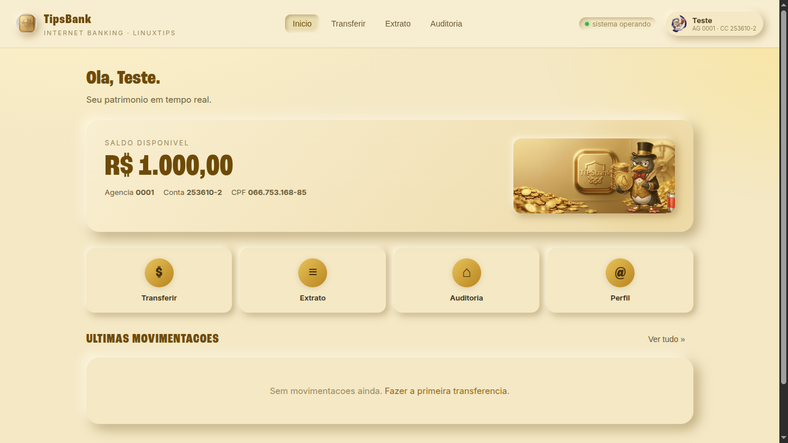

**4. Transferência** (`#/transferir`): origem "Teste Evidencia", destino "Luiz Caetano", R$ 100,00.

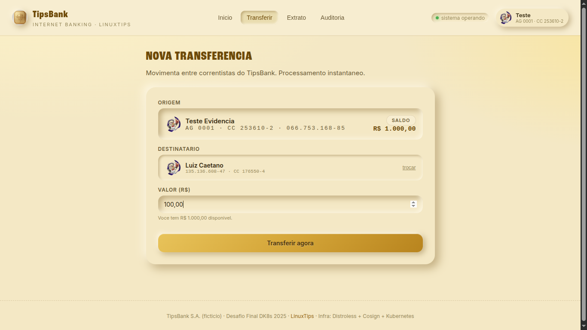

**5. Comprovante**: autenticação `1b735c60-1bfc-43a6-be37-3171bcb2af04`, status `concluida`.

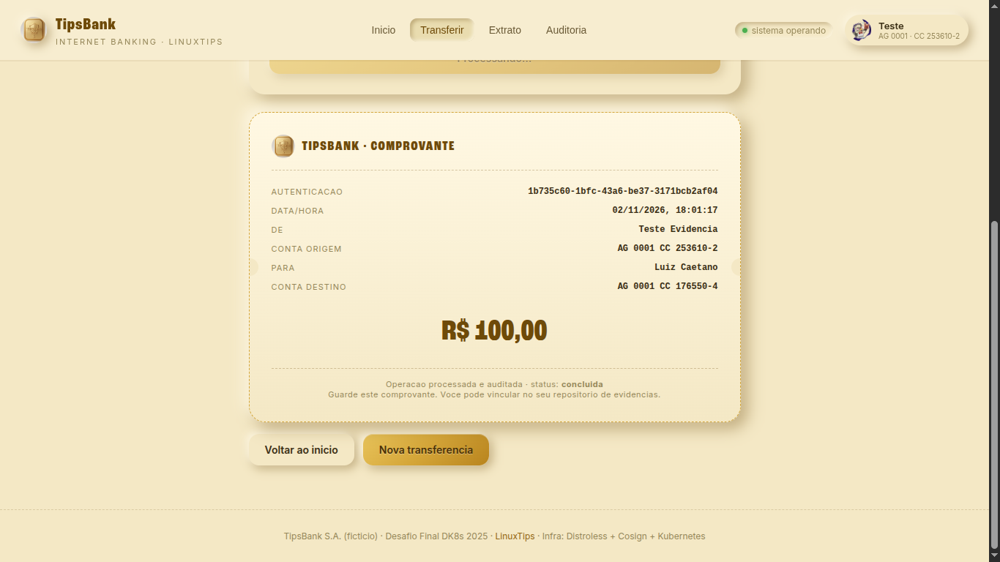

**6. Extrato** (`localhost:8080/#/extrato`): débito de −R$ 100,00 com o mesmo ID `1b735c60`.

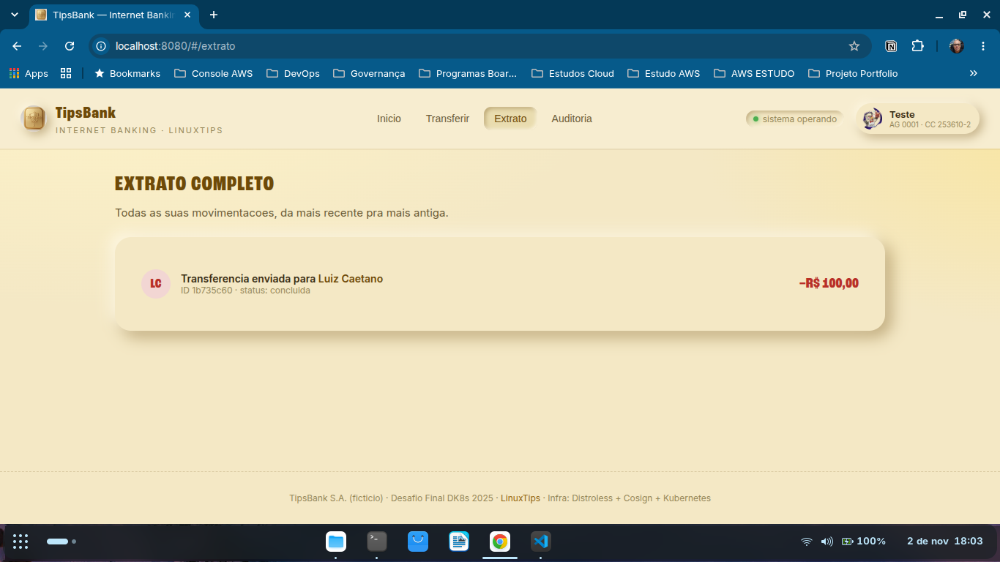

**7. Auditoria** (`localhost:8080/#/auditoria`): o evento `tx=1b735c60…` aparece no arquivo `2026-11-02`. Logo abaixo aparece o `tx=be2b3fa4…`, que é a transferência feita via `curl` no critério 3. A SPA e a API leem o mesmo `.jsonl`.

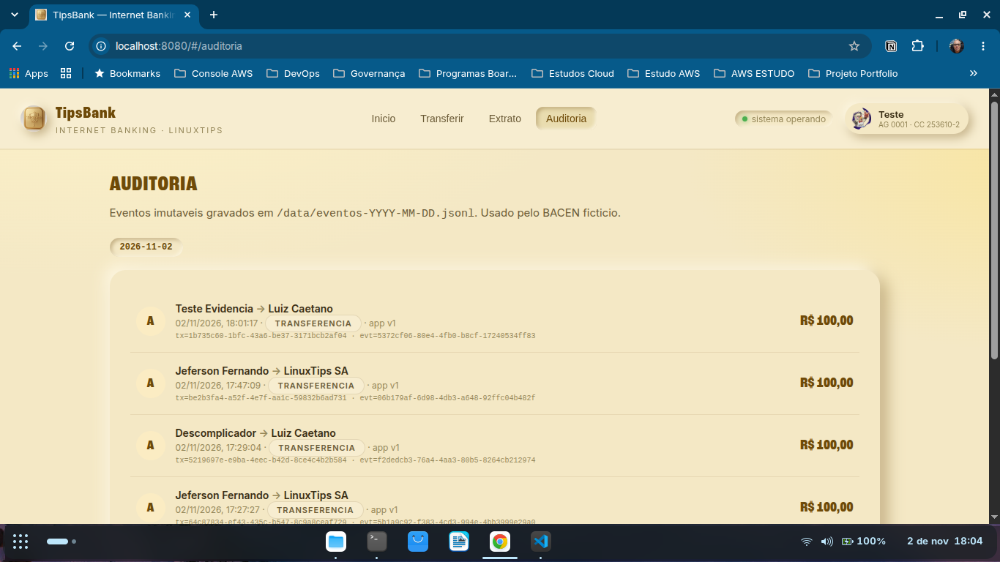

Conferência após o teste na SPA. As 6 transações concluídas no Postgres correspondem às 6 linhas no `.jsonl`, e os saldos fecham:

```console
$ curl -s localhost:8081/contas | jq -r '.[] | "\(.titular): \(.saldo)"'
Descomplicador: 900.00
Jeferson Fernando: 9999.98
LinuxTips SA: 700.00
Teste Evidencia: 900.00      # 1000 - 100
Luiz Caetano: 1000.02        # 900.02 + 100
$ docker exec tipsbank-postgres psql -U tipsbank -d tipsbank -t -c "select count(*) from transacoes"
     6
$ docker cp tipsbank-auditoria:/data/eventos-2026-11-02.jsonl - | tar -xO | wc -l
6
```

Validação do proxy reverso do nginx (o mesmo caminho que a SPA usa):

```console
$ curl -s -o /dev/null -w "%{http_code}\n" localhost:8080/
200
$ curl -s localhost:8080/api/contas/contas | jq length
4
$ curl -s localhost:8080/api/auditoria/eventos | jq length
5
$ curl -s localhost:8080/api/transacoes/extrato/bfdc6562-27d7-4971-a728-25409b4445c1 | jq -c '.[] | {origem_id,destino_id,valor,status}'
{"origem_id":"7f0abc12-f7d3-4613-a575-bfe286f41711","destino_id":"bfdc6562-27d7-4971-a728-25409b4445c1","valor":"100.00","status":"concluida"}
{"origem_id":"bfdc6562-27d7-4971-a728-25409b4445c1","destino_id":"11111111-1111-1111-1111-111111111111","valor":"100.00","status":"concluida"}
{"origem_id":"bfdc6562-27d7-4971-a728-25409b4445c1","destino_id":"11111111-1111-1111-1111-111111111111","valor":"99.98","status":"concluida"}
```

O extrato da conta "Luiz Caetano" mostra as 3 transferências feitas pela SPA. O saldo bate: 1000,00 − 99,98 − 100,00 + 100,00 = **900,02**.

### Extra — usuário dos containers (base para a etapa 1.2)

```console
$ for c in api-contas api-transacoes auditoria web; do echo "$c user=$(docker inspect tipsbank-$c --format '{{.Config.User}}')"; done
api-contas user=65532
api-transacoes user=65532
auditoria user=65532
web user=101
```

### Resultado

| Critério | Status |
|---|---|
| `GET /contas` com seeds e sem `senha_hash` | ✅ |
| Login 200 / 401 | ✅ |
| Transferência de R$ 100 altera os 2 saldos | ✅ |
| 1 linha no `.jsonl` por transferência | ✅ (5/5 via curl, 6/6 após o teste na SPA) |
| SPA ponta a ponta | ✅ |

---

## Etapa 1.2 — Build Distroless, scan com Trivy, assinatura Cosign

**Data**: 2026-11-03 · **Ferramentas**: Docker 29.1.3 + buildx 0.30.1, Trivy 0.69.3, Docker Scout 1.20.3, Cosign 3.1.4 · **Registry**: `ghcr.io/jlui70` (exigido pelo comando de compliance #1, que só aceita `ghcr.io/<user>`)

### Por que Distroless (multi-stage) reduz vulnerabilidades

Os Dockerfiles das APIs têm **dois estágios**:

1. **builder** (`python:3.x-slim`): tem `pip`, compiladores e shell. Instala as dependências com `pip install --target=/packages`. Esse estágio **não vai para a imagem final**.
2. **runtime** (`gcr.io/distroless/python3-*:nonroot`): recebe só o `/packages` e o `main.py`. Tem o interpretador Python e a glibc, e roda como o usuário `nonroot` (UID 65532).

Isso reduz vulnerabilidades por três motivos:
- **Menos pacotes, menos CVEs**: a imagem não tem `apt`, `bash`, `coreutils`, `curl` nem compiladores, e cada pacote a menos é um pacote a menos para ter CVE. O Trivy encontra só ~25 pacotes Python e as libs mínimas do Debian.
- **Menos superfície de ataque**: sem shell, quem conseguir executar código pela aplicação não tem `sh`, nem gerenciador de pacotes para instalar ferramentas, nem `curl` para baixar payloads (prova abaixo).
- **Não-root por padrão**: mesmo que alguém escape da aplicação, o processo não tem privilégio de root dentro do container.

O `--target=/packages` é usado em vez de um venv porque o venv guarda o caminho absoluto do `python3` do builder. No Distroless o binário fica em outro caminho e o venv quebraria. Com `PYTHONPATH=/packages` e `PATH=/packages/bin:$PATH`, o `python3` do runtime encontra as libs.

### Problema encontrado: as bases originais não passavam no critério

Primeiro escaneei as imagens base que vinham nos Dockerfiles:

```console
$ trivy image -q --severity HIGH,CRITICAL -f json gcr.io/distroless/python3-debian12:nonroot \
    | jq -r '[.Results[].Vulnerabilities[]?] | "total=\(length) CRITICAL=\(map(select(.Severity=="CRITICAL"))|length) com-fix=\(map(select(.Status=="fixed"))|length) will_not_fix=\(map(select(.Status=="will_not_fix"))|length)"'
total=63 CRITICAL=2 com-fix=45 will_not_fix=1

$ trivy image ... nginxinc/nginx-unprivileged:1.27-alpine   # mesmo filtro jq
total=60 CRITICAL=3 com-fix=60 will_not_fix=0
```

- **`python3-debian12`**: 45 CVEs já têm correção no Debian, mas a imagem Distroless ainda não foi reconstruída com essas correções. E, como ela não tem `apt`, **eu não consigo aplicar os patches no meu build**. Sobram ainda CVEs `will_not_fix` (zlib, CVE-2023-45853) e `affected` (ex.: sqlite, CVE-2025-7458, CRITICAL), que nenhuma atualização resolve.
- **`nginx-unprivileged:1.27-alpine`**: a linha 1.27 não recebe mais atualizações. As 60 CVEs já têm correção em versões mais novas.

### Alterações feitas

**APIs** (`apps/{api-contas,api-transacoes,auditoria}/Dockerfile`): troca para **Debian 13 (trixie)**. O builder e o runtime precisam ter **a mesma versão do Python**, porque o `/packages` contém wheels compilados para o Python do builder (ex.: `pydantic-core`, `psycopg-binary`).

```diff
-FROM python:3.11-slim-bookworm AS builder
+FROM python:3.13-slim-trixie AS builder
 ...
-FROM gcr.io/distroless/python3-debian12:nonroot
+FROM gcr.io/distroless/python3-debian13:nonroot
```

**web** (`apps/web/Dockerfile`): base atual com tag fixa (o compliance proíbe `:latest`), mais `apk upgrade` para aplicar as correções do Alpine publicadas depois da imagem base. Para isso o build vira root **apenas nesse passo** e volta para o UID 101:

```diff
-FROM nginxinc/nginx-unprivileged:1.27-alpine
+FROM nginxinc/nginx-unprivileged:1.31.7-alpine3.24
+USER root
+RUN apk upgrade --no-cache
+USER 101
```

**Dependências Python** (`requirements.txt` das 3 APIs): depois de trocar a base, o `trivy image` ainda apontava **3 HIGH no `starlette 0.38.6`** (CVE-2024-47874, CVE-2026-48818, CVE-2026-54283). O starlette é dependência **transitiva**: não aparece no `requirements.txt`, vem junto com o `fastapi==0.115.0`, que trava `starlette<0.39`. Por isso o `trivy fs apps/`, que só lê o que está declarado, dava 0. Só o `trivy image`, que lê o que foi realmente instalado em `/packages`, encontrou.

```diff
-fastapi==0.115.0
+fastapi==0.162.0
+starlette==1.10.0
```

Antes de mudar, confirmei com `pip install --dry-run` que o `fastapi` 0.162.0 resolve junto com os pins atuais (`pydantic==2.9.2`, `uvicorn==0.30.6`). Fixei o `starlette` explicitamente para a versão não mudar sozinha entre builds. Depois rodei de novo, no `docker compose`, todos os testes da etapa 1.1 (health, `/metrics`, login 200/401, validação 422, transferência, auditoria, extrato e proxy do `web`): tudo OK.

### Build

```console
$ R=ghcr.io/jlui70; TAG=v1.0.0
$ for a in api-contas api-transacoes auditoria web; do docker build -t $R/tipsbank-$a:$TAG apps/$a; done

$ docker images --format 'table {{.Repository}}:{{.Tag}}\t{{.ID}}\t{{.Size}}' | grep -E 'REPOSITORY|ghcr.io/jlui70'
REPOSITORY:TAG                                  IMAGE ID       SIZE
ghcr.io/jlui70/tipsbank-api-contas:v1.0.0       d6f0139e1ef3   131MB
ghcr.io/jlui70/tipsbank-api-transacoes:v1.0.0   e7125437d9aa   132MB
ghcr.io/jlui70/tipsbank-auditoria:v1.0.0        58ade0b93e48   100MB
ghcr.io/jlui70/tipsbank-web:v1.0.0              e9ac58eededb   65.7MB
```

O `-t` dá o nome completo, com o registry. É por esse nome que o `docker push` sabe para onde enviar.

### Critério 1 — Trivy: 0 HIGH/CRITICAL nas 4 imagens

```console
$ for a in api-contas api-transacoes auditoria web; do
    n=$(trivy image -q --severity HIGH,CRITICAL --ignore-unfixed -f json $R/tipsbank-$a:v1.0.0 | jq "[.Results[].Vulnerabilities[]?] | length")
    t=$(trivy image -q --severity HIGH,CRITICAL -f json $R/tipsbank-$a:v1.0.0 | jq "[.Results[].Vulnerabilities[]?] | length")
    echo "$a  com-fix=$n  total=$t"; done
api-contas  com-fix=0  total=29
api-transacoes  com-fix=0  total=29
auditoria  com-fix=0  total=29
web  com-fix=0  total=0
```

O `jq` soma as vulnerabilidades de **todos** os alvos que o Trivy escaneia: o sistema operacional e cada pacote Python. A tabela padrão do Trivy mostra a mesma coisa, só que com uma linha por alvo (são 21 a 28 por imagem):

```console
$ trivy image --severity HIGH,CRITICAL --ignore-unfixed ghcr.io/jlui70/tipsbank-api-contas:v1.0.0
│ ghcr.io/jlui70/tipsbank-api-contas:v1.0.0 (debian 13.7) │   debian   │        0        │    -    │
│ packages/SQLAlchemy-2.0.35.dist-info/METADATA           │ python-pkg │        0        │    -    │
│ packages/bcrypt-4.2.0.dist-info/METADATA                │ python-pkg │        0        │    -    │
│ packages/fastapi-0.162.0.dist-info/METADATA             │ python-pkg │        0        │    -    │
│ packages/starlette-1.10.0.dist-info/METADATA            │ python-pkg │        0        │    -    │
│ ...                                                     │ python-pkg │        0        │    -    │
```

**Justificativa do `--ignore-unfixed`**: as 29 HIGH que aparecem sem o filtro nas APIs são **todas `affected`**, ou seja, o Debian conhece a falha mas ainda **não publicou correção**. Não há versão para onde atualizar:

```console
$ trivy image -q --severity HIGH,CRITICAL -f json $R/tipsbank-api-contas:v1.0.0 | jq -r '.Results[].Vulnerabilities[]? | "\(.Severity) \(.Status)"' | sort | uniq -c
     29 HIGH affected

$ ... | jq -r '[.Results[].Vulnerabilities[]?.VulnerabilityID] | unique | length'
13

$ ... | jq -r '.Results[].Vulnerabilities[]? | .PkgName' | sort | uniq -c
      2 libexpat1
      1 libncursesw6
      5 libpython3.13-minimal
      5 libpython3.13-stdlib
      1 libsqlite3-0
      1 libtinfo6
      4 libuuid1
      5 python3.13-minimal
      5 python3.13-venv
```

São **13 CVEs únicas**, contadas mais de uma vez porque estão em subpacotes do mesmo código-fonte (as mesmas 5 do CPython aparecem em 4 pacotes). Nenhuma é CRITICAL. Quando o Debian publicar as correções, basta reconstruir as imagens. Em comparação com a base original, saímos de 63 (2 CRITICAL, 45 com correção pendente) para 0 com correção disponível.

### Docker Scout (segunda opinião, outro banco de CVEs)

```console
$ for a in api-contas api-transacoes auditoria web; do docker scout quickview local://$R/tipsbank-$a:v1.0.0; done
 Target     │  local://ghcr.io/jlui70/tipsbank-api-contas:v1.0.0      │    0C     0H     0M     0L
 Target     │  local://ghcr.io/jlui70/tipsbank-api-transacoes:v1.0.0  │    0C     0H     0M     0L
 Target     │  local://ghcr.io/jlui70/tipsbank-auditoria:v1.0.0       │    0C     0H     0M     0L
 Target     │  local://ghcr.io/jlui70/tipsbank-web:v1.0.0             │    0C     1H     5M     5L     1?
   Base image │  nginxinc/nginx-unprivileged:1-alpine                 │    8C    23H     5M     5L     1?

$ docker scout cves --only-severity critical,high local://$R/tipsbank-web:v1.0.0
   0C     1H     0M     0L  libxml2 2.13.9-r2
    ✗ HIGH CVE-2026-86140
      Affected range : <=2.13.9-r2
      Fixed version  : not fixed
```

- **APIs**: o Scout confirma o Trivy, com 0 em todas as severidades.
- **web**: o Scout encontra 1 HIGH no `libxml2` (CVE-2026-86140) que o Trivy não lista, nem sem o filtro, porque os bancos de CVEs são diferentes. Ela também está **sem correção publicada** (`not fixed`). Por isso vale usar dois scanners: um cobre o que falta no outro.
- A linha `Base image` é uma **inferência** do Scout (a imagem foi construída sem *provenance attestation*, então ele "adivinha" a base). Pelo mesmo motivo ele identifica a base das APIs como `distroless/cc-debian13`, quando ela é `python3-debian13`. Essa linha não deve ser lida como medição da base real.

### Critério 2 — Usuário não-root (65532 nas APIs, 101 no web)

```console
$ for a in api-contas api-transacoes auditoria web; do echo "$a User=$(docker inspect $R/tipsbank-$a:v1.0.0 --format '{{.Config.User}}')"; done
api-contas User=65532
api-transacoes User=65532
auditoria User=65532
web User=101

$ docker run --rm --entrypoint id $R/tipsbank-web:v1.0.0
uid=101(nginx) gid=101(nginx) groups=101(nginx),101(nginx)
```

Prova de que a imagem Distroless **não tem shell**:

```console
$ docker run --rm --entrypoint sh $R/tipsbank-api-contas:v1.0.0 -c id
docker: Error response from daemon: ... exec: "sh": executable file not found in $PATH
```

### Critério 3 — Tamanho (Python < 150 MB, web < 30 MB)

Existem duas medidas de tamanho: o `docker images` mostra a imagem **descompactada** no disco local, e o registry guarda as camadas **comprimidas**, que é o que o nó do cluster baixa. Medi o tamanho comprimido no ghcr.io somando as camadas do manifest:

```console
$ for a in api-contas api-transacoes auditoria web; do
    printf "%-24s %s MB\n" $a $(docker buildx imagetools inspect --raw $R/tipsbank-$a:v1.0.0 | jq '[.layers[].size] | add / 1e6 * 10 | round / 10'); done
api-contas               46 MB
api-transacoes           46.2 MB
auditoria                35.6 MB
web                      28.7 MB
```

| Imagem | Descompactada | Comprimida (registry) | Limite | |
|---|---|---|---|---|
| api-contas | 131 MB | 46,0 MB | 150 MB | ✅ |
| api-transacoes | 132 MB | 46,2 MB | 150 MB | ✅ |
| auditoria | 100 MB | 35,6 MB | 150 MB | ✅ |
| web | 65,7 MB | **28,7 MB** | 30 MB | ✅ |

As APIs ficam abaixo do limite nas duas medidas. Para o `web`, o critério se refere ao tamanho comprimido: até a base original `1.27-alpine` já passava de 30 MB descompactada. No `web`, a maior camada é o próprio nginx (~17 MB). O `apk upgrade` acrescenta ~1,9 MB e o HTML ~1 MB.

### Push para o ghcr.io

```console
$ for a in api-contas api-transacoes auditoria web; do docker push $R/tipsbank-$a:v1.0.0; done
...
b64fe4bb89ff: Mounted from jlui70/tipsbank-auditoria
v1.0.0: digest: sha256:c919b4d3096a906937522d512143c0020100c1ac31ac88e79849aac777f42e41 size: 10985
```

`Mounted from` significa que o registry **reaproveitou** camadas que já tinha recebido de outra imagem. As camadas são endereçadas pelo sha256 do conteúdo, então a base comum das 3 APIs só é enviada uma vez.

| Imagem | Digest |
|---|---|
| tipsbank-api-contas | `sha256:c919b4d3096a906937522d512143c0020100c1ac31ac88e79849aac777f42e41` |
| tipsbank-api-transacoes | `sha256:415945fea3f0cd8e69fb4e736e6f071bde7ad948783a22b09c30aac7c12a2c6e` |
| tipsbank-auditoria | `sha256:64768d4d27788fe6e390ffb27e1cca5ae068a79a1779e98eb6702ba1ab2af3b2` |
| tipsbank-web | `sha256:852f48826838c0de6a5dd73880ef13c151464f6f26bdc2ae90f5d9423b966ded` |

Os 4 pacotes foram deixados **públicos** no GitHub (Package settings → Change visibility), para o cluster baixar sem `imagePullSecret`. Teste de acesso anônimo, com uma configuração do Docker vazia (sem nenhuma credencial):

```console
$ ANON=$(mktemp -d); for a in api-contas api-transacoes auditoria web; do
    DOCKER_CONFIG=$ANON docker buildx imagetools inspect $R/tipsbank-$a:v1.0.0 >/dev/null && echo "$a publico"; done
api-contas publico
api-transacoes publico
auditoria publico
web publico
```

### Assinatura com Cosign (keyless / OIDC)

Escolhi a assinatura **keyless** porque o comando de compliance #7 do manual verifica com `--certificate-identity-regexp` e `--certificate-oidc-issuer-regexp`. Essas opções só se aplicam a assinaturas keyless. Com chave local (`cosign.key`), o comando exigiria `--key` e falharia.

```console
$ for a in api-contas api-transacoes auditoria web; do
    DIGEST=$(docker inspect --format '{{index .RepoDigests 0}}' $R/tipsbank-$a:v1.0.0)
    cosign sign --yes "$DIGEST"; done
```

- **Assinar pelo digest** (`imagem@sha256:...`) e não pela tag: uma tag pode passar a apontar para outra imagem, o digest não. A assinatura fica presa exatamente à imagem que foi escaneada.
- **Como o keyless funciona**:
  1. O cosign abre o navegador para o login OIDC (usei GitHub).
  2. O **Fulcio**, a autoridade certificadora do Sigstore, emite um certificado válido por ~10 minutos, com a minha identidade.
  3. A assinatura é registrada no **Rekor**, o log público de transparência.
  4. A assinatura é gravada no próprio ghcr.io, ligada à imagem.
- **Identidade**: usei o e-mail noreply do GitHub (`188764035+jlui70@users.noreply.github.com`) em vez do e-mail pessoal, porque a identidade fica pública e permanente no certificado e no Rekor.
- O `--yes` aceita o aviso de que a identidade será publicada. A variável `COSIGN_EXPERIMENTAL=1` do `scripts/build-e-assinar.sh` não é mais necessária no cosign 3.x, que já faz keyless por padrão.

A assinatura fica anexada à imagem como um *OCI referrer*:

```console
$ cosign tree $R/tipsbank-api-contas:v1.0.0
📦 Supply Chain Security Related artifacts for an image: ghcr.io/jlui70/tipsbank-api-contas:v1.0.0
└── 🔗 https://sigstore.dev/cosign/sign/v1 artifacts via OCI referrer: ghcr.io/jlui70/tipsbank-api-contas@sha256:f102fa38...
   └── 🍒 sha256:1d07d1748fcfbd2b6aa64c26d062773e377b991485c1e965740b7bb8756a0029
```

### Critério 4 — `cosign verify` passa nas 4 imagens

**Formato do comando de compliance #7:**

```console
$ for a in api-contas api-transacoes auditoria web; do img=$R/tipsbank-$a:v1.0.0
    cosign verify $img --certificate-identity-regexp '.*' --certificate-oidc-issuer-regexp '.*' >/dev/null && echo "OK: $img"; done

Verification for ghcr.io/jlui70/tipsbank-api-contas:v1.0.0 --
The following checks were performed on each of these signatures:
  - The cosign claims were validated
  - Existence of the claims in the transparency log was verified offline
  - The code-signing certificate was verified using trusted certificate authority certificates
OK: ghcr.io/jlui70/tipsbank-api-contas:v1.0.0
OK: ghcr.io/jlui70/tipsbank-api-transacoes:v1.0.0
OK: ghcr.io/jlui70/tipsbank-auditoria:v1.0.0
OK: ghcr.io/jlui70/tipsbank-web:v1.0.0
```

As três verificações do cosign:
1. as informações da assinatura conferem com o digest da imagem;
2. a assinatura está registrada no Rekor;
3. o certificado foi emitido pelo Fulcio.

**Verificação rigorosa**, com a identidade e o emissor exatos. O `'.*'` do compliance aceita uma assinatura keyless de **qualquer pessoa**. É esta versão que garante que fui **eu** quem assinou:

```console
$ for a in api-contas api-transacoes auditoria web; do img=$R/tipsbank-$a:v1.0.0
    cosign verify $img \
      --certificate-identity=188764035+jlui70@users.noreply.github.com \
      --certificate-oidc-issuer=https://github.com/login/oauth >/dev/null && echo "OK: $img"; done
OK: ghcr.io/jlui70/tipsbank-api-contas:v1.0.0
OK: ghcr.io/jlui70/tipsbank-api-transacoes:v1.0.0
OK: ghcr.io/jlui70/tipsbank-auditoria:v1.0.0
OK: ghcr.io/jlui70/tipsbank-web:v1.0.0
```

**Teste negativo**: com outra identidade, a verificação falha, como deve:

```console
$ cosign verify $R/tipsbank-api-contas:v1.0.0 \
    --certificate-identity=luiz7030@gmail.com --certificate-oidc-issuer=https://github.com/login/oauth
Error: no matching attestations: failed to verify certificate identity: no matching CertificateIdentity found,
last error: expected SAN value "luiz7030@gmail.com", got "188764035+jlui70@users.noreply.github.com"
```

### Nota sobre o `web` e o critério "Distroless"

O `web` usa `nginx-unprivileged` (Alpine). Ele é **não-root (UID 101) e minimal**, mas **não é Distroless** no sentido estrito: tem o shell do Alpine (`/bin/sh`) e o `apk`. Conforme o manual, o critério "100% Distroless" vale para as 3 APIs Python, e o `web` é a alternativa nonroot/minimal. Os demais critérios (não rodar como root, não usar `:latest`, 0 HIGH/CRITICAL com correção disponível, imagem assinada) valem integralmente para ele e foram atendidos.

### Resultado

| Critério | api-contas | api-transacoes | auditoria | web |
|---|---|---|---|---|
| Trivy 0 HIGH/CRITICAL (com correção disponível) | ✅ | ✅ | ✅ | ✅ |
| Docker Scout | ✅ 0C 0H | ✅ 0C 0H | ✅ 0C 0H | ✅ 1H sem correção |
| `cosign verify` (compliance #7 e rigoroso) | ✅ | ✅ | ✅ | ✅ |
| Usuário não-root | ✅ 65532 | ✅ 65532 | ✅ 65532 | ✅ 101 |
| Tamanho (Python < 150 MB, web < 30 MB) | ✅ 46,0 MB | ✅ 46,2 MB | ✅ 35,6 MB | ✅ 28,7 MB |

---

## Etapa 1.3 — Cluster kubeadm multi-node

**Data**: 2026-11-03 · **Infra**: 3 VMs KVM/libvirt no host local (Ubuntu 24.04.5 cloud image, 2 vCPU / 4 GiB / 30 GiB cada) · **Versões**: Kubernetes v1.36.6, containerd 2.4.2, Calico v3.33.0

Todos os scripts estão em [`infra/kubeadm/`](../infra/kubeadm/) e reproduzem o cluster do zero.

### Topologia

| Nó | Papel | IP (reserva DHCP por MAC) |
|---|---|---|
| `tipsbank-cp` | control-plane | 192.168.122.10 |
| `tipsbank-w1` | worker | 192.168.122.11 |
| `tipsbank-w2` | worker | 192.168.122.12 |

| Faixa | CIDR | Observação |
|---|---|---|
| Nós | 192.168.122.0/24 | rede `default` do libvirt |
| Pods | 10.244.0.0/16 | **não** usei o padrão do Calico (192.168.0.0/16) porque ele contém a rede dos nós |
| Services | 10.96.0.0/12 | padrão do kubeadm |

### Passo 1 — VMs (`create-vms.sh` + `user-data.tmpl`)

Para cada nó: reserva o IP fixo na rede do libvirt (`virsh net-update ... ip-dhcp-host`), cria um disco de 30 GiB em copy-on-write sobre a cloud image (`virsh vol-create-as --backing-vol`) e sobe a VM com `virt-install --import --cloud-init user-data=...`. O cloud-init só define hostname, `/etc/hosts` e a chave SSH.

### Passo 2 — Preparação dos 3 nós (`prepare-node.sh`)

Rodado via `ssh ubuntu@<ip> 'sudo bash -s' < prepare-node.sh` em cada nó. O script:

1. desliga a swap (`swapoff -a` + comenta no `/etc/fstab`);
2. carrega `overlay` e `br_netfilter` e liga `net.ipv4.ip_forward` e `net.bridge.bridge-nf-call-iptables`;
3. instala o **containerd 2.x** (repo do Docker) e troca `SystemdCgroup = false → true`, porque o kubelet usa o cgroup driver `systemd` e os dois precisam ser iguais;
4. instala `kubelet`, `kubeadm` e `kubectl` **1.36.6** do `pkgs.k8s.io` e trava a versão com `apt-mark hold`.

Conferência:

```console
$ for ip in 10 11 12; do ssh ubuntu@192.168.122.$ip 'echo "$(hostname): ufw=... swap=... cgroup=... br_netfilter=... ip_forward=... hold=..."'; done
tipsbank-cp: ufw=inactive swap=0 cgroup=1 br_netfilter=1 ip_forward=1 hold=kubeadm kubectl kubelet
tipsbank-w1: ufw=inactive swap=0 cgroup=1 br_netfilter=1 ip_forward=1 hold=kubeadm kubectl kubelet
tipsbank-w2: ufw=inactive swap=0 cgroup=1 br_netfilter=1 ip_forward=1 hold=kubeadm kubectl kubelet
```

**Portas (armadilha do manual)**: o `ufw` vem desativado na cloud image e as 3 VMs estão na mesma bridge sem filtro, então todas as portas do Day-1 já estão liberadas entre os nós: 6443 (API), 2379-2380 (etcd), 10250 (kubelet), 10257/10259 (controller-manager/scheduler), 30000-32767 (NodePort) e, do Calico, 179/TCP (BGP) e IP-in-IP (protocolo 4).

### Passo 3 — `kubeadm init` no control-plane

```console
$ sudo kubeadm init \
    --kubernetes-version v1.36.6 \
    --apiserver-advertise-address 192.168.122.10 \
    --pod-network-cidr 10.244.0.0/16 \
    --node-name tipsbank-cp
...
Your Kubernetes control-plane has initialized successfully!
```

### Passo 4 — `kubeadm join` dos workers

```console
$ JOIN=$(ssh ubuntu@192.168.122.10 'kubeadm token create --print-join-command')
$ ssh ubuntu@192.168.122.11 "sudo $JOIN"     # idem no .12
...
This node has joined the cluster
```

Antes do CNI os 3 nós ficam `NotReady`. É o esperado: o kubelet só marca o nó `Ready` quando existe uma rede de pods configurada.

### Passo 5 — CNI Calico (`install-calico.sh`)

Usei o Calico porque ele implementa **NetworkPolicy** (exigido na etapa 2.5; o Flannel não implementa). Instalei pelo manifest `calico.yaml`, sem o Tigera operator, e defini o `CALICO_IPV4POOL_CIDR` igual ao `--pod-network-cidr`:

```console
$ ./install-calico.sh
            - name: CALICO_IPV4POOL_CIDR
              value: "10.244.0.0/16"
$ kubectl -n kube-system rollout status ds/calico-node
daemon set "calico-node" successfully rolled out
```

### Critério 1 — 3 nodes `Ready`

```console
$ kubectl get nodes -o wide
NAME          STATUS   ROLES           AGE     VERSION   INTERNAL-IP      EXTERNAL-IP   OS-IMAGE             KERNEL-VERSION              CONTAINER-RUNTIME
tipsbank-cp   Ready    control-plane   2m41s   v1.36.6   192.168.122.10   <none>        Ubuntu 24.04.5 LTS   6.8.0-147-generic (amd64)   containerd://2.4.2
tipsbank-w1   Ready    <none>          2m30s   v1.36.6   192.168.122.11   <none>        Ubuntu 24.04.5 LTS   6.8.0-147-generic (amd64)   containerd://2.4.2
tipsbank-w2   Ready    <none>          2m30s   v1.36.6   192.168.122.12   <none>        Ubuntu 24.04.5 LTS   6.8.0-147-generic (amd64)   containerd://2.4.2
```

### Critério 2 — Todos os pods do `kube-system` em `Running`

```console
$ kubectl get pods -A -o wide
NAMESPACE     NAME                                       READY   STATUS    RESTARTS   AGE     IP               NODE
kube-system   calico-kube-controllers-6ffffbccff-g524j   1/1     Running   0          2m3s    10.244.63.131    tipsbank-w2
kube-system   calico-node-4qwxf                          1/1     Running   0          2m3s    192.168.122.12   tipsbank-w2
kube-system   calico-node-4w7fs                          1/1     Running   0          2m3s    192.168.122.10   tipsbank-cp
kube-system   calico-node-tgk5d                          1/1     Running   0          2m3s    192.168.122.11   tipsbank-w1
kube-system   coredns-589f44dc88-mdj96                   1/1     Running   0          2m31s   10.244.63.130    tipsbank-w2
kube-system   coredns-589f44dc88-vv5cm                   1/1     Running   0          2m31s   10.244.63.129    tipsbank-w2
kube-system   etcd-tipsbank-cp                           1/1     Running   0          2m40s   192.168.122.10   tipsbank-cp
kube-system   kube-apiserver-tipsbank-cp                 1/1     Running   0          2m40s   192.168.122.10   tipsbank-cp
kube-system   kube-controller-manager-tipsbank-cp        1/1     Running   0          2m40s   192.168.122.10   tipsbank-cp
kube-system   kube-proxy-9mpqz                           1/1     Running   0          2m30s   192.168.122.12   tipsbank-w2
kube-system   kube-proxy-hfwcl                           1/1     Running   0          2m30s   192.168.122.11   tipsbank-w1
kube-system   kube-proxy-xk97v                           1/1     Running   0          2m32s   192.168.122.10   tipsbank-cp
kube-system   kube-scheduler-tipsbank-cp                 1/1     Running   0          2m40s   192.168.122.10   tipsbank-cp
```

### Critério 3 — `kubectl run nginx` vai para um worker (taint mantido)

```console
$ kubectl describe node tipsbank-cp | grep Taints
Taints:             node-role.kubernetes.io/control-plane:NoSchedule

$ kubectl run nginx --image=nginx
pod/nginx created
$ kubectl get pod nginx -o wide
NAME    READY   STATUS    RESTARTS   AGE   IP             NODE          NOMINATED NODE   READINESS GATES
nginx   1/1     Running   0          13s   10.244.41.65   tipsbank-w1   <none>           <none>
```

O taint `NoSchedule` do control-plane **não foi removido**, por isso o scheduler mandou o pod para o `tipsbank-w1`.

### Extra — rede de pods entre nós

Um nó `Ready` não garante que o tráfego entre nós funciona. Por isso subi um pod no `tipsbank-w2` que resolve DNS (CoreDNS) e acessa o nginx, que está no `tipsbank-w1`:

```console
$ kubectl run nettest --image=busybox:1.37 --restart=Never \
    --overrides='{"spec":{"nodeName":"tipsbank-w2"}}' \
    -- sh -c 'nslookup kubernetes.default.svc.cluster.local; wget -qO- -T5 http://10.244.41.65 | grep -o "<title>.*</title>"'
$ kubectl logs nettest
Server:		10.96.0.10
Address:	10.96.0.10:53

Name:	kubernetes.default.svc.cluster.local
Address: 10.96.0.1

<title>Welcome to nginx!</title>
```

### Resultado

| Critério | Status |
|---|---|
| 3 nodes `Ready` | ✅ |
| Todos os pods do `kube-system` em `Running` | ✅ 13/13 |
| `kubectl run nginx` agendado em worker, sem remover o taint | ✅ `tipsbank-w1` |

---

## Etapa 1.4 — Namespaces, Deployments iniciais e Services

**Data**: 2026-11-03 · **Cluster**: kubeadm da etapa 1.3 · **Manifests**: [`k8s/`](../k8s/) · **Imagens**: `ghcr.io/jlui70/tipsbank-*:v1.0.0`, fixadas por digest (as mesmas assinadas na 1.2)

### Estrutura dos manifests

```
k8s/
├── 00-namespaces.yaml                 # tipsbank-contas, -transacoes, -auditoria, -web
├── gerar-secrets.sh                   # gera os secret-db.yaml a partir dos templates (senha via openssl rand)
├── contas/
│   ├── secret-db.yaml.example         # TEMPLATE: postgres-credentials (USER/PASSWORD/DB) + contas-db (DB_URL)
│   ├── configmap-app.yaml             # contas-config
│   ├── configmap-postgres-init.yaml   # init.sql (gerado de sql/init.sql)
│   ├── postgres.yaml                  # Headless Service + StatefulSet postgres-primary (PVC 2Gi)
│   └── api-contas.yaml                # Deployment (2 réplicas) + Service ClusterIP
├── transacoes/
│   ├── secret-db.yaml.example         # TEMPLATE: transacoes-db (DB_URL)
│   ├── configmap-app.yaml             # transacoes-config (CONTAS_URL, AUDITORIA_URL em FQDN)
│   └── api-transacoes.yaml            # Deployment (2) + Service
├── auditoria/
│   ├── configmap-app.yaml             # auditoria-config (DATA_DIR)
│   └── auditoria.yaml                 # Deployment (2) + Service; /data em emptyDir (vira NFS na 1.6)
└── web/
    ├── configmap-nginx.yaml           # nginx.conf com upstreams FQDN inter-namespace
    └── web.yaml                       # Deployment (2) + Service
```

### StorageClass default (pré-requisito do PVC)

O cluster kubeadm não vem com nenhuma StorageClass, então o PVC do Postgres ficaria `Pending`. Conforme a ARQUITETURA (§6, "local-path no kubeadm"), instalei o **local-path-provisioner v0.0.37** e o marquei como default (script [`infra/kubeadm/install-local-path.sh`](../infra/kubeadm/install-local-path.sh)). Ele não instala CRDs.

```console
$ kubectl get storageclass
NAME                   PROVISIONER             RECLAIMPOLICY   VOLUMEBINDINGMODE      ALLOWVOLUMEEXPANSION   AGE
local-path (default)   rancher.io/local-path   Delete          WaitForFirstConsumer   false                  11s
```

`WaitForFirstConsumer`: o volume só é criado quando o pod é agendado, no mesmo nó do pod.

### Decisões

- **Nomes da ARQUITETURA**: `postgres-primary` (Headless Service + StatefulSet) e label `role=app` nas APIs (`role=db` no Postgres). As NetworkPolicies da Semana 2 vão selecionar por esses labels.
- **Senha fora do Git**: os `secret-db.yaml` reais estão no `.gitignore`. O repositório guarda só os templates `secret-db.yaml.example`, com o placeholder `__POSTGRES_PASSWORD__`, e o script `k8s/gerar-secrets.sh`, que gera uma senha aleatória de 20 caracteres (`openssl rand`) e escreve os 2 arquivos com permissão `600`. Motivos:
  - o repositório é público, e um Secret só codifica o valor em base64, que não é criptografia (`base64 -d` revela a senha);
  - o `.gitignore` original do desafio já traz a seção "Segredos: NUNCA versionar", e o manual (4.4) pede para não commitar chaves privadas;
  - Vault, External Secrets e afins são proibidos no desafio, então a solução tem que ser nativa: template versionado + geração local.
  Rodar o script de novo reaproveita a senha existente (o Postgres já foi inicializado com ela no PVC); `--force` gera outra.
- **Secret x ConfigMap**: tudo que contém senha (incluindo a `DB_URL`) fica em Secret; URLs e parâmetros ficam em ConfigMap. Cada namespace tem os seus, com nomes diferentes, porque Secrets e ConfigMaps não são compartilhados entre namespaces. As variáveis entram por `secretKeyRef`/`configMapKeyRef`, uma a uma.
- **nginx.conf por ConfigMap** (o manual aceita as duas abordagens): a imagem `web:v1.0.0` assinada fica intacta. Os upstreams passaram a ser FQDN, por exemplo `api-contas.tipsbank-contas.svc.cluster.local:8080`. Uma anotação com o hash do ConfigMap no template força o rollout quando a configuração muda, porque o nginx só lê o arquivo no start.
- **Imagem por digest** (`:v1.0.0@sha256:...`): o pod roda exatamente a imagem escaneada e assinada na 1.2.
- **Hardening já aplicado**, para não refazer depois: `runAsNonRoot` com `runAsUser` explícito em todos os containers (65532 nas APIs, 101 no web, 70 no Postgres), `readOnlyRootFilesystem`, `allowPrivilegeEscalation: false`, `capabilities.drop: [ALL]`, `seccompProfile: RuntimeDefault`, `resources` e as 3 probes nas APIs (`/health/startup`, `/health/ready`, `/health/live`). O container principal se chama `app` (o HPA `ContainerResource` da Semana 3 referencia pelo nome).
- **Postgres não-root**: a imagem `postgres:16-alpine` normalmente inicia como root e troca para o UID 70. Aqui ela já sobe como 70, com `PGDATA` num subdiretório do volume e `emptyDir` em `/var/run/postgresql` e `/tmp` (a raiz é read-only).

### Aplicação

```console
$ ./k8s/gerar-secrets.sh                            # cria k8s/contas/secret-db.yaml e k8s/transacoes/secret-db.yaml
gerado: contas/secret-db.yaml
gerado: transacoes/secret-db.yaml
$ git check-ignore k8s/contas/secret-db.yaml k8s/transacoes/secret-db.yaml   # confirma: fora do Git
k8s/contas/secret-db.yaml
k8s/transacoes/secret-db.yaml
$ kubectl apply -f k8s/00-namespaces.yaml
$ kubectl apply --dry-run=server -R -f k8s/          # valida tudo no API server antes de criar
$ kubectl apply -f k8s/contas/secret-db.yaml -f k8s/contas/configmap-app.yaml \
    -f k8s/contas/configmap-postgres-init.yaml -f k8s/contas/postgres.yaml
$ kubectl -n tipsbank-contas rollout status sts/postgres-primary
partitioned roll out complete: 1 new pods have been updated...
$ kubectl -n tipsbank-contas logs postgres-primary-0 | grep init.sql
/usr/local/bin/docker-entrypoint.sh: running /docker-entrypoint-initdb.d/init.sql
$ kubectl apply -f k8s/contas/api-contas.yaml -f k8s/auditoria/ -f k8s/transacoes/
$ kubectl apply -f k8s/web/                          # por último: o nginx resolve os upstreams no start
```

### Critério 1 — Todos os workloads `Running`

```console
$ kubectl get pods -A | grep tipsbank
tipsbank-auditoria    auditoria-55758d6846-2gsd6                 1/1     Running   0          80s
tipsbank-auditoria    auditoria-55758d6846-vlcxr                 1/1     Running   0          80s
tipsbank-contas       api-contas-f48dbdf6-hvh4v                  1/1     Running   0          80s
tipsbank-contas       api-contas-f48dbdf6-tgr2t                  1/1     Running   0          80s
tipsbank-contas       postgres-primary-0                         1/1     Running   0          2m1s
tipsbank-transacoes   api-transacoes-79844ff98b-tgs22            1/1     Running   0          80s
tipsbank-transacoes   api-transacoes-79844ff98b-zq2jg            1/1     Running   0          80s
tipsbank-web          web-7856889856-jhnck                       1/1     Running   0          47s
tipsbank-web          web-7856889856-swz4r                       1/1     Running   0          47s

$ kubectl get deploy,sts -A -l app.kubernetes.io/part-of=tipsbank
NAMESPACE             NAME                             READY   UP-TO-DATE   AVAILABLE   AGE
tipsbank-auditoria    deployment.apps/auditoria        2/2     2            2           80s
tipsbank-contas       deployment.apps/api-contas       2/2     2            2           80s
tipsbank-transacoes   deployment.apps/api-transacoes   2/2     2            2           80s
tipsbank-web          deployment.apps/web              2/2     2            2           47s

NAMESPACE         NAME                                READY   AGE
tipsbank-contas   statefulset.apps/postgres-primary   1/1     2m1s
```

O "2/2" do critério aparece no `READY` dos Deployments (réplicas prontas / desejadas); cada pod tem 1 container (`1/1`). Os 2 pods de cada Deployment ficaram em workers diferentes (`tipsbank-w1` e `tipsbank-w2`).

Services, PVC, ConfigMaps e Secrets:

```console
$ kubectl get svc -A -l app.kubernetes.io/part-of=tipsbank
NAMESPACE             NAME               TYPE        CLUSTER-IP      EXTERNAL-IP   PORT(S)    AGE
tipsbank-auditoria    auditoria          ClusterIP   10.99.16.121    <none>        8080/TCP   80s
tipsbank-contas       api-contas         ClusterIP   10.100.19.37    <none>        8080/TCP   80s
tipsbank-contas       postgres-primary   ClusterIP   None            <none>        5432/TCP   2m1s
tipsbank-transacoes   api-transacoes     ClusterIP   10.100.53.36    <none>        8080/TCP   80s
tipsbank-web          web                ClusterIP   10.101.118.39   <none>        8080/TCP   47s

$ kubectl get pvc -A
NAMESPACE         NAME                      STATUS   VOLUME                                     CAPACITY   ACCESS MODES   STORAGECLASS
tipsbank-contas   data-postgres-primary-0   Bound    pvc-6cce5c49-8d70-446a-9ccf-0781e3270a06   2Gi        RWO            local-path

$ kubectl get cm,secret -A -l app.kubernetes.io/part-of=tipsbank
NAMESPACE             NAME                          DATA   AGE
tipsbank-auditoria    configmap/auditoria-config    2      80s
tipsbank-contas       configmap/contas-config       1      2m1s
tipsbank-transacoes   configmap/transacoes-config   4      80s
NAMESPACE             NAME                          TYPE     DATA   AGE
tipsbank-contas       secret/contas-db              Opaque   1      2m1s
tipsbank-contas       secret/postgres-credentials   Opaque   3      2m1s
tipsbank-transacoes   secret/transacoes-db          Opaque   1      80s
```

`postgres-primary` com `CLUSTER-IP None` = Headless Service. O DNS devolve direto o IP do pod do StatefulSet.

DNS inter-namespace, testado de um pod no `tipsbank-web`:

```console
$ kubectl run dnstest -n tipsbank-web --image=busybox:1.37 --restart=Never --rm -i --quiet -- \
    nslookup api-contas.tipsbank-contas.svc.cluster.local
Name:	api-contas.tipsbank-contas.svc.cluster.local
Address: 10.100.19.37
```

### Critério 2 — Transferência via `port-forward` da `api-transacoes`

```console
$ kubectl port-forward -n tipsbank-transacoes svc/api-transacoes 8080:8080 &
$ kubectl port-forward -n tipsbank-contas svc/api-contas 8081:8080 &      # só para conferir os saldos

$ curl -s localhost:8081/contas | jq -r '.[] | "\(.titular): \(.saldo)"'     # antes (banco novo)
Jeferson Fernando: 10000.00
LinuxTips SA: 500.00

$ curl -s -w '\nHTTP %{http_code}\n' -X POST localhost:8080/transferencias -H 'content-type: application/json' \
    -d '{"origem_id":"11111111-1111-1111-1111-111111111111","destino_id":"22222222-2222-2222-2222-222222222222","valor":"100.00"}'
{"id":"c004de1e-75f8-4502-9c8f-2dfd884d67ec","origem_id":"11111111-1111-1111-1111-111111111111","destino_id":"22222222-2222-2222-2222-222222222222","valor":"100.00","status":"concluida"}
HTTP 201

$ curl -s localhost:8081/contas | jq -r '.[] | "\(.titular): \(.saldo)"'     # depois
Jeferson Fernando: 9900.00
LinuxTips SA: 600.00
```

A transferência atravessou os 3 namespaces: `api-transacoes` → `api-contas` (débito/crédito) → Postgres → `auditoria`. O evento chegou numa das réplicas da auditoria:

```console
$ kubectl logs -n tipsbank-auditoria -l app.kubernetes.io/name=auditoria --prefix | grep evento
[pod/auditoria-55758d6846-vlcxr/app] {"ts":"2026-11-03 21:02:53,461","level":"INFO","service":"auditoria","msg":"evento registrado id=01ec6c93-... tipo=transferencia"}
[pod/auditoria-55758d6846-vlcxr/app] INFO:     10.244.41.71:44120 - "POST /eventos HTTP/1.1" 201 Created
```

Com `emptyDir`, cada réplica da auditoria tem o seu próprio `/data`: o evento fica só no pod que recebeu a requisição. Isso é esperado nesta etapa e é exatamente o que a etapa 1.6 (NFS RWX) resolve.

### Critério 3 — SPA via `port-forward` do `web`, com login

```console
$ kubectl port-forward -n tipsbank-web svc/web 8080:8080 &
$ curl -s -o /dev/null -w "GET / -> %{http_code}\n" localhost:8080/
GET / -> 200
$ curl -s -w ' HTTP %{http_code}\n' -X POST localhost:8080/api/contas/login -H 'content-type: application/json' \
    -d '{"documento":"12345678901","senha":"giropops"}'
{"id":"11111111-1111-1111-1111-111111111111","titular":"Jeferson Fernando","documento":"12345678901","saldo":"9900.00"} HTTP 200
$ curl -s -o /dev/null -w "senha errada -> HTTP %{http_code}\n" -X POST localhost:8080/api/contas/login ... -d '{"documento":"12345678901","senha":"x"}'
senha errada -> HTTP 401
$ curl -s localhost:8080/api/transacoes/extrato/22222222-2222-2222-2222-222222222222 | jq length
1
$ curl -s -o /dev/null -w '%{http_code}\n' localhost:8080/api/auditoria/eventos
200
```

O proxy do nginx alcança as 3 APIs pelos FQDN inter-namespace.

Teste no navegador, com `kubectl port-forward -n tipsbank-web svc/web 8080:8080` ativo:

**1. Login** (`localhost:8080/#/entrar`) com a conta seed (CPF `123.456.789-01`, senha `giropops`):

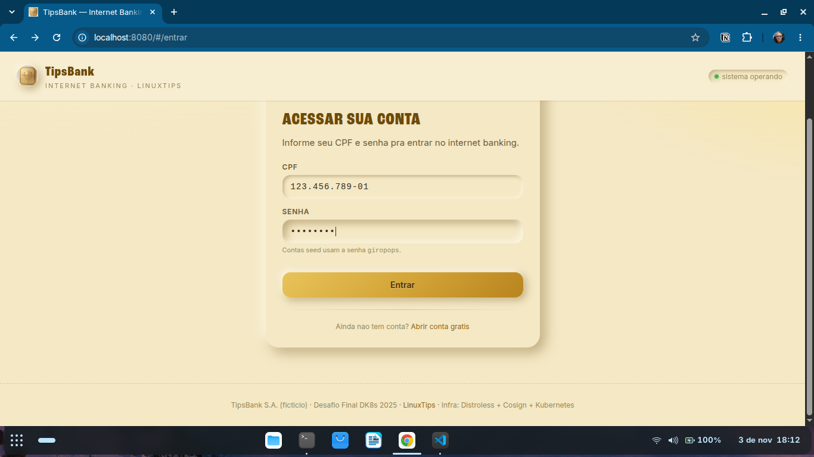

**2. Dashboard** (`#/conta`): saldo de R$ 9.900,00, que é o saldo inicial de R$ 10.000,00 menos a transferência de R$ 100,00 do critério 2. A SPA lê do mesmo Postgres do cluster.

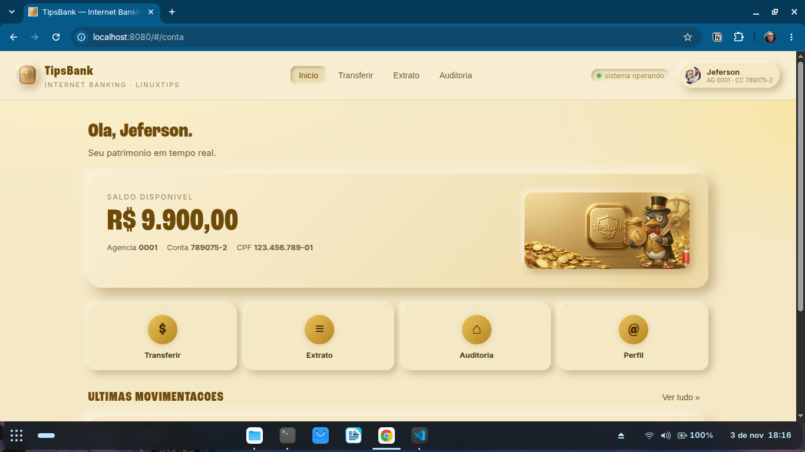

### Critério 4 — `imagePullSecrets`

Os 4 pacotes no ghcr.io são **públicos** (pull anônimo comprovado na 1.2), então o critério "se o registry for privado" não se aplica e os pods não precisam de `imagePullSecrets`:

```console
$ kubectl describe pod -n tipsbank-transacoes -l app.kubernetes.io/name=api-transacoes | grep -m2 Image
    Image:          ghcr.io/jlui70/tipsbank-api-transacoes:v1.0.0@sha256:415945fea3f0cd8e69fb4e736e6f071bde7ad948783a22b09c30aac7c12a2c6e
    Image ID:       ghcr.io/jlui70/tipsbank-api-transacoes@sha256:415945fea3f0cd8e69fb4e736e6f071bde7ad948783a22b09c30aac7c12a2c6e
$ kubectl get pod -n tipsbank-transacoes -l app.kubernetes.io/name=api-transacoes -o jsonpath='{.items[0].spec.imagePullSecrets}'
(vazio)
```

O `Image ID` (o que o nó realmente baixou) tem o mesmo digest da imagem assinada.

### Resultado

| Critério | Status |
|---|---|
| Todos os pods `Running`; Deployments 2/2, STS 1/1 | ✅ |
| Transferência via `port-forward` da `api-transacoes` | ✅ HTTP 201, saldos 9900/600 |
| SPA via `port-forward` do `web` com login | ✅ 200 / 401 pelo proxy |
| `imagePullSecrets` (registry privado) | N/A: pacotes públicos |

---

## Etapa 1.5 — ConfigMap, Secret e pod multicontainer

**Data**: 2026-11-03 · **Arquivos**: [`k8s/transacoes/configmap-log.yaml`](../k8s/transacoes/configmap-log.yaml) (novo) e [`k8s/transacoes/api-transacoes.yaml`](../k8s/transacoes/api-transacoes.yaml) (sidecar)

### Como a app passou a gravar em arquivo, sem rebuild da imagem

O manual aceita "um handler de log em arquivo no `main.py`" ou "`tee` via command override". O `tee` não funciona aqui porque a imagem é Distroless e não tem shell. Mudar o `main.py` exigiria uma imagem nova, com novo scan e nova assinatura. Usei uma terceira via, que mantém a imagem `v1.0.0` assinada intacta:

- O ENTRYPOINT da imagem é `python3 -m uvicorn main:app ...`, e o uvicorn aceita `--log-config <arquivo>` (um `dictConfig` do Python em JSON).
- O Deployment passa `args: [--log-config, /etc/app/log-config.json]`. Em Kubernetes, `args` substitui o `CMD` e é somado ao `ENTRYPOINT`.
- O arquivo vem do ConfigMap `transacoes-log-config` e define dois handlers: `console` (stdout, como antes) e `file` (`RotatingFileHandler` em `/var/log/app/app.log`, 10 MB, 1 backup).
- O uvicorn aplica essa configuração **antes** de importar o `main.py`. Quando o `logging.basicConfig()` do app roda, o logger raiz já tem handlers e o `basicConfig` não faz nada. Os logs da app (logger `api-transacoes`) passam a sair no console **e** no arquivo, no mesmo formato JSON do app, agora com o campo `logger`.
- O access log do uvicorn (inclusive o das probes, a cada 5 s) continua só no stdout, para não poluir o arquivo. O logger `httpx` foi para `WARNING`, porque a mensagem dele tem aspas (`"HTTP/1.1 200 OK"`) que quebrariam o JSON da linha. A informação útil (origem, destino, valor) já está no log da transferência.

Antes de aplicar no cluster, testei localmente com `docker run --read-only -u 65532 ... --log-config /etc/app/log-config.json`: o log `bootstrap versao=v1` foi gravado em JSON no arquivo.

### Sidecar `log-forwarder`

```yaml
        - name: log-forwarder
          image: busybox:1.37@sha256:a7dbc319b1438115a207e11930dc4bb3e643dcb3ec0bdd694bb36cd8fad289ec
          command: [sh, -c, 'exec tail -n +1 -F /var/log/app/app.log']
          securityContext: {runAsUser: 65532, allowPrivilegeEscalation: false, readOnlyRootFilesystem: true, capabilities: {drop: [ALL]}}
          livenessProbe:
            exec: {command: [pidof, tail]}
          resources: {requests: {cpu: 5m, memory: 8Mi}, limits: {cpu: 50m, memory: 32Mi}}
          volumeMounts:
            - {name: app-logs, mountPath: /var/log/app, readOnly: true}
      volumes:
        - name: app-logs
          emptyDir: {sizeLimit: 50Mi}
```

- **`emptyDir` compartilhado**: o container `app` monta `/var/log/app` com escrita e o sidecar monta somente leitura. O volume vive enquanto o pod existir; `sizeLimit` evita que o log encha o disco do nó.
- **`tail -F`** (maiúsculo) segue o **nome** do arquivo: espera o arquivo aparecer e continua funcionando depois da rotação do `RotatingFileHandler`. `-n +1` lê desde a primeira linha. O `exec` faz o `tail` virar o PID 1 do container, e a `livenessProbe` verifica se ele continua rodando.
- O sidecar também tem `runAsUser` explícito, `livenessProbe` e `resources.limits`, porque os comandos de compliance #2, #3 e #4 olham **todos** os containers do pod.
- `busybox:1.37` (Trivy: 0 HIGH/CRITICAL) fixado por digest. Ele vem do Docker Hub e, como as outras imagens de terceiros, será espelhado no `ghcr.io/jlui70` antes do teste de compliance da etapa 4.6.

### Aplicação

```console
$ kubectl diff -f k8s/transacoes/api-transacoes.yaml        # revisa a mudança antes de aplicar
$ kubectl apply -f k8s/transacoes/configmap-log.yaml -f k8s/transacoes/api-transacoes.yaml
configmap/transacoes-log-config created
deployment.apps/api-transacoes configured
$ kubectl -n tipsbank-transacoes rollout status deploy/api-transacoes
deployment "api-transacoes" successfully rolled out
$ kubectl get pods -n tipsbank-transacoes
NAME                              READY   STATUS    RESTARTS   AGE
api-transacoes-7bdfb68566-2sr6v   2/2     Running   0          45s
api-transacoes-7bdfb68566-frk47   2/2     Running   0          39s
```

`READY 2/2` agora significa 2 containers prontos no pod.

### Critério 1 — O pod tem 2 containers

```console
$ kubectl get pod api-transacoes-7bdfb68566-2sr6v -n tipsbank-transacoes -o yaml | grep -E '^  - (args|command):|^    name: (app|log-forwarder)$|^    image: (ghcr|busybox)'
  - args:
    image: ghcr.io/jlui70/tipsbank-api-transacoes:v1.0.0@sha256:415945fea3f0cd8e69fb4e736e6f071bde7ad948783a22b09c30aac7c12a2c6e
    name: app
  - command:
    image: busybox:1.37@sha256:a7dbc319b1438115a207e11930dc4bb3e643dcb3ec0bdd694bb36cd8fad289ec
    name: log-forwarder

$ kubectl get pod api-transacoes-7bdfb68566-2sr6v -n tipsbank-transacoes -o jsonpath='{range .spec.containers[*]}{.name}{"\t"}{.image}{"\n"}{end}'
app	ghcr.io/jlui70/tipsbank-api-transacoes:v1.0.0@sha256:415945fea3f0cd8e69fb4e736e6f071bde7ad948783a22b09c30aac7c12a2c6e
log-forwarder	busybox:1.37@sha256:a7dbc319b1438115a207e11930dc4bb3e643dcb3ec0bdd694bb36cd8fad289ec
```

### Critério 2 — `kubectl logs -c log-forwarder` mostra o log estruturado da app

4 transferências via `kubectl port-forward -n tipsbank-transacoes svc/api-transacoes 8080:8080` (todas HTTP 201):

```console
$ kubectl logs -n tipsbank-transacoes api-transacoes-7bdfb68566-2sr6v -c log-forwarder | jq -c 'select(.logger=="api-transacoes") | {ts,level,msg}'
{"ts":"2026-11-03 21:30:26,009","level":"INFO","msg":"bootstrap versao=v1"}
{"ts":"2026-11-03 21:31:06,534","level":"INFO","msg":"transferencia id=0ca5e795-066a-48cf-8298-4f01bd8b4bee origem=11111111-1111-1111-1111-111111111111 destino=22222222-2222-2222-2222-222222222222 valor=10.00"}
{"ts":"2026-11-03 21:31:06,641","level":"INFO","msg":"transferencia id=8d2cca61-b787-4c47-bcf1-676caf8ce603 origem=11111111-1111-1111-1111-111111111111 destino=22222222-2222-2222-2222-222222222222 valor=10.00"}
{"ts":"2026-11-03 21:31:06,724","level":"INFO","msg":"transferencia id=8103db69-5599-424b-858f-418a3cb3a5aa origem=11111111-1111-1111-1111-111111111111 destino=22222222-2222-2222-2222-222222222222 valor=10.00"}
{"ts":"2026-11-03 21:31:06,804","level":"INFO","msg":"transferencia id=88df1d94-d038-414f-bfab-b4e0df051e5a origem=11111111-1111-1111-1111-111111111111 destino=22222222-2222-2222-2222-222222222222 valor=10.00"}
```

Linha completa, como o sidecar publica:

```console
$ kubectl logs -n tipsbank-transacoes api-transacoes-7bdfb68566-2sr6v -c log-forwarder | grep '^{' | head -4
{"ts":"2026-11-03 21:30:26,008","level":"INFO","service":"api-transacoes","logger":"uvicorn.error","msg":"Started server process [1]"}
{"ts":"2026-11-03 21:30:26,008","level":"INFO","service":"api-transacoes","logger":"uvicorn.error","msg":"Waiting for application startup."}
{"ts":"2026-11-03 21:30:26,009","level":"INFO","service":"api-transacoes","logger":"api-transacoes","msg":"bootstrap versao=v1"}
{"ts":"2026-11-03 21:30:26,103","level":"INFO","service":"api-transacoes","logger":"uvicorn.error","msg":"Application startup complete."}
```

Todas as linhas são JSON válido. Conferido com `jq -e` linha a linha nos 2 pods: 9 e 5 linhas, 0 inválidas. O segundo pod só tem logs de inicialização porque o `port-forward` para um Service se conecta a **um único pod**, sem balanceamento: as 4 transferências foram para o mesmo pod.

### Critério 3 — Nenhuma variável sensível direto no Deployment

Todas as variáveis de todos os workloads do TipsBank:

```console
$ kubectl get deploy,sts -A -l app.kubernetes.io/part-of=tipsbank -o json | jq -r '.items[] | ... | (.env // [])[] | ...' | column -t
tipsbank-auditoria/auditoria/app           DATA_DIR           configMapKeyRef:auditoria-config
tipsbank-auditoria/auditoria/app           LOG_LEVEL          configMapKeyRef:auditoria-config
tipsbank-contas/api-contas/app             DB_URL             secretKeyRef:contas-db
tipsbank-contas/api-contas/app             LOG_LEVEL          configMapKeyRef:contas-config
tipsbank-transacoes/api-transacoes/app     DB_URL             secretKeyRef:transacoes-db
tipsbank-transacoes/api-transacoes/app     CONTAS_URL         configMapKeyRef:transacoes-config
tipsbank-transacoes/api-transacoes/app     AUDITORIA_URL      configMapKeyRef:transacoes-config
tipsbank-transacoes/api-transacoes/app     APP_VERSION        configMapKeyRef:transacoes-config
tipsbank-transacoes/api-transacoes/app     LOG_LEVEL          configMapKeyRef:transacoes-config
tipsbank-contas/postgres-primary/postgres  POSTGRES_USER      secretKeyRef:postgres-credentials
tipsbank-contas/postgres-primary/postgres  POSTGRES_PASSWORD  secretKeyRef:postgres-credentials
tipsbank-contas/postgres-primary/postgres  POSTGRES_DB        secretKeyRef:postgres-credentials
tipsbank-contas/postgres-primary/postgres  PGDATA             value=/var/lib/postgresql/data/pgdata
```

- Credenciais (`DB_URL`, `POSTGRES_*`) vêm de `secretKeyRef`; URLs e parâmetros vêm de `configMapKeyRef`. O único `value` literal é o `PGDATA`, um caminho de diretório sem informação sensível.
- Os nomes são diferentes em cada namespace e nada é compartilhado entre namespaces:

```console
$ kubectl get cm,secret -A -l app.kubernetes.io/part-of=tipsbank --no-headers | awk '{print $1, $2}'
tipsbank-auditoria configmap/auditoria-config
tipsbank-contas configmap/contas-config
tipsbank-transacoes configmap/transacoes-config
tipsbank-transacoes configmap/transacoes-log-config
tipsbank-contas secret/contas-db
tipsbank-contas secret/postgres-credentials
tipsbank-transacoes secret/transacoes-db
```

Os itens 4 e 5 do passo a passo (credenciais em Secret, URLs em ConfigMap, nomes distintos por namespace) já tinham sido feitos na etapa 1.4. A senha continua fora do Git: os Secrets são gerados por `k8s/gerar-secrets.sh`.

### Prévia dos comandos de compliance #2, #3 e #4 (workloads do TipsBank)

```console
$ kubectl get pods -A -l app.kubernetes.io/part-of=tipsbank -o json | jq -c '[.items[] | select(.spec.securityContext.runAsUser == 0 or (.spec.containers[].securityContext.runAsUser // 0) == 0) | .metadata.name]'
[]
$ kubectl get deploy,sts -A -l app.kubernetes.io/part-of=tipsbank -o json | jq -c '[.items[] | select(.spec.template.spec.containers[].livenessProbe == null) | .metadata.name]'
[]
$ kubectl get deploy,sts -A -l app.kubernetes.io/part-of=tipsbank -o json | jq -c '[.items[] | select(.spec.template.spec.containers[].resources.limits == null) | .metadata.name]'
[]
```

O sidecar novo já entra limpo nos três.

### Resultado

| Critério | Status |
|---|---|
| Pod da `api-transacoes` com 2 containers | ✅ `app` + `log-forwarder` (2/2) |
| `kubectl logs -c log-forwarder` com o log estruturado | ✅ JSON válido, transferências visíveis |
| Sem variável sensível no Deployment (`secretKeyRef`/`configMapKeyRef`) | ✅ |

---

## Etapa 1.6 — PV NFS para a auditoria

**Data**: 2026-11-03 · **Servidor NFS**: VM externa `tipsbank-nfs` (192.168.122.13, Ubuntu 24.04, `nfs-kernel-server`) · **Arquivos**: [`infra/nfs/`](../infra/nfs/), [`k8s/auditoria/pv-nfs.yaml`](../k8s/auditoria/pv-nfs.yaml), [`k8s/auditoria/auditoria.yaml`](../k8s/auditoria/auditoria.yaml)

### Decisão: servidor NFS fora do cluster

O manual aceita "StatefulSet `nfs-ganesha`" ou "um nó externo com `nfs-kernel-server`". Escolhi o nó externo porque um servidor NFS em container precisa rodar como root/privileged. Isso violaria o comando de compliance #2 ("nenhum pod rodando como root", em **todos** os namespaces) e exigiria uma exceção no Kyverno na Semana 4.

| Item | Valor |
|---|---|
| VM | `tipsbank-nfs`, 1 vCPU / 1 GiB / 20 GiB, criada por `infra/nfs/create-nfs-vm.sh` (mesma imagem base e cloud-init da 1.3) |
| Export | `/srv/nfs/auditoria 192.168.122.0/24(rw,sync,no_subtree_check,all_squash,anonuid=65532,anongid=65532)` |
| Dono do diretório | `65532:65532`, modo `0770` |
| Cliente nos nós | `nfs-common` instalado nos 3 nós (também incluído no `infra/kubeadm/prepare-node.sh`) |

**`all_squash` + `anonuid=65532`**: todo acesso de cliente vira o UID 65532 (o `nonroot` do Distroless). Os arquivos já nascem com o dono certo, e o pod não precisa de um initContainer rodando como root para fazer `chown`, que o compliance também barraria. Teste de montagem direto no nó, sem Kubernetes: um arquivo criado pelo **root** do `tipsbank-w1` aparece com dono `65532`:

```console
$ ssh ubuntu@192.168.122.11 'sudo mount -t nfs 192.168.122.13:/srv/nfs/auditoria /mnt/t && sudo touch /mnt/t/teste-root && ls -ln /mnt/t'
-rw-r--r-- 1 65532 65532 0 Nov  3 21:44 teste-root
```

O kubelet usa o `mount.nfs` do **nó** para montar o volume. Sem o pacote `nfs-common` nos workers, o pod fica preso em `ContainerCreating` com erro de mount.

### PV e PVC

```yaml
apiVersion: v1
kind: PersistentVolume
metadata:
  name: auditoria-nfs
spec:
  capacity: {storage: 1Gi}
  accessModes: [ReadWriteMany]
  persistentVolumeReclaimPolicy: Retain     # apagar o PVC não apaga os eventos de auditoria
  storageClassName: ""                      # estático: não usa a StorageClass default (local-path)
  mountOptions: [nfsvers=4.2, hard]
  nfs:
    server: 192.168.122.13                  # IP: quem monta é o kubelet no nó, que não usa o CoreDNS
    path: /srv/nfs/auditoria
  claimRef: {namespace: tipsbank-auditoria, name: auditoria-data}
---
apiVersion: v1
kind: PersistentVolumeClaim
metadata:
  name: auditoria-data
  namespace: tipsbank-auditoria
spec:
  accessModes: [ReadWriteMany]
  storageClassName: ""
  volumeName: auditoria-nfs
  resources: {requests: {storage: 1Gi}}
```

- `storageClassName: ""` no PV **e** no PVC: sem isso, o PVC pegaria a StorageClass default (local-path), que é RWO e cria outro volume.
- `claimRef` + `volumeName`: amarra o PV a esse PVC nos dois sentidos.
- `Retain`: trilha de auditoria não pode sumir junto com um `kubectl delete pvc`.
- No Deployment da `auditoria`, o `emptyDir` virou `persistentVolumeClaim: {claimName: auditoria-data}` e as réplicas foram de 2 para 3.

```console
$ kubectl apply -f k8s/auditoria/pv-nfs.yaml -f k8s/auditoria/auditoria.yaml
$ kubectl -n tipsbank-auditoria rollout status deploy/auditoria
deployment "auditoria" successfully rolled out
$ kubectl get pods -n tipsbank-auditoria -o wide
NAME                         READY   STATUS    RESTARTS   AGE   IP              NODE
auditoria-5b5d94954b-kqjf8   1/1     Running   0          11s   10.244.41.75    tipsbank-w1
auditoria-5b5d94954b-txjtk   1/1     Running   0          16s   10.244.63.141   tipsbank-w2
auditoria-5b5d94954b-vb6bf   1/1     Running   0          6s    10.244.63.142   tipsbank-w2

$ ssh ubuntu@192.168.122.11 'mount | grep nfs4'
192.168.122.13:/srv/nfs/auditoria on /var/lib/kubelet/pods/15823689-.../volumes/kubernetes.io~nfs/auditoria-nfs type nfs4 (rw,relatime,vers=4.2,rsize=131072,wsize=131072,namlen=255,hard,proto=tcp,timeo=600,retrans=2,sec=sys,clientaddr=192.168.122.11,local_lock=none,addr=192.168.122.13)
```

### Critério 1 — PV `Bound` ao PVC correto

```console
$ kubectl get pv,pvc -A
NAME                                                        CAPACITY   ACCESS MODES   RECLAIM POLICY   STATUS   CLAIM                                     STORAGECLASS
persistentvolume/auditoria-nfs                              1Gi        RWX            Retain           Bound    tipsbank-auditoria/auditoria-data
persistentvolume/pvc-6cce5c49-8d70-446a-9ccf-0781e3270a06   2Gi        RWO            Delete           Bound    tipsbank-contas/data-postgres-primary-0   local-path

NAMESPACE            NAME                                            STATUS   VOLUME                                     CAPACITY   ACCESS MODES   STORAGECLASS
tipsbank-auditoria   persistentvolumeclaim/auditoria-data            Bound    auditoria-nfs                              1Gi        RWX
tipsbank-contas      persistentvolumeclaim/data-postgres-primary-0   Bound    pvc-6cce5c49-8d70-446a-9ccf-0781e3270a06   2Gi        RWO            local-path
```

`auditoria-nfs` (RWX, estático, sem StorageClass) está `Bound` a `tipsbank-auditoria/auditoria-data`. O outro PV é o do Postgres (1.4), dinâmico via local-path.

### Critério 2 — Os pods listam os mesmos arquivos

A imagem da `auditoria` é Distroless e **não tem `ls`**, então o comando literal do manual falha:

```console
$ kubectl exec -n tipsbank-auditoria deploy/auditoria -- ls /data
error: ... OCI runtime exec failed: exec failed: unable to start container process: exec: "ls": executable file not found in $PATH
```

Usei o equivalente com o Python que já existe na imagem:

```console
$ for p in auditoria-5b5d94954b-kqjf8 auditoria-5b5d94954b-txjtk auditoria-5b5d94954b-vb6bf; do
    echo "$p $(kubectl exec -n tipsbank-auditoria $p -- python3 -c "import os; print(sorted(os.listdir('/data')))")"; done
auditoria-5b5d94954b-kqjf8 ['eventos-2026-11-03.jsonl']
auditoria-5b5d94954b-txjtk ['eventos-2026-11-03.jsonl']
auditoria-5b5d94954b-vb6bf ['eventos-2026-11-03.jsonl']
```

As 3 réplicas, em 2 nós diferentes (`tipsbank-w1` e `tipsbank-w2`), veem o mesmo arquivo.

### Critério 3 — Após 100 transferências, a soma das linhas bate

Com o `/data` vazio, disparei 100 transferências de **dentro do cluster** (um pod busybox chamando o Service da `api-transacoes`), para o tráfego ser balanceado entre as réplicas. O `port-forward` se conectaria a um pod só.

```console
$ kubectl exec -n tipsbank-contas postgres-primary-0 -- psql -U tipsbank -d tipsbank -tAc "select count(*) from transacoes where status='concluida'"
109
$ kubectl run carga -n tipsbank-transacoes --image=busybox:1.37@sha256:a7dbc319... --restart=Never --overrides='...' # 100 x wget --post-data ... /transferencias
$ kubectl logs carga -n tipsbank-transacoes
enviadas=100 ok=100
$ kubectl exec -n tipsbank-contas postgres-primary-0 -- psql ... -tAc "select count(*) from transacoes where status='concluida'"
209                                                    # +100

# eventos recebidos por réplica (logs "evento registrado ... tipo=transferencia")
auditoria-5b5d94954b-kqjf8 recebeu: 37 eventos (tipsbank-w1)
auditoria-5b5d94954b-txjtk recebeu: 30 eventos (tipsbank-w2)
auditoria-5b5d94954b-vb6bf recebeu: 33 eventos (tipsbank-w2)

# soma das linhas em TODOS os arquivos de /data, lida de cada pod
auditoria-5b5d94954b-kqjf8 arquivos= 1 linhas= 100 json_validas= 100
auditoria-5b5d94954b-txjtk arquivos= 1 linhas= 100 json_validas= 100
auditoria-5b5d94954b-vb6bf arquivos= 1 linhas= 100 json_validas= 100

# direto no servidor NFS
$ ssh ubuntu@192.168.122.13 "sudo sh -c 'wc -l /srv/nfs/auditoria/*.jsonl'"
100 /srv/nfs/auditoria/eventos-2026-11-03.jsonl
```

100 transferências disparadas = 100 concluídas no Postgres = 37 + 30 + 33 eventos recebidos pelas 3 réplicas = 100 linhas no arquivo compartilhado, todas JSON válido.

### Armadilha: conflito observado com escrita concorrente

O manual avisa: "como a app faz `open("a")` por escrita, o NFS precisa suportar locking". Para testar, disparei **300 eventos direto na auditoria, com 10 envios em paralelo**: 10 loops de 30 `wget` rodando ao mesmo tempo contra o Service. Esse teste foi feito antes da execução limpa acima. O arquivo resultante foi guardado fora do export, em `/srv/nfs/evidencias/eventos-2026-11-03.stress.jsonl`, para não contaminar a contagem do critério 3.

```console
POST 201 recebidos pelo cliente: 300
auditoria-5b5d94954b-kqjf8 registrou: 92
auditoria-5b5d94954b-txjtk registrou: 119
auditoria-5b5d94954b-vb6bf registrou: 89          # 92 + 119 + 89 = 300: a app confirmou todos

$ ssh ubuntu@192.168.122.13 "sudo python3 -c '...análise do arquivo...'"
stress: linhas= 379 validas= 373 corrompidas= 6 bytes_NUL= 1291 | eventos stress= 273 de 300 (perdidos 27 ) | transferencias= 100
```

**Conflito observado: 27 de 300 eventos (9%) perdidos**, mesmo com a API respondendo HTTP 201 para todos, e **6 linhas corrompidas**, cada uma com cerca de 215 bytes NUL e só o começo de um evento:

```console
430 bytes, NUL= 216 | inicio: b'{"id": "b480eed9-a719-4c21-94a8-1246bccdbfa4", "recebido_em": "2026-11-03T21:46:35.984949+'
429 bytes, NUL= 215 | inicio: b'{"id": "cd2bc68b-e56b-46c9-9c9b-d5c51451833e", "recebido_em": "2026-11-03T21:46:36.253649+'
```

**Causa:**
1. A app grava com `open("a")` + `write()`, **sem pedir lock** (`fcntl.lockf`/`flock`).
2. Em disco local, o kernel garante que cada `write` com `O_APPEND` vai para o fim do arquivo de forma atômica. **No NFS não**: cada cliente (cada nó) pergunta o tamanho do arquivo ao servidor e grava naquele deslocamento. Dois pods em nós diferentes, gravando ao mesmo tempo, recebem o mesmo "fim de arquivo" e um sobrescreve o outro. Daí os eventos perdidos e os buracos preenchidos com NUL, do tamanho de um evento (~215 bytes).
3. O servidor **suporta** locking (NFSv4.2: o lock faz parte do protocolo, `local_lock=none` no mount). Mas lock no NFS é cooperativo: só protege quem pede, e a app não pede. "O NFS suportar locking" é necessário, mas não basta.
4. Com carga sequencial (as 100 transferências do critério 3) não aparece, porque nunca há duas gravações ao mesmo tempo.

**Impacto:** num banco, perder evento de auditoria depois de confirmar com 201 é uma falha de compliance. Correções possíveis, todas exigindo mudança no `main.py` e portanto nova imagem, novo scan e nova assinatura:
- `fcntl.lockf(f, fcntl.LOCK_EX)` em volta do `write` (o NFSv4 repassa o lock ao servidor), mantendo um arquivo único;
- um arquivo por réplica (`eventos-<dia>-<hostname>.jsonl`), sem disputa. O critério do manual já fala em "soma das linhas em **todos os arquivos**";
- ou um backend com escrita transacional (ex.: tabela no Postgres).

Nesta etapa mantive a app original e registrei a limitação, como o manual pede.

### Resultado

| Critério | Status |
|---|---|
| PV `Bound` ao PVC correto | ✅ `auditoria-nfs` ↔ `tipsbank-auditoria/auditoria-data` (RWX) |
| Pods listam os mesmos arquivos | ✅ 3 réplicas em 2 nós (via `python3 os.listdir`: a imagem não tem `ls`) |
| 100 transferências = soma das linhas | ✅ 100 = 100 (37 + 30 + 33 por réplica) |
| Armadilha de locking | ⚠️ Conflito observado e documentado: 27/300 perdidos com 10 envios em paralelo |

---

# SEMANA 2 — Exposição e Segurança de Rede

## Etapa 2.1 — Ingress Nginx + múltiplos hosts

**Data**: 2026-11-04 · **Controller**: Ingress NGINX v1.15.1 (chart `ingress-nginx` 4.15.1, Helm v4.3.1) · **Arquivos**: [`infra/ingress-nginx/`](../infra/ingress-nginx/), [`k8s/web/ingress.yaml`](../k8s/web/ingress.yaml), [`k8s/contas/ingress.yaml`](../k8s/contas/ingress.yaml), [`k8s/transacoes/ingress.yaml`](../k8s/transacoes/ingress.yaml), [`k8s/auditoria/ingress.yaml`](../k8s/auditoria/ingress.yaml), [`k8s/web/configmap-nginx.yaml`](../k8s/web/configmap-nginx.yaml)

### Instalação do controller

```bash
./infra/ingress-nginx/install.sh      # helm upgrade --install ... --version 4.15.1 -f values-kubeadm.yaml
```

| Decisão (`values-kubeadm.yaml`) | Por quê |
|---|---|
| `hostPort` 80/443, 2 réplicas com anti-affinity (1 por worker), Service `ClusterIP` | O kubeadm não tem LoadBalancer. O controller escuta direto na porta 80/443 dos workers, e o "IP do controller" é o IP de um worker |
| `updateStrategy` `maxSurge: 0` / `maxUnavailable: 1` | Com hostPort, dois pods não cabem no mesmo nó. O padrão (surge 1 / unavailable 0) deixaria o pod novo `Pending` para sempre num rollout |
| `publishService.enabled: false` | O `ADDRESS` dos Ingress recebe o IP dos nós do controller (com o Service `ClusterIP` ficaria vazio) |
| `admissionWebhooks.enabled: false` | O webhook de validação depende de 2 `Job` (`admission-create`/`patch`) para gerar o certificado. O desafio proíbe Job (exceto o do Locust). Sem o webhook, um Ingress inválido só aparece no log do controller, e não no `kubectl apply` |
| `resources.limits` 500m / 256Mi | Compliance #4. Probes e `securityContext` (UID 101, `drop ALL` + `NET_BIND_SERVICE`, `allowPrivilegeEscalation: false`) já vêm no chart |
| IngressClass `nginx`, `default: false` | Cada Ingress declara `ingressClassName: nginx` explicitamente (passo 4 do manual) |

**Nota sobre a versão:** o projeto ingress-nginx foi **aposentado em março de 2026** (repositório arquivado, sem novas versões nem correções de segurança). A v1.15.1 é a última e foi testada oficialmente até o Kubernetes 1.35. Funciona no cluster 1.36.6 deste lab. Uso o Ingress NGINX porque o manual o exige (as anotações de canary, affinity, rate limit e auth das etapas 2.2 e 2.4 são dele). O sucessor indicado pelo Kubernetes é a Gateway API.

```console
$ helm list -n ingress-nginx
NAME          NAMESPACE      REVISION  STATUS    CHART                 APP VERSION
ingress-nginx ingress-nginx  1         deployed  ingress-nginx-4.15.1  1.15.1

$ kubectl -n ingress-nginx get pods -o wide
NAME                                        READY   STATUS    RESTARTS   AGE     IP              NODE
ingress-nginx-controller-685ddd8b68-2k5z6   1/1     Running   0          6m43s   10.244.41.83    tipsbank-w1
ingress-nginx-controller-685ddd8b68-gdbc6   1/1     Running   0          6m43s   10.244.63.154   tipsbank-w2

$ kubectl get jobs -A
No resources found
```

### Decisão: Ingress puro (sem proxy no `web`)

O manual aceita manter o proxy reverso do `nginx.conf` do `web` ou usar Ingress com paths, e indica o Ingress como prática preferida. **Escolhi o Ingress puro:**

- `app.tipsbank.local/` → `svc/web`, que agora só serve os arquivos estáticos da SPA.
- As chamadas da SPA (`/api/contas/*`, `/api/transacoes/*`, `/api/auditoria/*`) são roteadas pelo Ingress **direto** para cada API. O `proxy_pass` e os `upstream` saíram do `k8s/web/configmap-nginx.yaml` (anotação `tipsbank.io/nginx-conf-sha` atualizada para forçar o rollout).
- Ganhos: um salto a menos; o `web` não depende mais dos Services das APIs para iniciar (antes, no boot frio, ele caía com `host not found in upstream`); na 2.5, a NetworkPolicy do `tipsbank-web` precisa só de DNS + entrada do controller; e o canary da 2.4 também vale para o tráfego da SPA.

**7 Ingress, um por namespace e por host.** Um Ingress só aponta para Services do próprio namespace. Separar os hosts deixa as anotações da 2.2 (Affinity Cookie e Basic Auth no host `api`, rate limit no `app`) restritas a onde devem valer.

| Namespace | Ingress | Host | Path | Service |
|---|---|---|---|---|
| `tipsbank-web` | `web` | `app.tipsbank.local` | `/` (Prefix) | `web:8080` |
| `tipsbank-contas` | `api-contas` | `api.tipsbank.local` | `/contas(/\|$)(.*)` | `api-contas:8080` |
| `tipsbank-contas` | `api-contas-spa` | `app.tipsbank.local` | `/api/contas(/\|$)(.*)` | `api-contas:8080` |
| `tipsbank-transacoes` | `api-transacoes` | `api.tipsbank.local` | `/transacoes(/\|$)(.*)` | `api-transacoes:8080` |
| `tipsbank-transacoes` | `api-transacoes-spa` | `app.tipsbank.local` | `/api/transacoes(/\|$)(.*)` | `api-transacoes:8080` |
| `tipsbank-auditoria` | `auditoria` | `api.tipsbank.local` | `/auditoria(/\|$)(.*)` | `auditoria:8080` |
| `tipsbank-auditoria` | `auditoria-spa` | `app.tipsbank.local` | `/api/auditoria(/\|$)(.*)` | `auditoria:8080` |

Nos Ingress das APIs, `use-regex: "true"` + `rewrite-target: /$2` removem o prefixo: `/contas/contas` chega na API como `/contas`. É o mesmo efeito do `proxy_pass http://contas/;` que o `web` fazia.

### Critério 1 — Ingress com address preenchido

```console
$ kubectl get ingress -A
NAMESPACE             NAME                 CLASS   HOSTS                ADDRESS                         PORTS   AGE
tipsbank-auditoria    auditoria            nginx   api.tipsbank.local   192.168.122.11,192.168.122.12   80      5m29s
tipsbank-auditoria    auditoria-spa        nginx   app.tipsbank.local   192.168.122.11,192.168.122.12   80      5m29s
tipsbank-contas       api-contas           nginx   api.tipsbank.local   192.168.122.11,192.168.122.12   80      5m29s
tipsbank-contas       api-contas-spa       nginx   app.tipsbank.local   192.168.122.11,192.168.122.12   80      5m29s
tipsbank-transacoes   api-transacoes       nginx   api.tipsbank.local   192.168.122.11,192.168.122.12   80      5m29s
tipsbank-transacoes   api-transacoes-spa   nginx   app.tipsbank.local   192.168.122.11,192.168.122.12   80      5m29s
tipsbank-web          web                  nginx   app.tipsbank.local   192.168.122.11,192.168.122.12   80      5m29s
```

### Critério 2 — `app.tipsbank.local` retorna o HTML da SPA

```console
$ curl -s -i -H 'Host: app.tipsbank.local' http://192.168.122.11/ | head -3
HTTP/1.1 200 OK
Date: Wed, 04 Nov 2026 19:22:14 GMT
Content-Type: text/html

$ curl -s -H 'Host: app.tipsbank.local' http://192.168.122.11/ | grep -o '<title>.*</title>'
<title>TipsBank — Internet Banking de Luxo</title>
```

### Critério 3 — `api.tipsbank.local/contas/contas` lista as contas

```console
$ curl -s -H 'Host: api.tipsbank.local' http://192.168.122.11/contas/contas | jq -c '[.[] | {titular, saldo}]'
[{"titular":"Jeferson Fernando","saldo":"9620.00"},{"titular":"LinuxTips SA","saldo":"880.00"}]

$ curl -s -H 'Host: api.tipsbank.local' http://192.168.122.11/transacoes/health/live
{"status":"ok","version":"v1"}
$ curl -s -H 'Host: api.tipsbank.local' http://192.168.122.11/auditoria/health/live
{"status":"ok"}
$ curl -s -o /dev/null -w '%{http_code}\n' -H 'Host: api.tipsbank.local' http://192.168.122.12/contas/contas   # pelo outro worker
200
```

A rota da SPA vai direto para a API. No log do controller, o upstream é o Service da `api-contas`, e não o `web`:

```console
$ curl -s -H 'Host: app.tipsbank.local' http://192.168.122.11/api/contas/contas | jq length
2
$ kubectl logs -n ingress-nginx -l app.kubernetes.io/component=controller --prefix | grep 'api/contas/contas'
[pod/ingress-nginx-controller-685ddd8b68-2k5z6/controller] 192.168.122.1 - - [04/Nov/2026:19:17:34 +0000] "GET /api/contas/contas HTTP/1.1" 200 235 "-" "curl/8.5.0" 98 0.012 [tipsbank-contas-api-contas-8080] [] 10.244.63.152:8080 235 0.012 200 ...
```

### Critério 4 — `/etc/hosts` do laptop

```console
$ grep tipsbank /etc/hosts
192.168.122.11 app.tipsbank.local api.tipsbank.local

$ curl -s http://app.tipsbank.local/ | grep -o '<title>.*</title>'
<title>TipsBank — Internet Banking de Luxo</title>
$ curl -s http://api.tipsbank.local/contas/contas | jq -c '[.[] | {titular, saldo}]'
[{"titular":"Jeferson Fernando","saldo":"9620.00"},{"titular":"LinuxTips SA","saldo":"880.00"}]
$ curl -s -o /dev/null -w '%{http_code}\n' -X POST http://app.tipsbank.local/api/contas/login \
    -H 'content-type: application/json' -d '{"documento":"12345678901","senha":"giropops"}'
200
```

Os dois nomes apontam para o `tipsbank-w1`. O `tipsbank-w2` (192.168.122.12) responde igual e serve de alternativa se o w1 cair.

SPA no navegador em `http://app.tipsbank.local` (resolvido pelo `/etc/hosts`), logada com a conta seed. O saldo (R$ 9.620,00) é o mesmo devolvido pelo `curl` em `api.tipsbank.local/contas/contas`, e todas as chamadas `/api/*` da página passam pelo Ingress:

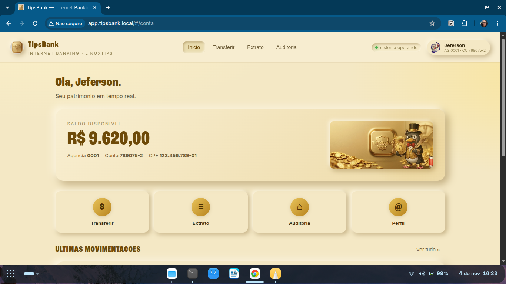

### Resultado

| Critério | Status |
|---|---|
| `kubectl get ingress -A` com address | ✅ 7 Ingress, `192.168.122.11,192.168.122.12` |
| `app.tipsbank.local` → HTML da SPA | ✅ HTTP 200, `<title>TipsBank ...` |
| `api.tipsbank.local/contas/contas` → contas | ✅ 2 contas seed |
| `/etc/hosts` com as entradas | ✅ `192.168.122.11 app.tipsbank.local api.tipsbank.local` |
| SPA no navegador pelo nome | ✅ login e dashboard em `app.tipsbank.local` (print) |

## Etapa 2.2 — TLS com cert-manager + recursos avançados do Ingress

**Data**: 2026-11-04 · **cert-manager**: v1.21.3 (Helm, CRDs incluídas) · **Arquivos**: [`infra/cert-manager/`](../infra/cert-manager/), [`infra/ingress-nginx/values-kubeadm.yaml`](../infra/ingress-nginx/values-kubeadm.yaml), [`k8s/*/ingress.yaml`](../k8s/), [`k8s/contas/secret-basic-auth.yaml.example`](../k8s/contas/secret-basic-auth.yaml.example), [`k8s/contas/gerar-basic-auth.sh`](../k8s/contas/gerar-basic-auth.sh)

### cert-manager e ClusterIssuer

```bash
./infra/cert-manager/install.sh       # helm upgrade --install (values.yaml) + cluster-issuers.yaml
```

| Decisão (`infra/cert-manager/values.yaml`) | Por quê |
|---|---|
| `startupapicheck.enabled: false` | É um `Job` pós-instalação que só testa a API do cert-manager. Job é proibido no desafio. O `install.sh` faz a mesma checagem com `rollout status` + `apply --dry-run=server` |
| `containerSecurityContext.runAsUser: 65532` nos 3 componentes | O comando de compliance #2 trata container sem `runAsUser` explícito como root. As imagens já rodam como 65532 |
| `resources.limits` nos 3 componentes | Compliance #4 |
| Imagens `quay.io/jetstack/*` | Registry aceito pelo compliance #1 |

**Cadeia de certificados do lab (`cluster-issuers.yaml`):** um ClusterIssuer `selfsigned` cria **uma vez** a CA `TipsBank Lab CA` (Certificate `isCA: true`, Secret `tipsbank-ca` no ns `cert-manager`), e o ClusterIssuer `tipsbank-ca`, do tipo CA, assina os certificados dos Ingress. Comparado a usar o `selfsigned` direto em cada Ingress, todos os certificados têm o mesmo emissor, e basta confiar em um único `ca.crt` para o `curl`/navegador aceitarem todos, sem `-k`.

```console
$ helm list -n cert-manager
NAME          NAMESPACE     REVISION  STATUS    CHART                 APP VERSION
cert-manager  cert-manager  1         deployed  cert-manager-v1.21.3  v1.21.3

$ kubectl get clusterissuer
NAME          READY   AGE
selfsigned    True    4m11s
tipsbank-ca   True    4m11s

$ kubectl get jobs -A
No resources found
```

### TLS nos Ingress

Todos os Ingress ganharam `tls:` com o host. Os que têm a anotação `cert-manager.io/cluster-issuer: tipsbank-ca` fazem o cert-manager criar o `Certificate` automaticamente (ingress-shim). Um Ingress só lê Secrets do próprio namespace, por isso cada namespace tem o seu certificado: 7 no total, mais a CA. O `api-contas-admin` reaproveita o Secret `api-tipsbank-tls` do `api-contas` (mesmo host e namespace) sem a anotação, porque dois Ingress anotados com o mesmo `secretName` disputariam o mesmo Certificate.

```console
$ kubectl get certificate -A
NAMESPACE             NAME               READY   SECRET             AGE
cert-manager          tipsbank-ca        True    tipsbank-ca        2m15s
tipsbank-auditoria    api-tipsbank-tls   True    api-tipsbank-tls   20s
tipsbank-auditoria    app-tipsbank-tls   True    app-tipsbank-tls   20s
tipsbank-contas       api-tipsbank-tls   True    api-tipsbank-tls   21s
tipsbank-contas       app-tipsbank-tls   True    app-tipsbank-tls   20s
tipsbank-transacoes   api-tipsbank-tls   True    api-tipsbank-tls   20s
tipsbank-transacoes   app-tipsbank-tls   True    app-tipsbank-tls   20s
tipsbank-web          app-tipsbank-tls   True    app-tipsbank-tls   21s

$ kubectl get ingress -A
NAMESPACE             NAME                 CLASS   HOSTS                ADDRESS                         PORTS     AGE
tipsbank-auditoria    auditoria            nginx   api.tipsbank.local   192.168.122.11,192.168.122.12   80, 443   19m
tipsbank-auditoria    auditoria-spa        nginx   app.tipsbank.local   192.168.122.11,192.168.122.12   80, 443   19m
tipsbank-contas       api-contas           nginx   api.tipsbank.local   192.168.122.11,192.168.122.12   80, 443   19m
tipsbank-contas       api-contas-admin     nginx   api.tipsbank.local   192.168.122.11,192.168.122.12   80, 443   2m17s
tipsbank-contas       api-contas-spa       nginx   app.tipsbank.local   192.168.122.11,192.168.122.12   80, 443   19m
tipsbank-transacoes   api-transacoes       nginx   api.tipsbank.local   192.168.122.11,192.168.122.12   80, 443   19m
tipsbank-transacoes   api-transacoes-spa   nginx   app.tipsbank.local   192.168.122.11,192.168.122.12   80, 443   19m
tipsbank-web          web                  nginx   app.tipsbank.local   192.168.122.11,192.168.122.12   80, 443   19m
```

### Critério 1 — `curl -k https://app.tipsbank.local/` retorna 200

```console
$ curl -sk -o /dev/null -w '%{http_code} %{content_type}\n' https://app.tipsbank.local/
200 text/html

$ echo | openssl s_client -connect 192.168.122.11:443 -servername app.tipsbank.local 2>/dev/null \
    | openssl x509 -noout -issuer -ext subjectAltName -dates
issuer=CN = TipsBank Lab CA
X509v3 Subject Alternative Name: critical
    DNS:app.tipsbank.local
notBefore=Nov  4 19:34:27 2026 GMT
notAfter=Feb  2 19:34:27 2027 GMT

# sem -k, confiando só na CA do lab
$ kubectl -n cert-manager get secret tipsbank-ca -o jsonpath='{.data.ca\.crt}' | base64 -d > tipsbank-ca.crt
$ curl -s --cacert tipsbank-ca.crt -o /dev/null -w '%{http_code} ssl_verify=%{ssl_verify_result}\n' https://app.tipsbank.local/
200 ssl_verify=0

# HTTP agora redireciona para HTTPS (padrão do Ingress NGINX quando o Ingress tem tls)
$ curl -s -o /dev/null -w '%{http_code} -> %{redirect_url}\n' http://app.tipsbank.local/
308 -> https://app.tipsbank.local/
$ curl -skI https://app.tipsbank.local/ | grep -i strict
strict-transport-security: max-age=31536000; includeSubDomains
```

O certificado é renovado sozinho pelo cert-manager (validade padrão de 90 dias, renovação aos 2/3).

### Critério 2 — Basic Auth em `api.tipsbank.local/contas/admin`

A `api-contas` não tem rotas `/admin`. O Ingress `api-contas-admin` cria uma entrada administrativa autenticada para a mesma API: path `/contas/admin(/|$)(.*)` com `rewrite-target: /$2`, então `/contas/admin/contas` chega na API como `/contas`. O path é mais longo que o do Ingress `api-contas`, e por isso o controller o testa primeiro.

**Credencial fora do Git**, no mesmo padrão dos Secrets do banco (1.4): só o template `secret-basic-auth.yaml.example` é versionado. O `gerar-basic-auth.sh` gera a senha (`openssl rand`), calcula o hash SHA-512 crypt (`openssl passwd -6 -stdin`, sem a senha aparecer na linha de comando) e grava `secret-basic-auth.yaml` + `.basic-auth-senha` com permissão `600`. Os dois estão no `.gitignore`. Só o **hash** vai para o cluster.

```console
$ ./k8s/contas/gerar-basic-auth.sh
gerado: secret-basic-auth.yaml (usuário: admin, senha em .basic-auth-senha)
$ git check-ignore -v k8s/contas/secret-basic-auth.yaml k8s/contas/.basic-auth-senha
.gitignore:22:k8s/**/secret-basic-auth.yaml   k8s/contas/secret-basic-auth.yaml
.gitignore:23:k8s/**/.basic-auth-senha        k8s/contas/.basic-auth-senha
$ kubectl apply -f k8s/contas/secret-basic-auth.yaml

$ curl -sk -o /dev/null -w 'sem credencial: %{http_code}\n' https://api.tipsbank.local/contas/admin/contas
sem credencial: 401
$ curl -sk -o /dev/null -w 'senha errada:   %{http_code}\n' -u admin:errada https://api.tipsbank.local/contas/admin/contas
senha errada:   401
$ curl -sk -u "admin:$(cat k8s/contas/.basic-auth-senha)" https://api.tipsbank.local/contas/admin/contas | jq -c '[.[] | .titular]'
["Jeferson Fernando","LinuxTips SA"]
$ curl -sk -o /dev/null -w 'com credencial: %{http_code}\n' -u "admin:$(cat k8s/contas/.basic-auth-senha)" https://api.tipsbank.local/contas/admin/contas
com credencial: 200
```

### Affinity Cookie em `api.tipsbank.local/transacoes`

Anotações no Ingress `api-transacoes`: `affinity: cookie`, `session-cookie-name: TIPSBANK_TX`, `session-cookie-max-age: "3600"` e `session-cookie-path: /transacoes`. O path explícito é necessário porque, com `use-regex`, o path da location é uma regex e não serviria como path de cookie. Teste: o pod que atendeu cada requisição aparece no log do controller (`upstream_addr`).

```console
$ kubectl get pods -n tipsbank-transacoes -o custom-columns=POD:.metadata.name,IP:.status.podIP --no-headers
api-transacoes-7bdfb68566-2sr6v   10.244.63.150
api-transacoes-7bdfb68566-frk47   10.244.41.81

$ curl -sk -c jar.txt -D - -o /dev/null https://api.tipsbank.local/transacoes/health/live | grep -i set-cookie
set-cookie: TIPSBANK_TX=1793820901.762.170.746183|ce724c...; Max-Age=3600; Path=/transacoes; Secure; HttpOnly

# 10 requisições sem cookie x 10 com o cookie (-b jar.txt); contagem por pod no log do controller
== sem cookie
      5 ] 10.244.41.81:8080
      5 ] 10.244.63.150:8080
== com cookie
     10 ] 10.244.41.81:8080
```

### Rate limit de 50 req/s em `app.tipsbank.local`

Anotações no Ingress `web`: `limit-rps: "50"` e `limit-burst-multiplier: "1"`. No ConfigMap do controller: `limit-req-status-code: "429"`.

- O **burst** padrão do Ingress NGINX é 5× o limite (250). Uma rajada de 100 requisições nunca seria barrada. Com multiplicador 1, o burst é 50.
- O status padrão do nginx para limite estourado é **503**, que pareceria erro do servidor. `429 Too Many Requests` é o código correto e o que o critério pede.
- O limite é por IP de cliente e por réplica do controller. O `/etc/hosts` aponta para o w1, então toda a rajada cai no mesmo controller.
- Vale só para o Ingress `web` (a SPA em `/`). As rotas `/api/*` do mesmo host são outros Ingress e não são limitadas.

```console
$ seq 100 | xargs -P 50 -I{} curl -sk -o /dev/null -w '%{http_code}\n' https://app.tipsbank.local/ | sort | uniq -c
     97 200
      3 429
$ curl -sk -i https://app.tipsbank.local/ | head -1        # durante uma rajada
HTTP/2 429
$ seq 100 | xargs -P 50 -I{} curl -sk -o /dev/null -w '%{http_code}\n' https://app.tipsbank.local/api/contas/health/live | sort | uniq -c
    100 200
```

Com `curl`, cada requisição abre uma conexão TLS nova, e a rajada leva ~1,1 s: cabem ~50/s + 50 de burst ≈ 105, e só 3 passaram do limite. Ferramentas de carga como `hey`/`ab` reaproveitam conexões, mandam mais rápido e mostram a proporção real.

Com o **`ab`** (Apache Bench, pacote `apache2-utils`), que é o que o manual pede: 100 requisições, 50 simultâneas. A contagem por código vem do log do controller (User-Agent `ApacheBench`):

```console
$ ab -n 100 -c 50 https://app.tipsbank.local/ | grep -E 'Concurrency|Time taken|Complete|Failed|Non-2xx|Requests per second'
Concurrency Level:      50
Time taken for tests:   0.816 seconds
Complete requests:      100
Failed requests:        26
Non-2xx responses:      26
Requests per second:    122.51 [#/sec] (mean)

$ kubectl logs -n ingress-nginx -l app.kubernetes.io/component=controller --tail=500 | grep '"ApacheBench' | awk '{print $9}' | sort | uniq -c
     74 200
     26 429
```

A rajada a 122 req/s passa do limite de 50/s + burst de 50: as primeiras ~74 são atendidas e as **26 excedentes recebem 429**. O "Failed requests: 26" do `ab` são os mesmos 429: o `ab` conta como falha qualquer resposta com tamanho diferente da primeira.

### Upstream Hashing (passo 7) em `api.tipsbank.local/auditoria`

Anotação `upstream-hash-by: "$http_x_cliente"`: o controller escolhe o pod pelo hash do cabeçalho `X-Cliente` (hash consistente). O mesmo cliente cai sempre no mesmo pod. Com outra réplica a mais ou a menos, só uma parte dos clientes muda de pod.

**Ocorrência do teste:** na 1ª tentativa a anotação estava só no Ingress `auditoria`, e o hash não funcionou (o mesmo cliente caía nos 3 pods). O controller cria **um upstream por Service** (`tipsbank-auditoria-auditoria-8080`), compartilhado pelos Ingress `auditoria` e `auditoria-spa`, e o que não tinha a anotação prevaleceu. Diagnóstico com o `/dbg` do controller:

```console
$ kubectl exec -n ingress-nginx <controller> -- /dbg backends get tipsbank-auditoria-auditoria-8080 | jq -c .upstreamHashByConfig
{"upstream-hash-by-subset-size":3}                                   # antes: sem upstream-hash-by
{"upstream-hash-by":"$http_x_cliente","upstream-hash-by-subset-size":3}   # depois: anotação nos 2 Ingress
```

Resultado com a anotação nos dois Ingress (4 requisições por cliente, 6 sem cabeçalho):

```console
$ kubectl get pods -n tipsbank-auditoria -o custom-columns=POD:.metadata.name,IP:.status.podIP --no-headers
auditoria-5b5d94954b-kqjf8   10.244.41.76
auditoria-5b5d94954b-txjtk   10.244.63.149
auditoria-5b5d94954b-vb6bf   10.244.63.153

      4 ana 10.244.63.149
      4 bruno 10.244.63.149
      4 carla 10.244.63.149
      4 diego 10.244.63.153
      4 elisa 10.244.41.76
      6 semheader 10.244.63.153
```

Sem o cabeçalho (é o caso das chamadas da SPA), o hash é de uma string vazia, e tudo vai para o mesmo pod. Com a auditoria gravando no NFS compartilhado (1.6), isso não afeta o resultado. Pela mesma regra de "um upstream por Service", o Affinity Cookie da `api-transacoes` também vale para o upstream usado pelo `api-transacoes-spa`. Na prática, o navegador não envia o cookie em `/api/transacoes`, porque o `Path` do cookie é `/transacoes`.

### Resultado

| Critério | Status |
|---|---|
| `curl -k https://app.tipsbank.local/` → 200 | ✅ 200 (e 200 sem `-k`, com `--cacert` da CA do lab) |
| `/contas/admin/contas` → 401 sem credencial, 200 com | ✅ 401 / 401 (senha errada) / 200 |
| Rajada de 100 requests com 429 após o rate limit | ✅ `ab -n 100 -c 50`: 74 × 200 e 26 × 429 |
| Affinity Cookie em transações | ✅ 10/10 no mesmo pod com o cookie; 5/5 sem |
| Upstream Hashing documentado | ✅ mesmo `X-Cliente` → mesmo pod; ocorrência do upstream compartilhado registrada |

## Etapa 2.3 — Cluster EKS paralelo

**Data**: 2026-11-05 · **Região**: `us-east-1` · **EKS**: 1.36 (nós `v1.36.5-eks`, Amazon Linux 2023) · **eksctl**: 0.225.0 · **Arquivos**: [`infra/eks/`](../infra/eks/), [`infra/ingress-nginx/values-eks.yaml`](../infra/ingress-nginx/values-eks.yaml)

O mesmo TipsBank do kubeadm (Semana 1 + 2.1 e 2.2) rodou num cluster EKS criado com `eksctl`, ao lado do kubeadm, com um context para cada cluster e HTTPS com DNS real (domínio próprio + Let's Encrypt). Para economizar (passo 7 do manual), a sessão foi única: subir, aplicar, provar e destruir em ~1h30.

### Cluster (passos 1 e 2)

O comando do manual (`eksctl create cluster --name tipsbank --nodes 2 --node-type t3.medium`) foi escrito como arquivo versionado, [`infra/eks/cluster.yaml`](../infra/eks/cluster.yaml), com os ajustes que o TipsBank precisa no EKS:

| Ajuste | Por quê |
|---|---|
| `version: "1.36"` | Mesma minor do kubeadm (1.36.6) |
| `vpc.cidr: 192.168.0.0/16` (padrão do eksctl, explícito) | A NetworkPolicy da 2.5 já tem essa faixa no `except` |
| `nat.gateway: Single` | 1 NAT Gateway para as subnets privadas (o `HighlyAvailable` cria 1 por AZ e custa 2×) |
| Add-on `vpc-cni` com `enableNetworkPolicy: "true"` | Sem o agente de NetworkPolicy, o EKS aceita as policies e não aplica nenhuma (como o Flannel, armadilha da 2.5) |
| Add-ons `aws-ebs-csi-driver` + `eks-pod-identity-agent` | O EKS atual não provisiona disco sem o driver EBS CSI, e a `gp2` que vem no cluster não é default. Permissão IAM do driver via Pod Identity (sem chave fixa) |
| `disableIMDSv1: true` | Metadata da instância só com token (IMDSv2) |
| `disablePodIMDS` no padrão (`false`) | De propósito: o "antes" da prova do `169.254.169.254` precisa mostrar o metadata respondendo aos pods |

```console
$ eksctl create cluster -f infra/eks/cluster.yaml --kubeconfig ~/.kube/tipsbank-eks.kubeconfig
...
2026-11-05 08:35:42 [✔]  created 1 managed nodegroup(s) in cluster "tipsbank"
2026-11-05 08:37:03 [ℹ]  addon "aws-ebs-csi-driver" active
2026-11-05 08:37:42 [ℹ]  addon "metrics-server" active
2026-11-05 08:37:45 [✔]  EKS cluster "tipsbank" in "us-east-1" region is ready      # 08:21 → 08:37 (16 min)
```

**Contexts (passo 3 do manual):** cada cluster tem o seu arquivo, e a variável `KUBECONFIG` junta os dois numa visão só:

```bash
K=~/.kube/tipsbank-eks.kubeconfig
kubectl --kubeconfig $K config rename-context "$(kubectl --kubeconfig $K config current-context)" eks-tipsbank
export KUBECONFIG=~/.kube/tipsbank-eks.kubeconfig:~/.kube/tipsbank-kubeadm.kubeconfig
```

O `kubeadm-local` é o context renomeado na 2.5. O arquivo do EKS vai **primeiro** na lista: o context ativo vem dele, e nenhum comando grava `current-context` no arquivo do kubeadm. O kubeconfig do EKS não tem certificado de cliente: a cada comando ele roda `aws eks get-token` (com `AWS_PROFILE` gravado no próprio arquivo) e manda um token IAM temporário.

```console
$ kubectl config get-contexts
CURRENT   NAME            CLUSTER                        AUTHINFO                                      NAMESPACE
*         eks-tipsbank    tipsbank.us-east-1.eksctl.io   devops-manager@tipsbank.us-east-1.eksctl.io
          kubeadm-local   kubernetes                     kubernetes-admin

$ kubectl --context kubeadm-local get nodes
NAME          STATUS   ROLES           AGE   VERSION
tipsbank-cp   Ready    control-plane   40h   v1.36.6
tipsbank-w1   Ready    <none>          40h   v1.36.6
tipsbank-w2   Ready    <none>          40h   v1.36.6

$ kubectl --context eks-tipsbank get nodes -o wide
NAME                            STATUS   ROLES    AGE   VERSION               INTERNAL-IP     OS-IMAGE                        CONTAINER-RUNTIME
ip-192-168-20-85.ec2.internal   Ready    <none>   15m   v1.36.5-eks-6e7947a   192.168.20.85   Amazon Linux 2023.12.20261102   containerd://2.3.7+unknown
ip-192-168-56-27.ec2.internal   Ready    <none>   15m   v1.36.5-eks-6e7947a   192.168.56.27   Amazon Linux 2023.12.20261102   containerd://2.3.7+unknown
```

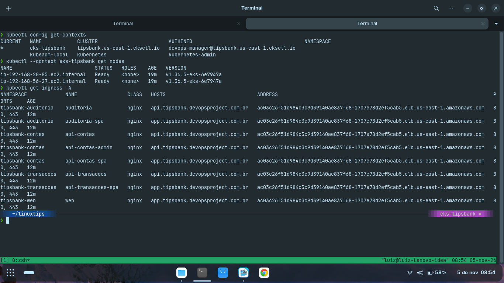

### Storage, Ingress Controller e cert-manager (passo 4)

```bash
kubectl apply -f infra/eks/storageclass-gp3.yaml                       # gp3 (EBS CSI) como default
./infra/ingress-nginx/install.sh infra/ingress-nginx/values-eks.yaml    # mesmo chart 4.15.1 da 2.1
./infra/cert-manager/install.sh                                         # mesmo da 2.2
```

| Peça | kubeadm (2.1/2.2) | EKS (`values-eks.yaml`) |
|---|---|---|
| Entrada | `hostPort` 80/443 nos workers, Service `ClusterIP` | Service `type: LoadBalancer` → **NLB** (`aws-load-balancer-type: nlb`, cross-zone) |
| IP do cliente | chega direto no worker | `externalTrafficPolicy: Local`: o NLB entrega no nó que tem o controller e preserva o IP de origem (o rate limit da 2.2 é por IP) |
| ADDRESS dos Ingress | vazio (`publishService` off) | hostname do NLB (`publishService` padrão) |
| Certificado | 1 por namespace, CA do lab | **1 certificado padrão** do controller (`--default-ssl-certificate=ingress-nginx/tipsbank-tls`), Let's Encrypt |
| Admission webhook | off (Jobs) | off (mesmo motivo: o chart cria 2 Jobs) |

```console
$ kubectl get storageclass
NAME            PROVISIONER             RECLAIMPOLICY   VOLUMEBINDINGMODE      ALLOWVOLUMEEXPANSION
gp2             kubernetes.io/aws-ebs   Delete          WaitForFirstConsumer   false
gp3 (default)   ebs.csi.aws.com         Delete          WaitForFirstConsumer   true

$ kubectl -n ingress-nginx get svc
NAME                       TYPE           CLUSTER-IP       EXTERNAL-IP                                                                     PORT(S)
ingress-nginx-controller   LoadBalancer   10.100.110.234   ac03c26f51d984c3c9d39140ae837f68-1707e78d2ef5cab5.elb.us-east-1.amazonaws.com   80:31105/TCP,443:31639/TCP
```

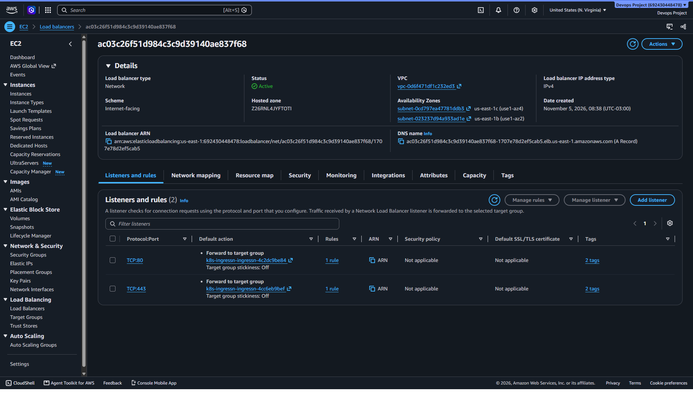

### App (passo 5)

Os mesmos manifests do kubeadm, aplicados arquivo por arquivo (um `kubectl apply -R -f k8s/` levaria junto o `pv-nfs.yaml`, que aponta para a VM NFS do lab, inalcançável da AWS). Secrets: os mesmos arquivos gerados localmente na 1.4 e na 2.2, fora do Git. Duas diferenças:

- **Auditoria:** [`infra/eks/auditoria-pvc.yaml`](../infra/eks/auditoria-pvc.yaml) cria o PVC `auditoria-data` em EBS `gp3` (`ReadWriteOnce`) e a auditoria roda com **1 réplica**. O RWX equivalente na AWS seria o EFS, fora do escopo ("apenas a app e o Ingress"). Os `fsGroup` 70 (Postgres) e 65532 (auditoria) da 1.4/1.6 dão a posse do disco novo, e o `PGDATA` em subdiretório evita o `lost+found` do ext4.
- **Ingress:** [`infra/eks/ingress-eks.sh`](../infra/eks/ingress-eks.sh) gera os 8 Ingress a partir dos `k8s/*/ingress.yaml` (troca `*.tipsbank.local` por `*.tipsbank.devopsproject.com.br`, tira a anotação da CA do lab e o `secretName`). Ele se recusa a rodar fora do context `eks-tipsbank`.

```console
$ kubectl get pods -A -o wide | grep tipsbank
tipsbank-auditoria    auditoria-5b5d94954b-6hndc        1/1   Running   0   9m14s   192.168.42.121   ip-192-168-56-27.ec2.internal
tipsbank-contas       api-contas-f48dbdf6-8tvlx         1/1   Running   0   9m20s   192.168.8.37     ip-192-168-20-85.ec2.internal
tipsbank-contas       api-contas-f48dbdf6-d957j         1/1   Running   0   9m20s   192.168.34.99    ip-192-168-56-27.ec2.internal
tipsbank-contas       postgres-primary-0                1/1   Running   0   10m     192.168.25.75    ip-192-168-20-85.ec2.internal
tipsbank-transacoes   api-transacoes-68d8d7fb4c-8f9wv   2/2   Running   0   9m5s    192.168.33.226   ip-192-168-56-27.ec2.internal
tipsbank-transacoes   api-transacoes-68d8d7fb4c-gfgxh   2/2   Running   0   9m5s    192.168.11.210   ip-192-168-20-85.ec2.internal
tipsbank-web          web-fb74f8dbc-czbhz               1/1   Running   0   9m      192.168.47.165   ip-192-168-56-27.ec2.internal
tipsbank-web          web-fb74f8dbc-nflth               1/1   Running   0   9m      192.168.8.178    ip-192-168-20-85.ec2.internal

$ kubectl get pvc -A
NAMESPACE            NAME                      STATUS   CAPACITY   ACCESS MODES   STORAGECLASS
tipsbank-auditoria   auditoria-data            Bound    1Gi        RWO            gp3
tipsbank-contas      data-postgres-primary-0   Bound    2Gi        RWO            gp3

$ kubectl get ingress -A
NAMESPACE             NAME                 CLASS   HOSTS                               ADDRESS                                                                         PORTS
tipsbank-auditoria    auditoria            nginx   api.tipsbank.devopsproject.com.br   ac03c26f51d984c3c9d39140ae837f68-1707e78d2ef5cab5.elb.us-east-1.amazonaws.com   80, 443
tipsbank-auditoria    auditoria-spa        nginx   app.tipsbank.devopsproject.com.br   ac03c26f51d984c3c9d39140ae837f68-1707e78d2ef5cab5.elb.us-east-1.amazonaws.com   80, 443
tipsbank-contas       api-contas           nginx   api.tipsbank.devopsproject.com.br   ac03c26f51d984c3c9d39140ae837f68-1707e78d2ef5cab5.elb.us-east-1.amazonaws.com   80, 443
tipsbank-contas       api-contas-admin     nginx   api.tipsbank.devopsproject.com.br   ac03c26f51d984c3c9d39140ae837f68-1707e78d2ef5cab5.elb.us-east-1.amazonaws.com   80, 443
tipsbank-contas       api-contas-spa       nginx   app.tipsbank.devopsproject.com.br   ac03c26f51d984c3c9d39140ae837f68-1707e78d2ef5cab5.elb.us-east-1.amazonaws.com   80, 443
tipsbank-transacoes   api-transacoes       nginx   api.tipsbank.devopsproject.com.br   ac03c26f51d984c3c9d39140ae837f68-1707e78d2ef5cab5.elb.us-east-1.amazonaws.com   80, 443
tipsbank-transacoes   api-transacoes-spa   nginx   app.tipsbank.devopsproject.com.br   ac03c26f51d984c3c9d39140ae837f68-1707e78d2ef5cab5.elb.us-east-1.amazonaws.com   80, 443
tipsbank-web          web                  nginx   app.tipsbank.devopsproject.com.br   ac03c26f51d984c3c9d39140ae837f68-1707e78d2ef5cab5.elb.us-east-1.amazonaws.com   80, 443
```

Os pods recebem IPs da própria VPC (`192.168.x.x`), não de um pod CIDR separado: é o VPC CNI.

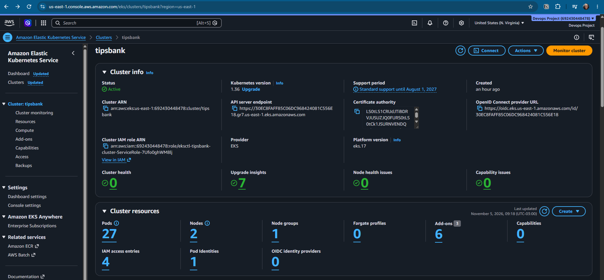
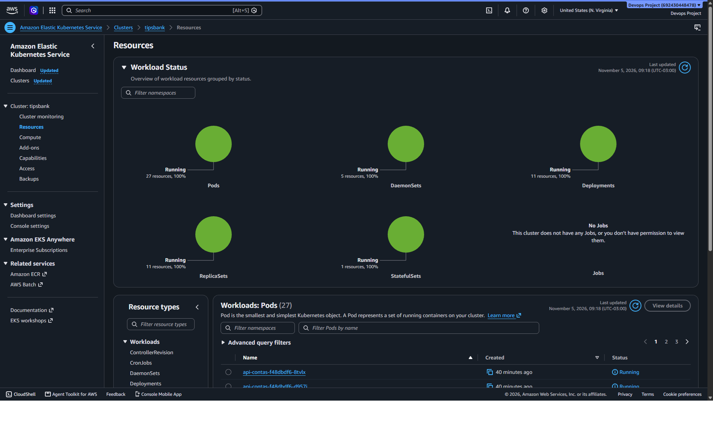
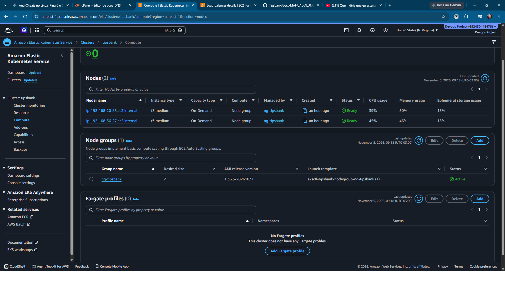

**Console do EKS sem pods e nodes:** no primeiro acesso, o console mostrou "Data unavailable" em Pods e Nodes ([print](img/2.3-08-console-sem-access-entry.png)). O console consulta a API do **Kubernetes** com a identidade de quem está logado no navegador (o root da conta), e só o criador do cluster (`devops-manager`, usado pelo CLI) tinha **access entry**. Resolvido com uma access entry só leitura para o root (`AmazonEKSAdminViewPolicy`, escopo cluster): o IAM autentica, a access entry autoriza dentro do cluster.

### HTTPS com DNS real (passo 6)

Domínio próprio `devopsproject.com.br`, DNS na HostGator. Dois **CNAME** (TTL 300) apontam para o **hostname** do NLB: os IPs de um NLB podem mudar, o nome não.

| Nome | Tipo | Aponta para |
|---|---|---|
| `app.tipsbank.devopsproject.com.br` | CNAME | `ac03c26f…-1707e78d2ef5cab5.elb.us-east-1.amazonaws.com` |
| `api.tipsbank.devopsproject.com.br` | CNAME | idem |

Certificado: [`infra/eks/letsencrypt.yaml`](../infra/eks/letsencrypt.yaml), ClusterIssuers `letsencrypt-staging` e `letsencrypt-prod` (ACME **HTTP-01**, solver pelo Ingress `nginx`) e **um** `Certificate` com os 2 nomes no namespace `ingress-nginx`, usado como certificado padrão do controller. Com 1 certificado por namespace (como no kubeadm), seriam 4 certificados idênticos para `app.*`, e o Let's Encrypt limita a 5 duplicados por semana. Primeiro **staging** (limites folgados, certificado não confiável) para validar o fluxo; depois **produção**.

```console
$ kubectl apply -f infra/eks/letsencrypt.yaml          # staging
$ kubectl -n ingress-nginx get certificate,order
NAME                                       READY   SECRET         AGE
certificate.cert-manager.io/tipsbank-tls   True    tipsbank-tls   33s
NAME                                                   STATE   AGE
order.acme.cert-manager.io/tipsbank-tls-1-2721828999   valid   33s
issuer=C = US, O = Let's Encrypt, CN = (STAGING) Ersatz Emmer YR2     # curl sem -k: exit 60 (não confiável, esperado)

$ kubectl -n ingress-nginx patch certificate tipsbank-tls --type merge -p '{"spec":{"issuerRef":{"name":"letsencrypt-prod"}}}'
$ kubectl -n ingress-nginx delete secret tipsbank-tls   # força a emissão nova
$ kubectl -n ingress-nginx get certificate,order
certificate.cert-manager.io/tipsbank-tls   True    tipsbank-tls   91s
order.acme.cert-manager.io/tipsbank-tls-2-1484984183   valid   33s

$ dig +noall +answer app.tipsbank.devopsproject.com.br @8.8.8.8
app.tipsbank.devopsproject.com.br. 300 IN CNAME ac03c26f51d984c3c9d39140ae837f68-1707e78d2ef5cab5.elb.us-east-1.amazonaws.com.
ac03c26f51d984c3c9d39140ae837f68-1707e78d2ef5cab5.elb.us-east-1.amazonaws.com. 60 IN A 34.198.179.128
ac03c26f51d984c3c9d39140ae837f68-1707e78d2ef5cab5.elb.us-east-1.amazonaws.com. 60 IN A 18.211.3.171

$ curl -s -o /dev/null -w '%{http_code} ssl_verify=%{ssl_verify_result}\n' https://app.tipsbank.devopsproject.com.br/       # SEM -k
200 ssl_verify=0
$ curl -s -o /dev/null -w '%{http_code} ssl_verify=%{ssl_verify_result}\n' https://api.tipsbank.devopsproject.com.br/contas/contas
200 ssl_verify=0
$ curl -s -o /dev/null -w '%{http_code}\n' https://api.tipsbank.devopsproject.com.br/contas/admin/      # Basic Auth da 2.2
401
$ curl -sI http://app.tipsbank.devopsproject.com.br/ | grep -iE '^(HTTP|location)'
HTTP/1.1 308 Permanent Redirect
Location: https://app.tipsbank.devopsproject.com.br
$ curl -sI https://app.tipsbank.devopsproject.com.br/ | grep -i strict
strict-transport-security: max-age=31536000; includeSubDomains

$ echo | openssl s_client -connect app.tipsbank.devopsproject.com.br:443 -servername app.tipsbank.devopsproject.com.br 2>/dev/null \
    | openssl x509 -noout -subject -issuer -ext subjectAltName -dates
subject=CN = app.tipsbank.devopsproject.com.br
issuer=C = US, O = Let's Encrypt, CN = YR2
X509v3 Subject Alternative Name:
    DNS:api.tipsbank.devopsproject.com.br, DNS:app.tipsbank.devopsproject.com.br
notBefore=Nov  5 10:49:25 2026 GMT
notAfter=Feb  3 10:49:24 2027 GMT
```

Transferência de ponta a ponta pela API pública, com as NetworkPolicies ativas (ver complemento na 2.5):

```console
$ curl -s -X POST https://api.tipsbank.devopsproject.com.br/transacoes/transferencias -H 'Content-Type: application/json' \
    -d '{"origem_id":"11111111-1111-1111-1111-111111111111","destino_id":"22222222-2222-2222-2222-222222222222","valor":"10.00"}'
{"id":"0f6362bb-0463-4f5a-a7e1-ed24f300285e",...,"valor":"10.00","status":"concluida"}       # HTTP 201
$ curl -s https://api.tipsbank.devopsproject.com.br/contas/contas | jq -c '.[] | {titular, saldo}'
{"titular":"Jeferson Fernando","saldo":"9990.00"}
{"titular":"LinuxTips SA","saldo":"510.00"}
# evento gravado pela auditoria no disco EBS (/data/eventos-2026-11-05.jsonl):
{"tipo": "transferencia", "transacao_id": "0f6362bb-0463-4f5a-a7e1-ed24f300285e", "valor": "10.00", "versao_app": "v1", ...}
```

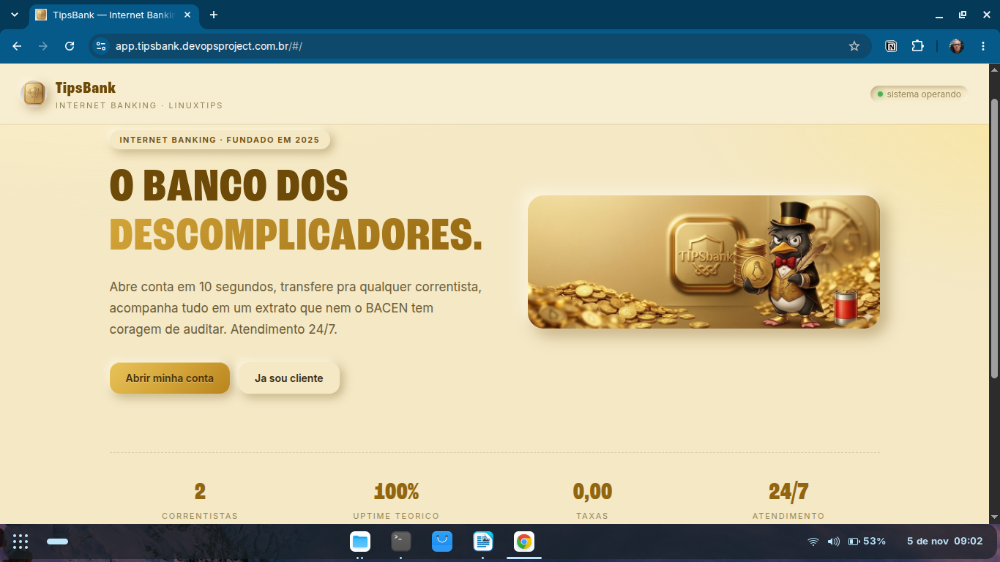
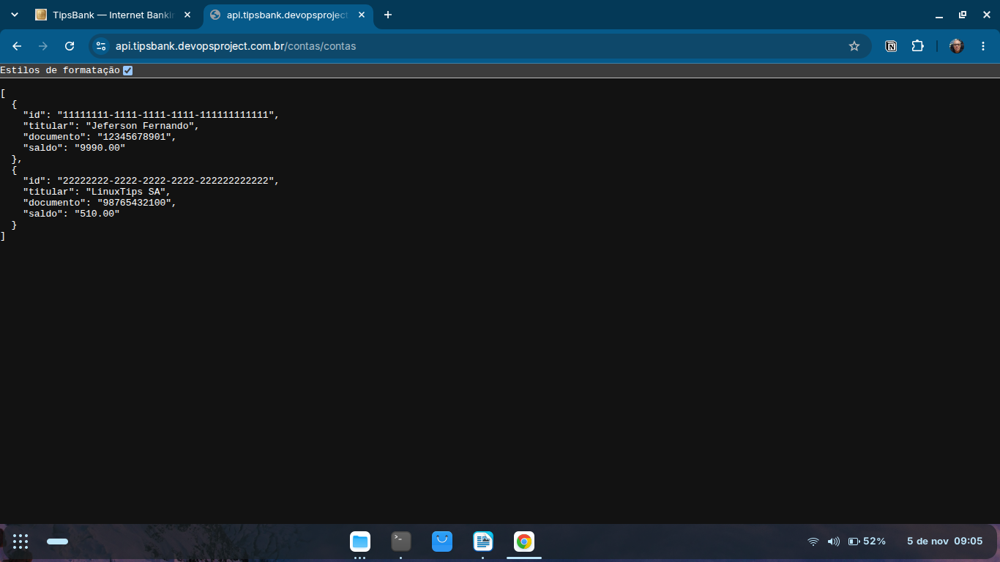

### Infra criada na AWS

O `eksctl` cria tudo via **CloudFormation** (stacks `eksctl-tipsbank-cluster`, `eksctl-tipsbank-nodegroup-ng-tipsbank` e a da role do add-on EBS CSI). O que ficou de pé durante a sessão:

| Recurso | O quê | Para que serve no TipsBank |
|---|---|---|
| VPC `eksctl-tipsbank-cluster/VPC` | `192.168.0.0/16`, ao lado da VPC default (`172.31.0.0/16`) | Rede do cluster: nós **e pods** (VPC CNI) recebem IP daqui |
| 4 subnets em 2 AZs (`us-east-1b`, `us-east-1c`) | 1 pública + 1 privada por AZ | Públicas: NLB e NAT. Privadas: disponíveis para nós sem IP público. Neste cluster, os nós ficaram nas públicas (padrão do eksctl sem `privateNetworking`) |
| Internet Gateway + NAT Gateway (1, `Single`) | Saída para a internet | IGW para as subnets públicas, NAT para as privadas |
| 4 route tables | a principal (sem uso), 1 pública e 1 privada por AZ | Rota `0.0.0.0/0` → IGW (públicas) ou → NAT (privadas) |
| Control plane EKS | gerenciado pela AWS, fora da VPC do usuário | API server + etcd; chega nos nós por ENIs dentro das subnets |
| 2 EC2 `t3.medium` (`tipsbank-ng-tipsbank-Node`) | managed node group, 1 por AZ, AL2023 | Os 2 workers (`kubectl get nodes`) |
| 2 volumes EBS gp3 20 GiB | disco raiz de cada nó | Sistema e imagens. Os PVCs (`gp3` 2 Gi do Postgres e 1 Gi da auditoria) existiram só enquanto os namespaces existiram: no print, das 09:33, eles já tinham sido apagados (`reclaimPolicy: Delete`) |
| NLB | criado pelo Service `LoadBalancer` do ingress-nginx | Entrada HTTP/HTTPS, alvo dos CNAMEs |
| IAM | role do cluster, role dos nós, role do EBS CSI (Pod Identity), access entries | Quem pode fazer o quê, na AWS e dentro do cluster |

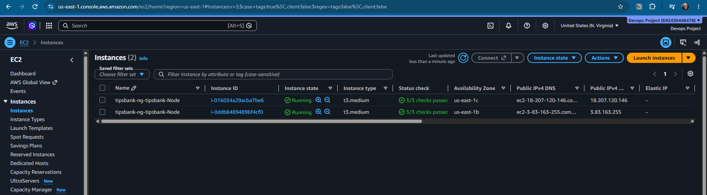
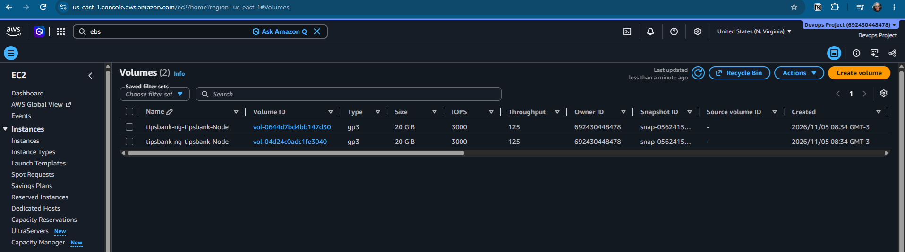
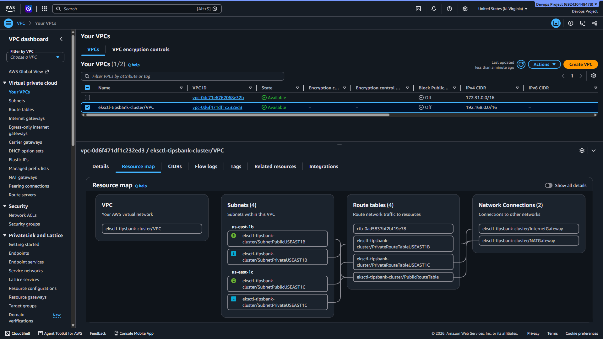

### Destruição (passo 7)

Na ordem: primeiro o Ingress Controller (apaga o NLB; se ele ficasse, o `eksctl delete` travaria na VPC), depois os namespaces (PVCs → discos EBS, `reclaimPolicy: Delete`), depois o cluster. No fim, os 2 CNAMEs foram apagados na HostGator: um CNAME apontando para um NLB que não existe mais é *dangling DNS* (quem conseguir um recurso com aquele nome passa a responder pelo subdomínio).

```console
$ helm uninstall ingress-nginx -n ingress-nginx --wait          # 1. NLB
release "ingress-nginx" uninstalled
$ kubectl delete namespace tipsbank-contas tipsbank-transacoes tipsbank-auditoria tipsbank-web   # 2. PVCs -> EBS
$ kubectl get pv
No resources found
$ eksctl delete cluster -f infra/eks/cluster.yaml --wait          # 3. 09:31 -> 09:42 (11 min)
2026-11-05 09:42:45 [✔]  all cluster resources were deleted

# conferência de sobras (us-east-1): tudo vazio, só a VPC default
eks clusters:        (nenhum)
load balancers:      (nenhum)    # NLB e classic
instâncias EC2:      (nenhuma)
volumes EBS:         (nenhum)
NAT Gateways:        (nenhum)
Elastic IPs:         (nenhum)
snapshots:           (nenhum)
stacks CloudFormation *tipsbank*: (nenhuma)
VPCs:                vpc-0dc71e6762068e32b 172.31.0.0/16   # a default da conta

$ dig +short app.tipsbank.devopsproject.com.br @ns1090.hostgator.com.br    # CNAMEs apagados
$ dig +short api.tipsbank.devopsproject.com.br @ns1090.hostgator.com.br
```

Sessão inteira: cluster de pé das 08:37 às 09:42 (~1h05), mais ~16 min de criação e ~11 min de remoção.

### kubeadm × EKS

| Peça | kubeadm (lab) | EKS |
|---|---|---|
| Control plane | VM `tipsbank-cp`, mantida por mim | gerenciado pela AWS (US$ 0,10/h) |
| CNI | Calico, pod CIDR `10.244.0.0/16` | VPC CNI: pods com IP da VPC (`192.168.0.0/16`); NetworkPolicy pelo `aws-network-policy-agent` |
| Pods por nó | sem limite prático | 17 por t3.medium (IPs das ENIs) |
| Entrada | `hostPort` 80/443 nos workers | Service `LoadBalancer` → NLB |
| StorageClass | `local-path` (disco do nó) | `gp3` via EBS CSI (disco de rede, preso a uma AZ) |
| Volume RWX | NFS em VM | EFS (não usado: auditoria com 1 réplica RWO) |
| TLS | CA do lab (cert-manager), 1 certificado por namespace | Let's Encrypt HTTP-01, 1 certificado padrão do controller |
| Metadata | não existe | `169.254.169.254` com credenciais IAM do nó: bloqueado pela NetworkPolicy |
| Acesso ao cluster | certificado X.509 do `admin.conf` | token IAM (`aws eks get-token`) + access entries |

### Resultado

| Critério | Status |
|---|---|
| `kubectl config get-contexts` mostra dois contexts funcionando | ✅ `kubeadm-local` (3 nós) e `eks-tipsbank` (2 nós) |
| `kubectl --context eks-tipsbank get nodes` retorna os nodes do EKS | ✅ 2 × t3.medium `Ready`, v1.36.5-eks |
| O TipsBank está acessível via HTTPS com DNS real | ✅ `https://app.tipsbank.devopsproject.com.br` e `https://api.tipsbank.devopsproject.com.br`, Let's Encrypt produção, 200 sem `-k` |

## Etapa 2.4 — Canary de transações

**Data**: 2026-11-04 · **Imagem v2**: `ghcr.io/jlui70/tipsbank-api-transacoes:v2.0.0@sha256:b67d2d2726893029ea6fcefc520f4e0ae04b047d531b6da209cd94c3506a01a7` · **Arquivos**: [`apps/api-transacoes/`](../apps/api-transacoes/), [`k8s/transacoes/api-transacoes.yaml`](../k8s/transacoes/api-transacoes.yaml), [`k8s/transacoes/api-transacoes-v2.yaml`](../k8s/transacoes/api-transacoes-v2.yaml), [`k8s/transacoes/ingress-canary.yaml`](../k8s/transacoes/ingress-canary.yaml)

### Passos 1 e 2 — v2: build, scan, push e assinatura

O manual oferece duas mudanças, e as duas foram feitas:

- **`APP_VERSION` no build:** `ARG APP_VERSION=v1` no estágio final do Dockerfile, mais `ENV APP_VERSION=${APP_VERSION}`. O build da v2 usa `--build-arg APP_VERSION=v2`. O padrão continua `v1`.
- **Endpoint novo `GET /pix` (mock)**, que só existe na v2. Ele permite diferenciar as versões pelo comportamento, e não só pelo texto da versão.

```console
$ docker build --build-arg APP_VERSION=v2 -t ghcr.io/jlui70/tipsbank-api-transacoes:v2.0.0 apps/api-transacoes
$ docker inspect ghcr.io/jlui70/tipsbank-api-transacoes:v2.0.0 --format '{{.Config.User}}'    # 65532
$ trivy image -q --severity HIGH,CRITICAL --ignore-unfixed -f json ghcr.io/jlui70/tipsbank-api-transacoes:v2.0.0 \
    | jq '[.Results[].Vulnerabilities[]?] | length'
0
$ docker push ghcr.io/jlui70/tipsbank-api-transacoes:v2.0.0
$ cosign sign --yes ghcr.io/jlui70/tipsbank-api-transacoes@sha256:b67d2d2726893029ea6fcefc520f4e0ae04b047d531b6da209cd94c3506a01a7
$ cosign verify ghcr.io/jlui70/tipsbank-api-transacoes:v2.0.0 \
    --certificate-identity=188764035+jlui70@users.noreply.github.com \
    --certificate-oidc-issuer=https://github.com/login/oauth
[{"critical":{"identity":{"docker-reference":"ghcr.io/jlui70/tipsbank-api-transacoes:v2.0.0"},"image":{"docker-manifest-digest":"sha256:b67d2d2726893029ea6fcefc520f4e0ae04b047d531b6da209cd94c3506a01a7"},"type":"https://sigstore.dev/cosign/sign/v1"},"optional":{}}]
```

A v2 usa a mesma identidade keyless e o mesmo emissor da 1.2. O Deployment referencia a imagem por **tag@digest**.

### Passos 3 e 4 — Deployment e Service da v2 (e o ajuste na v1)

**Problema encontrado:** o Service e o Deployment da v1 selecionavam só `app.kubernetes.io/name: api-transacoes`. Com a v2 usando o mesmo nome, o Service da v1 passaria a incluir o pod da v2. O split deixaria de ser 90/10, e os dois Deployments ficariam com selectors sobrepostos, o que o Kubernetes desaconselha.

**Solução:** label `version` nas duas versões, e `version` no selector de cada Service e Deployment:

| Objeto | Selector |
|---|---|
| Service `api-transacoes` / Deployment `api-transacoes` (v1, 2 réplicas) | `app.kubernetes.io/name: api-transacoes, version: v1` |
| Service `api-transacoes-v2` / Deployment `api-transacoes-v2` (v2, 1 réplica) | `app.kubernetes.io/name: api-transacoes, version: v2` |

O `app.kubernetes.io/name` continua igual nas duas versões, e a NetworkPolicy da 2.5 vale para ambas.

**A v2 não recebe o `APP_VERSION` do ConfigMap.** Na v1, a variável vem do `transacoes-config` (`v1`) e sobrescreveria a da imagem: a v2 responderia `v1`.

**O selector de um Deployment é imutável:**

```console
$ kubectl apply --dry-run=server -f k8s/transacoes/api-transacoes.yaml
The Deployment "api-transacoes" is invalid: spec.selector: Invalid value: {"matchLabels":{"app.kubernetes.io/name":"api-transacoes","version":"v1"}}: field is immutable
```

A v1 foi recriada sem derrubar a API. O Deployment foi apagado com `--cascade=orphan` (os pods antigos continuaram atendendo), o novo foi criado, o Service só mudou depois dos pods novos prontos, e por fim o ReplicaSet órfão foi removido. Um laço de `curl` a cada 0,2 s mediu a continuidade:

```console
$ kubectl -n tipsbank-transacoes delete deploy api-transacoes --cascade=orphan
$ kubectl apply -f k8s/transacoes/api-transacoes.yaml -l role=app       # só o Deployment (o Service não tem role=app)
$ kubectl -n tipsbank-transacoes rollout status deploy/api-transacoes
$ kubectl apply -f k8s/transacoes/api-transacoes.yaml                   # agora o Service com version: v1
$ kubectl -n tipsbank-transacoes delete rs -l 'app.kubernetes.io/name=api-transacoes,!version'

# requisições durante a troca
     99 200
      1 000
```

Uma requisição (a 45ª, durante a subida dos pods novos) estourou o `--max-time 2` do `curl`, sem erro no log do controller. Num ambiente real, a alternativa sem nenhuma perda é criar o Deployment novo com outro nome, virar o Service e só depois apagar o antigo.

```console
$ kubectl -n tipsbank-transacoes get pods -L version
NAME                                 READY   STATUS    RESTARTS   AGE   VERSION
api-transacoes-68d8d7fb4c-82hz2      2/2     Running   0          13m   v1
api-transacoes-68d8d7fb4c-dwf5c      2/2     Running   0          13m   v1
api-transacoes-v2-757757d964-r9kmd   2/2     Running   0          12s   v2

# endpoints de cada Service: sem mistura
api-transacoes    -> api-transacoes-68d8d7fb4c-dwf5c api-transacoes-68d8d7fb4c-82hz2
api-transacoes-v2 -> api-transacoes-v2-757757d964-r9kmd
```

### Passo 5 — Ingress canário

`k8s/transacoes/ingress-canary.yaml`: dois Ingress com `canary: "true"`, `canary-weight: "10"`, `canary-by-header: X-Canary` e `canary-by-header-value: "true"`. Um está no host `api.tipsbank.local` (`/transacoes...`) e o outro em `app.tipsbank.local` (`/api/transacoes...`, as chamadas da SPA). Cada um tem o mesmo host e path do Ingress principal correspondente, e o controller divide o tráfego daquela rota entre o Service da v1 e o `api-transacoes-v2`. Com o Ingress puro (2.1), a SPA também passa pelo canário, e o split fica transparente para o usuário final.

```console
$ kubectl get ingress -n tipsbank-transacoes
NAME                        CLASS   HOSTS                ADDRESS                         PORTS     AGE
api-transacoes              nginx   api.tipsbank.local   192.168.122.11,192.168.122.12   80, 443   86m
api-transacoes-canary       nginx   api.tipsbank.local   192.168.122.11,192.168.122.12   80, 443   10s
api-transacoes-spa          nginx   app.tipsbank.local   192.168.122.11,192.168.122.12   80, 443   86m
api-transacoes-spa-canary   nginx   app.tipsbank.local   192.168.122.11,192.168.122.12   80, 443   10s
```

### Critério 1 — Proporção ~9:1 em `/transacoes/health/live`

1000 requisições sem cabeçalho:

```console
$ seq 1000 | xargs -P 20 -I{} curl -sk https://api.tipsbank.local/transacoes/health/live -w '\n' | jq -r .version | sort | uniq -c
    897 v1
    103 v2
```

**897 / 103 = 89,7% / 10,3%.** Pelo host da SPA (500 requisições em `app.tipsbank.local/api/transacoes/health/live`): 437 v1 / 63 v2. O peso é sorteado a cada requisição, e por isso amostras menores oscilam mais.

### Extra — Canary por cabeçalho `X-Canary: true`

```console
$ for i in 1 2 3 4 5; do curl -sk -H 'X-Canary: true' https://api.tipsbank.local/transacoes/health/live; echo; done
{"status":"ok","version":"v2"}      (5 de 5)

$ curl -sk -H 'X-Canary: true' https://api.tipsbank.local/transacoes/pix
{"status":"mock","pix":"em breve","version":"v2"}
$ curl -sk -o /dev/null -w '%{http_code}\n' -H 'X-Canary: false' https://api.tipsbank.local/transacoes/pix
404                                  # cai no peso -> quase sempre v1, que não tem /pix

$ curl -sk -X POST https://api.tipsbank.local/transacoes/transferencias -H 'X-Canary: true' \
    -H 'content-type: application/json' -d '{"origem_id":"1111...","destino_id":"2222...","valor":"1.00"}' -D - -o /dev/null
HTTP/2 201
x-app-version: v2                    # transferência real (Postgres + auditoria) atendida pela v2
```

Qualquer outro valor de `X-Canary` (ou nenhum) cai na regra de peso.

### Critério 2 — `kubectl rollout undo` nos dois Deployments

Para ter uma revisão anterior, cada Deployment recebeu um `rollout restart` (nova revisão com a anotação `restartedAt`) e depois um `rollout undo`:

```console
$ kubectl -n tipsbank-transacoes rollout restart deploy/api-transacoes-v2
$ kubectl -n tipsbank-transacoes rollout undo deploy/api-transacoes-v2
deployment.apps/api-transacoes-v2 rolled back
$ kubectl -n tipsbank-transacoes rollout restart deploy/api-transacoes
$ kubectl -n tipsbank-transacoes rollout undo deploy/api-transacoes
deployment.apps/api-transacoes rolled back

$ kubectl -n tipsbank-transacoes get rs -L version
NAME                           DESIRED   CURRENT   READY   AGE     VERSION
api-transacoes-68d8d7fb4c      2         2         2       15m     v1    <- ReplicaSet original de volta
api-transacoes-dbddb7864       0         0         0       60s     v1    <- revisão do restart, desfeita
api-transacoes-v2-757757d964   1         1         1       2m30s   v2    <- original de volta
api-transacoes-v2-86dbd48d8d   0         0         0       79s     v2    <- desfeita
```

O `undo` reaproveita o template da revisão anterior: os pods voltam ao **mesmo ReplicaSet** (mesmo hash `68d8d7fb4c` / `757757d964`), e a revisão 1 passa a se chamar 3. Depois do undo, o canário continua 9:1 (273 v1 / 27 v2 em 300 requisições).

### Resultado

| Critério | Status |
|---|---|
| `/transacoes/health/live` com v1/v2 em ~9:1 | ✅ 897 / 103 em 1000 requisições |
| `kubectl rollout undo` em qualquer Deployment | ✅ v1 e v2 voltaram ao ReplicaSet original |
| Canary por `X-Canary: true` (extra) | ✅ 5/5 na v2; `/pix` 200 na v2 e 404 na v1 |
| v2 assinada e sem HIGH/CRITICAL | ✅ Trivy 0; `cosign verify` com a identidade da 1.2 |

## Etapa 2.5 — NetworkPolicy zero-trust

**Data**: 2026-11-04 · **CNI**: Calico v3.33.0 (implementa NetworkPolicy; etapa 1.3) · **Arquivos**: [`k8s/contas/networkpolicy.yaml`](../k8s/contas/networkpolicy.yaml), [`k8s/transacoes/networkpolicy.yaml`](../k8s/transacoes/networkpolicy.yaml), [`k8s/auditoria/networkpolicy.yaml`](../k8s/auditoria/networkpolicy.yaml), [`k8s/web/networkpolicy.yaml`](../k8s/web/networkpolicy.yaml)

### Modelo

Em cada um dos 4 namespaces `tipsbank-*`:

1. **`default-deny`**: `podSelector: {}` + `policyTypes: [Ingress, Egress]` sem regras. Nada entra nem sai.
2. **`allow-dns-egress`**: todos os pods saem só para o CoreDNS (`kube-system`, `k8s-app: kube-dns`), porta 53 UDP/TCP.
3. **Uma policy por fluxo** da ARQUITETURA §5, com origem e destino por `podSelector` + `namespaceSelector` (label automático `kubernetes.io/metadata.name`).

| Namespace | Entrada permitida | Saída permitida (além do DNS) |
|---|---|---|
| `tipsbank-web` | ingress-nginx → `web:8080` | nenhuma (Ingress puro, 2.1) |
| `tipsbank-contas` | ingress-nginx e api-transacoes → `api-contas:8080`; api-contas e api-transacoes (`role: app`) → `postgres-primary:5432` | api-contas → postgres:5432 |
| `tipsbank-transacoes` | ingress-nginx → `api-transacoes:8080` (v1 e v2) | api-contas:8080, auditoria:8080, postgres:5432; HTTPS externo com `ipBlock` + `except` |
| `tipsbank-auditoria` | ingress-nginx e api-transacoes → `auditoria:8080` | nenhuma |

As policies selecionam `app.kubernetes.io/name: api-transacoes`, igual nas duas versões do canary (2.4). A v1 e a v2 têm as mesmas permissões.

**Decisões em relação ao passo 3 do manual:**

- **`web` → APIs: não liberado.** Com o Ingress puro (2.1), o `web` não faz proxy, e a policy do `tipsbank-web` é a versão "drasticamente mais simples" prevista no manual: entrada só do controller e saída só para o DNS.
- **`api-transacoes` → `postgres-primary:5432`: liberado.** O manual omite esse fluxo, mas a ARQUITETURA o lista: a `api-transacoes` grava a tabela `transacoes`.
- **`auditoria` → NFS 2049: não liberado, porque não é necessário.** Quem monta o volume NFS é o **kubelet**, no namespace de rede do nó, e NetworkPolicy só controla o tráfego dos pods. Prova abaixo: com as policies ativas, um pod novo da auditoria monta e grava no NFS, e o próprio pod continua **sem** acesso a `192.168.122.13:2049`.
- **`ipBlock` com `except` (passo 4):** a `api-transacoes` pode sair por HTTPS (443) para provedores externos (o PIX da v2), via `0.0.0.0/0` **exceto** as faixas privadas `10.0.0.0/8` (pods e Services do kubeadm), `172.16.0.0/12` e `192.168.0.0/16` (inclui `192.168.122.0/24`, os nós e VMs do lab: API server, kubelet, etcd e NFS, a rede de gerência) e o link-local `169.254.0.0/16` (inclui o metadata da nuvem). Ou seja: saída **só para a internet pública**. Usar as faixas privadas padrão, e não as do lab, faz a mesma policy valer no EKS (2.3), onde a VPC padrão do `eksctl` é `192.168.0.0/16` e o endpoint privado do API server fica dentro dela, na porta 443.

```console
$ kubectl get netpol -A
NAMESPACE             NAME                            POD-SELECTOR                              AGE
tipsbank-auditoria    allow-dns-egress                <none>                                    67s
tipsbank-auditoria    auditoria-ingress               app.kubernetes.io/name=auditoria          67s
tipsbank-auditoria    default-deny                    <none>                                    67s
tipsbank-contas       allow-dns-egress                <none>                                    68s
tipsbank-contas       api-contas-egress-postgres      app.kubernetes.io/name=api-contas         68s
tipsbank-contas       api-contas-ingress              app.kubernetes.io/name=api-contas         68s
tipsbank-contas       default-deny                    <none>                                    68s
tipsbank-contas       postgres-ingress                app.kubernetes.io/name=postgres-primary   68s
tipsbank-transacoes   allow-dns-egress                <none>                                    68s
tipsbank-transacoes   api-transacoes-egress-externo   app.kubernetes.io/name=api-transacoes     67s
tipsbank-transacoes   api-transacoes-egress-interno   app.kubernetes.io/name=api-transacoes     67s
tipsbank-transacoes   api-transacoes-ingress          app.kubernetes.io/name=api-transacoes     68s
tipsbank-transacoes   default-deny                    <none>                                    68s
tipsbank-web          allow-dns-egress                <none>                                    67s
tipsbank-web          default-deny                    <none>                                    67s
tipsbank-web          web-ingress                     app.kubernetes.io/name=web                67s
```

### Aplicação sem interrupção

Um laço chamou a SPA, a `api-contas` (pela rota da SPA) e uma transferência (`POST /transferencias`, que passa por api-transacoes → api-contas → Postgres → auditoria) a cada 0,3 s, antes, durante e depois do `kubectl apply`:

```console
# SPA / api-contas / transferência — 150 ciclos
    150 200 200 201
```

### Como os testes foram feitos

As imagens das APIs são Distroless, sem `curl` nem shell. Os testes rodam com `python3` dentro do container `app` (`urllib` para HTTP e `socket` para TCP, com timeout de 3 s). No `web` (nginx-unprivileged, Alpine), com `wget`/`nc`.

```bash
kubectl exec -n tipsbank-auditoria <pod> -c app -- python3 -c "
import urllib.request
print(urllib.request.urlopen('http://api-contas.tipsbank-contas:8080/health/live', timeout=3).status)"
```

### Antes x depois

| De → para | Antes | Depois |
|---|---|---|
| auditoria → api-contas:8080 | OK | **bloqueado** (timeout) |
| auditoria → postgres:5432 | OK | **bloqueado** |
| transacoes → api-contas:8080 | OK | OK (200) |
| transacoes → API server 192.168.122.10:6443 | OK | **bloqueado** (`except`) |
| transacoes → NFS 192.168.122.13:2049 | OK | **bloqueado** (`except`) |
| transacoes → internet 1.1.1.1:443 | OK | OK (`ipBlock`) |
| transacoes → 169.254.169.254:80 | sem resposta (não há metadata no lab) | **bloqueado** (`except`) |
| web → api-contas:8080 | OK | **bloqueado** |

### Critério 1 — auditoria → api-contas: timeout

```console
$ kubectl exec -n tipsbank-auditoria auditoria-5b5d94954b-kqjf8 -c app -- python3 -c "...urlopen('http://api-contas.tipsbank-contas:8080/health/live', timeout=3)..."
BLOQUEADO URLError <urlopen error timed out>
```

### Critério 2 — transacoes → api-contas: 200

```console
$ kubectl exec -n tipsbank-transacoes api-transacoes-68d8d7fb4c-mmlsk -c app -- python3 -c "...urlopen('http://api-contas.tipsbank-contas:8080/health/live', timeout=3).status"
200
$ kubectl exec -n tipsbank-transacoes api-transacoes-v2-757757d964-8gqdn -c app -- python3 -c "..."     # v2
200
```

### Critério 3 — saída para IP não permitido: bloqueada

A partir da `api-transacoes` (o único pod com alguma saída externa):

```console
  169.254.169.254:80 (metadata)     BLOQUEADO TimeoutError
  192.168.122.10:6443 (API server)  BLOQUEADO TimeoutError
  192.168.122.11:10250 (kubelet)    BLOQUEADO TimeoutError
  192.168.122.13:2049 (NFS)         BLOQUEADO TimeoutError
  1.1.1.1:443 (externo HTTPS)       OK                      <- única saída externa, só a 443
  1.1.1.1:80 (externo HTTP)         BLOQUEADO TimeoutError
```

Outros bloqueios conferidos:

```console
  auditoria -> postgres:5432        BLOQUEADO TimeoutError
  auditoria -> 1.1.1.1:443          BLOQUEADO TimeoutError
  api-contas -> auditoria:8080      BLOQUEADO TimeoutError
  api-contas -> 192.168.122.10:6443 BLOQUEADO TimeoutError
  web -> api-contas:8080            BLOQUEADO
  web -> 1.1.1.1:443                BLOQUEADO
```

Fluxos permitidos e DNS:

```console
  transacoes -> auditoria:8080      OK
  transacoes -> postgres:5432       OK
  api-contas -> postgres:5432       OK
  auditoria resolve api-contas: 10.100.19.37
```

### Probes e NFS continuam funcionando

- **Probes:** nenhum pod perdeu o `READY` nem reiniciou depois das policies (os restarts listados são do boot da manhã). O tráfego do kubelet para os pods do próprio nó é sempre permitido pela especificação de NetworkPolicy.
- **NFS:** um pod da auditoria foi recriado com as policies ativas e montou o volume normalmente:

```console
$ kubectl delete pod -n tipsbank-auditoria auditoria-5b5d94954b-kqjf8
$ kubectl -n tipsbank-auditoria rollout status deploy/auditoria
deployment "auditoria" successfully rolled out
$ kubectl exec -n tipsbank-auditoria auditoria-5b5d94954b-r967v -- python3 -c "...open('/data/.teste-netpol','w')...os.listdir('/data')"
grava no NFS: ['.teste-netpol', 'eventos-2026-11-03.jsonl', 'eventos-2026-11-04.jsonl']
$ ssh ubuntu@192.168.122.11 "mount | grep -c 'nfs4.*192.168.122.13'"
1
```

### Complemento no EKS (2026-11-05): o `169.254.169.254` de verdade

No kubeadm não existe metadata, então o bloqueio acima só mostra timeout. No EKS (2.3) o metadata da instância existe e entrega credenciais temporárias da IAM role do nó. As mesmas 16 policies, sem nenhuma alteração, foram aplicadas no EKS com o VPC CNI e o agente de NetworkPolicy ligado (`enableNetworkPolicy: "true"`, container `aws-eks-nodeagent` no DaemonSet `aws-node`):

```console
$ kubectl -n kube-system get ds aws-node -o jsonpath='{range .spec.template.spec.containers[*]}{.name}{" "}{.image}{"\n"}{end}'
aws-node 602401143452.dkr.ecr.us-east-1.amazonaws.com/amazon-k8s-cni:v1.22.4-eksbuild.10
aws-eks-nodeagent 602401143452.dkr.ecr.us-east-1.amazonaws.com/amazon/aws-network-policy-agent:v1.4.0-eksbuild.1

# PUT /latest/api/token (IMDSv2) de dentro do pod api-transacoes, via python3 (Distroless sem curl)
ANTES:  METADATA RESPONDEU: token de 56 bytes
$ kubectl apply -f k8s/contas/networkpolicy.yaml -f k8s/transacoes/networkpolicy.yaml -f k8s/auditoria/networkpolicy.yaml -f k8s/web/networkpolicy.yaml
DEPOIS: BLOQUEADO <urlopen error timed out>

$ kubectl get networkpolicy -A --no-headers | wc -l
16
# app continua funcionando: SPA, as 3 APIs e uma transferência e2e (201) pelo Ingress
200 https://app.tipsbank.devopsproject.com.br/
200 https://api.tipsbank.devopsproject.com.br/contas/contas
200 https://api.tipsbank.devopsproject.com.br/transacoes/health/ready
200 https://api.tipsbank.devopsproject.com.br/auditoria/health/ready
```

Sem a policy, um pod comprometido conseguiria pegar as credenciais do nó (a role dos nós tem, por exemplo, leitura do ECR e as permissões do VPC CNI para criar e alterar interfaces de rede na VPC) e agir na AWS com elas. O `except` com `169.254.0.0/16` fecha esse caminho, e o `except` com `192.168.0.0/16` (a VPC) faz a regra de saída 443 externa não incluir o endpoint privado do API server.

### Resultado

| Critério | Status |
|---|---|
| auditoria → api-contas:8080 | ✅ timeout |
| transacoes → api-contas:8080/health/live | ✅ 200 (v1 e v2) |
| Saída para IP não permitido | ✅ bloqueada: metadata, API server, kubelet e NFS |
| Saída para `169.254.169.254` no EKS (complemento, 2026-11-05) | ✅ antes: token IMDSv2 de 56 bytes; depois: timeout. App 200 e transferência 201 |
| `default-deny` + DNS nos 4 namespaces | ✅ 16 policies; app funcionando (150/150 ciclos) |
| `ipBlock` com `except` | ✅ 443 externo só para a internet pública (faixas privadas e link-local no `except`), só para a api-transacoes |

---

# SEMANA 3 — Resiliência, Scheduling, Autoscaling e Observabilidade

## Etapa 3.1 — Probes completas

**Data**: 2026-11-06 · **Arquivos**: [`k8s/contas/api-contas.yaml`](../k8s/contas/api-contas.yaml), [`k8s/transacoes/api-transacoes.yaml`](../k8s/transacoes/api-transacoes.yaml), [`k8s/transacoes/api-transacoes-v2.yaml`](../k8s/transacoes/api-transacoes-v2.yaml), [`k8s/auditoria/auditoria.yaml`](../k8s/auditoria/auditoria.yaml), [`k8s/contas/postgres.yaml`](../k8s/contas/postgres.yaml), [`k8s/web/web.yaml`](../k8s/web/web.yaml)

As probes já existiam desde a 1.4. Nesta etapa, o `startupProbe.periodSeconds` das 4 APIs passou de 2 para **5** (passo 2 do manual: `failureThreshold: 30` × 5 s = **2,5 min** para subir).

| Endpoint (app) | Probe | O que verifica |
|---|---|---|
| `/health/startup` | startup | o uvicorn subiu e o `lifespan` terminou (schema criado no Postgres) |
| `/health/live` | liveness | o processo responde. **Não** consulta dependências: se o Postgres cair, a API não deve ser reiniciada em cascata |
| `/health/ready` | readiness | api-contas e api-transacoes fazem `SELECT now()` no Postgres; a auditoria verifica se `/data` (NFS) é gravável. Falhou → sai do Service, sem reiniciar |

```console
$ kubectl get deploy,sts -A -o json | jq -r '...'   # probe: caminho/comando, periodSeconds × failureThreshold
WORKLOAD           CONTAINER      STARTUP                LIVENESS            READINESS
auditoria          app            /health/startup 5s×30  /health/live 10s×3  /health/ready 5s×3
api-contas         app            /health/startup 5s×30  /health/live 10s×3  /health/ready 5s×3
api-transacoes     app            /health/startup 5s×30  /health/live 10s×3  /health/ready 5s×3
api-transacoes     log-forwarder  -                      tail 30s×3          -
api-transacoes-v2  app            /health/startup 5s×30  /health/live 10s×3  /health/ready 5s×3
api-transacoes-v2  log-forwarder  -                      tail 30s×3          -
web                app            -                      /healthz 10s×3      /healthz 5s×3
postgres-primary   postgres       -                      pg_isready 10s×3    pg_isready 5s×3
```

- **Postgres** (passo 4): `exec` com `pg_isready -h 127.0.0.1 -U "$POSTGRES_USER" -d "$POSTGRES_DB"` (via `sh -c` para expandir as variáveis do Secret). A liveness tem `initialDelaySeconds: 30` para não matar o banco durante o `initdb` do primeiro boot.
- **web** (passo 5): `/healthz` na porta 8080 (`location = /healthz { return 200 "ok\n"; }` no `nginx.conf`).
- **Sidecar `log-forwarder`**: só liveness (`pidof tail`); ele não recebe tráfego, então readiness não se aplica.

### Critério 1 — `kubectl describe pod` com as 3 probes

```console
$ kubectl -n tipsbank-contas describe pod api-contas-7ccf999f58-qrzxd | grep -E 'Liveness|Readiness|Startup'
    Liveness:   http-get http://:http/health/live delay=0s timeout=1s period=10s #success=1 #failure=3
    Readiness:  http-get http://:http/health/ready delay=0s timeout=1s period=5s #success=1 #failure=3
    Startup:    http-get http://:http/health/startup delay=0s timeout=1s period=5s #success=1 #failure=30
```

### Critério 2 — matar o processo → `Killing` + `Started`

O passo 6 sugere `kubectl exec ... kill 1`, mas as imagens são **Distroless** e não têm o binário `kill`:

```console
$ kubectl -n tipsbank-contas exec api-contas-7ccf999f58-qrzxd -c app -- kill 1
error: ... exec: "kill": executable file not found in $PATH
```

O PID 1 do container é o próprio `python3 -m uvicorn main:app`. Foram feitos dois testes no mesmo pod:

**Teste A: sinal de dentro do container (equivalente ao `kill 1`), com o `python3` da imagem**

```console
$ kubectl -n tipsbank-contas exec api-contas-7ccf999f58-qrzxd -c app -- python3 -c "import os,signal; os.kill(1, signal.SIGKILL)"
api-contas-7ccf999f58-qrzxd   1/1   Running   0     93s          # ignorado: o kernel protege o PID 1 do namespace

$ kubectl -n tipsbank-contas exec api-contas-7ccf999f58-qrzxd -c app -- python3 -c "import os,signal; os.kill(1, signal.SIGTERM)"
api-contas-7ccf999f58-qrzxd   1/1   Running   1 (8s ago)   102s
lastState: {"terminated":{"exitCode":0,"reason":"Completed",...}}

Normal    Created     Container created
Normal    Started     Container started
Warning   Unhealthy   Startup probe failed: ... connect: connection refused   # startup segurando a liveness enquanto o uvicorn sobe
```

O container reinicia (`RESTARTS 1`), mas **sem** evento `Killing`: quem encerrou foi o próprio processo (desligamento gracioso do uvicorn ao receber SIGTERM), e o kubelet só aplicou a `restartPolicy: Always`.

**Teste B: processo travado → a liveness detecta e o kubelet mata**

É o cenário que a liveness existe para resolver: o processo está vivo, mas não responde. Ele foi congelado com `SIGSTOP` a partir do nó (`tipsbank-w1`), onde o PID 1 do container aparece com o PID real do host:

```console
$ CID=$(kubectl -n tipsbank-contas get pod api-contas-7ccf999f58-qrzxd -o jsonpath='{.status.containerStatuses[?(@.name=="app")].containerID}' | sed 's|containerd://||')
$ ssh ubuntu@192.168.122.11 "sudo ctr -n k8s.io task ls | grep $CID"      # → PID 29958 no nó
$ ssh ubuntu@192.168.122.11 "sudo kill -STOP 29958; ps -o pid,stat,cmd -p 29958"
  29958 Tsl  python3 -m uvicorn main:app --host 0.0.0.0 --port 8080      # T = stopped

07:20:45  1/1   Running   1            # congelado
07:21:06  0/1   Running   1            # readiness falhou: saiu do Service
07:21:47  0/1   Running   2 (1s ago)   # reiniciado pela liveness

$ kubectl -n tipsbank-contas get events --field-selector involvedObject.name=api-contas-7ccf999f58-qrzxd --sort-by=.lastTimestamp
Warning   Unhealthy   Liveness probe failed: Get "http://10.244.41.117:8080/health/live": context deadline exceeded (Client.Timeout exceeded while awaiting headers)
Normal    Killing     Container app failed liveness probe, will be restarted
Warning   Unhealthy   Readiness probe failed: ... context deadline exceeded
Normal    Created     Container created
Normal    Started     Container started
```

A readiness tirou o pod do Service **antes** da liveness reiniciar o container (5 s × 3 < 10 s × 3). Entre o `Killing` e o `Started` passaram ~30 s, o `terminationGracePeriodSeconds` padrão: o processo congelado não reage ao SIGTERM, então o kubelet espera o prazo e manda SIGKILL. Depois o pod voltou para `1/1 Running`, com `RESTARTS 2`.

### Critério 3 — nenhuma API em CrashLoopBackOff durante o deploy

A própria mudança do `periodSeconds` gerou um rollout nas 4 APIs (9 pods recriados). Um `kubectl get pods -w` gravou todos os estados durante o rollout:

```console
$ kubectl apply -f k8s/contas/api-contas.yaml -f k8s/auditoria/auditoria.yaml -f k8s/transacoes/api-transacoes.yaml -f k8s/transacoes/api-transacoes-v2.yaml
07:18:48 → 07:19:12  4 × deployment "..." successfully rolled out

# estados vistos no watch (contagem)
     12 Completed
     24 ContainerCreating
     16 Pending
     39 Running
     20 Terminating                      # nenhum CrashLoopBackOff / Error
```

Todos os pods novos ficaram com `RESTARTS 0`.

> **Observação para a 3.2:** durante esse rollout, o tráfego contínuo pelo Ingress (`/health/ready` das 3 APIs, a cada ~0,4 s) teve **4 falhas em 111**: 2 × `502` na auditoria e 2 × timeout na api-contas. É a corrida do encerramento: o pod antigo recebe SIGTERM e para de aceitar conexões antes de o ingress-nginx tirá-lo da lista de endpoints. Não é um problema de probe; vai ser tratado na 3.2 (critério "rollout não derruba tráfego").

### Resultado

| Critério | Status |
|---|---|
| `describe pod` com as 3 probes | ✅ startup/liveness/readiness nas 4 APIs; Postgres com `pg_isready` (liveness + readiness); web com `/healthz` |
| `Killing` + `Started` ao matar o processo | ✅ teste B (processo travado): `Killing: Container app failed liveness probe, will be restarted` → `Started`. Teste A (SIGTERM): reinício sem `Killing` |
| Nenhuma API em CrashLoopBackOff durante o deploy | ✅ rollout das 4 APIs sem CrashLoopBackOff, todas com `RESTARTS 0` |

---

## Etapa 3.2 — Rollout strategy e rollback

**Data**: 2026-11-06 · **Arquivos**: [`k8s/transacoes/api-transacoes.yaml`](../k8s/transacoes/api-transacoes.yaml), [`apps/api-transacoes/Dockerfile.v1.9.9-quebrada`](../apps/api-transacoes/Dockerfile.v1.9.9-quebrada); `preStop` também em `api-contas`, `auditoria`, `api-transacoes-v2` e `web`

### Estratégia (passos 1 e 5)

```yaml
spec:
  replicas: 2
  revisionHistoryLimit: 5       # guarda os 5 ReplicaSets anteriores para o rollout undo
  strategy:
    type: RollingUpdate
    rollingUpdate:
      maxSurge: 1               # sobe 1 pod novo por vez, além das 2 réplicas
      maxUnavailable: 0         # nunca derruba um pod antigo antes de um novo ficar Ready
```

Com 2 réplicas, o padrão (25%/25%) já arredondava para `maxSurge: 1` (para cima) e `maxUnavailable: 0` (para baixo). Deixar explícito tira a dependência do arredondamento: com 4 réplicas, o padrão permitiria 1 pod a menos durante o rollout.

### Encerramento gracioso: `preStop` (achado da 3.1)

Na 3.1, um rollout com tráfego contínuo teve falhas no momento em que os pods antigos terminavam. O pod recebe SIGTERM e o uvicorn/nginx fecha as conexões **ao mesmo tempo** em que o ingress-nginx e o kube-proxy ainda estão tirando o pod dos endpoints. Um `preStop` atrasa o SIGTERM em 5 s. Como as imagens Distroless não têm `sleep`, foi usada a ação nativa do Kubernetes:

```yaml
          lifecycle:
            preStop:
              sleep: {seconds: 5}
```

O `rollout restart` das 4 apps (api-contas, auditoria, api-transacoes e web) foi feito com um laço de GET a cada 0,2 s em `/contas`, `/transacoes` e `/auditoria/health/ready` e na SPA:

| Rollout | Requisições | Falhas |
|---|---|---|
| antes (sem `preStop`) | 848 | **5** (2 × `502` e 1 × timeout na auditoria; 2 × timeout no web) |
| aplicando o `preStop` | 972 | 7: os pods que terminaram eram os **antigos**, ainda sem `preStop` |
| depois (`rollout restart` com `preStop` ativo) | 1164 | **0** |

### Critério 1 — rollout quebrado não derruba tráfego (passos 2 e 3)

A `v1.9.9` é a v1.0.0 com um bug proposital no `ENTRYPOINT` (`main:aplicacao` em vez de `main:app`): o uvicorn sai com erro logo no startup. Ela foi publicada no ghcr.io (`sha256:7f6533fd…`, sem assinatura: é uma imagem de teste).

```console
$ docker run --rm ghcr.io/jlui70/tipsbank-api-transacoes:v1.9.9
ERROR:    Error loading ASGI app. Attribute "aplicacao" not found in module "main".
```

Deploy com o mesmo laço de tráfego rodando:

```console
$ kubectl -n tipsbank-transacoes set image deploy/api-transacoes \
    app=ghcr.io/jlui70/tipsbank-api-transacoes:v1.9.9@sha256:7f6533fd0a6d7454363bcb9645313f9b4d4b8f7257b9892ba99280e7aecb4a8a
$ kubectl -n tipsbank-transacoes rollout status deploy/api-transacoes --timeout=90s
Waiting for deployment "api-transacoes" rollout to finish: 1 out of 2 new replicas have been updated...
error: timed out waiting for the condition

$ kubectl -n tipsbank-transacoes get pods -l app.kubernetes.io/name=api-transacoes,version=v1
NAME                              READY   STATUS             RESTARTS      AGE
api-transacoes-68d65d5866-5fl5c   2/2     Running            0             7m14s    # v1.0.0
api-transacoes-68d65d5866-hgf6w   2/2     Running            0             7m3s     # v1.0.0
api-transacoes-b55f697b4-mcknj    1/2     CrashLoopBackOff   3 (38s ago)   91s      # v1.9.9

$ kubectl -n tipsbank-transacoes logs api-transacoes-b55f697b4-mcknj -c app --tail=1
{"level":"ERROR","service":"api-transacoes","logger":"uvicorn.error","msg":"Error loading ASGI app. Attribute "aplicacao" not found in module "main"."}

Warning   Unhealthy   Startup probe failed: Get "http://10.244.63.139:8080/health/startup": dial tcp 10.244.63.139:8080: connect: connection refused
Warning   BackOff     Back-off restarting failed container app in pod api-transacoes-b55f697b4-mcknj_tipsbank-transacoes(...)

$ kubectl -n tipsbank-transacoes get deploy api-transacoes -o jsonpath='{range .status.conditions[*]}{.type}={.status} {.reason}{"\n"}{end}'
Available=True MinimumReplicasAvailable
Progressing=True ReplicaSetUpdated
```

O rollout **parou** no primeiro pod novo: com `maxSurge: 1`, só um pod da v1.9.9 foi criado e, com `maxUnavailable: 0`, nenhum pod antigo foi removido, porque o novo nunca ficou Ready. Os 2 pods da v1.0.0 continuaram atendendo. Se nada fosse feito, depois de `progressDeadlineSeconds` (600 s, o padrão) a condição `Progressing` viraria `False / ProgressDeadlineExceeded`, que é o sinal que um pipeline de CD usa para falhar o deploy.

```console
# tráfego durante deploy quebrado + rollback (07:49:41 → 07:52:58)
    656 api.tipsbank.local/auditoria/health/ready 200
    656 api.tipsbank.local/contas/health/ready 200
    656 api.tipsbank.local/transacoes/health/ready 200
    656 app.tipsbank.local/ 200                       # 2624/2624, zero falhas
```

### Critério 2 — `kubectl rollout history` com pelo menos 3 revisões

Cada mudança recebeu a anotação `kubernetes.io/change-cause` (é a coluna CHANGE-CAUSE):

```console
$ kubectl -n tipsbank-transacoes rollout history deploy/api-transacoes
REVISION  CHANGE-CAUSE
4         2.4: teste de rollout undo (restart)
5         2.4: teste de rollout undo (restart)
6         2.4: teste de rollout undo (restart)
7         3.2: maxSurge 1 / maxUnavailable 0 / revisionHistoryLimit 5 + preStop sleep 5s
9         3.2: v1.9.9 QUEBRADA (crash no startup)
10        3.2: rollout undo (volta para v1.0.0)

$ kubectl -n tipsbank-transacoes rollout history deploy/api-transacoes --revision=9 | grep Image
    Image:	ghcr.io/jlui70/tipsbank-api-transacoes:v1.9.9@sha256:7f6533fd0a6d7454363bcb9645313f9b4d4b8f7257b9892ba99280e7aecb4a8a
```

`revisionHistoryLimit: 5`: são 6 ReplicaSets (o atual + 5 antigos com 0 réplicas). Os mais velhos (revisões 1–3) foram apagados pelo controller. A revisão 8 "sumiu" porque o `undo` reaproveitou o ReplicaSet dela, que virou a revisão 10.

```console
$ kubectl -n tipsbank-transacoes get rs -l app.kubernetes.io/name=api-transacoes,version=v1
NAME                        DESIRED   CURRENT   READY   AGE
api-transacoes-596f64786f   0         0         0       60m
api-transacoes-6867f9cbfb   0         0         0       34m
api-transacoes-68d65d5866   2         2         2       9m9s
api-transacoes-6d994b4987   0         0         0       10m
api-transacoes-768f5b4c86   0         0         0       12m
api-transacoes-b55f697b4    0         0         0       3m26s
```

### Critério 3 — `kubectl rollout undo` volta a versão e o pod fica Ready (passo 4)

```console
$ kubectl -n tipsbank-transacoes rollout undo deploy/api-transacoes
deployment.apps/api-transacoes rolled back
$ kubectl -n tipsbank-transacoes rollout status deploy/api-transacoes
deployment "api-transacoes" successfully rolled out

$ kubectl -n tipsbank-transacoes get pods -l app.kubernetes.io/name=api-transacoes,version=v1
NAME                              READY   STATUS        RESTARTS      AGE
api-transacoes-68d65d5866-5fl5c   2/2     Running       0             7m15s
api-transacoes-68d65d5866-hgf6w   2/2     Running       0             7m4s
api-transacoes-b55f697b4-mcknj    1/2     Terminating   3 (39s ago)   92s

$ kubectl -n tipsbank-transacoes get deploy api-transacoes -o jsonpath='{.spec.template.spec.containers[0].image}'
ghcr.io/jlui70/tipsbank-api-transacoes:v1.0.0@sha256:415945fea3f0cd8e69fb4e736e6f071bde7ad948783a22b09c30aac7c12a2c6e
```

O rollback foi instantâneo: o template voltou a ser igual ao do ReplicaSet `68d65d5866`, cujos pods nunca saíram do ar. O controller só removeu o pod quebrado. Depois do `undo`, `kubectl diff -f k8s/transacoes/api-transacoes.yaml` não mostra diferença: o cluster está de novo igual ao Git (o `set image` foi um teste imperativo, nunca entrou no manifest).

### Resultado

| Critério | Status |
|---|---|
| `maxSurge: 1`, `maxUnavailable: 0`, `revisionHistoryLimit: 5` explícitos | ✅ |
| Rollout quebrado não derruba tráfego | ✅ rollout parado em 1 pod `CrashLoopBackOff`; 2624/2624 requisições 200 |
| `rollout history` com ≥ 3 revisões | ✅ 6 revisões listadas, com CHANGE-CAUSE |
| `rollout undo` volta a versão, pod Ready | ✅ imagem v1.0.0, 2/2 pods `2/2 Running` |
| Extra: rollout sem erro com `preStop` | ✅ 5/848 falhas → 0/1164 |

---

## Etapa 3.3 — Affinity, AntiAffinity, Taints e Tolerations

**Data**: 2026-11-06 · **Arquivos**: [`infra/kubeadm/add-worker.sh`](../infra/kubeadm/add-worker.sh), [`k8s/contas/postgres.yaml`](../k8s/contas/postgres.yaml), [`k8s/contas/postgres-replica.yaml`](../k8s/contas/postgres-replica.yaml), [`sql/00-replicacao.sh`](../sql/00-replicacao.sh), [`k8s/contas/configmap-postgres-init.yaml`](../k8s/contas/configmap-postgres-init.yaml), [`k8s/contas/networkpolicy.yaml`](../k8s/contas/networkpolicy.yaml), [`k8s/gerar-secrets.sh`](../k8s/gerar-secrets.sh); `affinity` em `api-contas`, `api-transacoes`, `auditoria` e `web`

### Decisão: um 3º worker dedicado

Com só 2 workers, o manual entra em conflito consigo mesmo:

- **Passo 3 vs. passo 1:** com o taint num dos 2 workers, todas as APIs ficam no outro, e a anti-affinity do passo 1 não tem para onde espalhar.
- **Passo 2 vs. passo 4:** o passo 2 exige primary e replica em nodes **diferentes** (`required`), mas o passo 4 manda "os pods do Postgres" para **o** node com taint, e há um só.

Solução: um worker novo, `tipsbank-w3` (192.168.122.14, 2 vCPU / 3 GiB), criado com a mesma receita da 1.3 (`infra/kubeadm/add-worker.sh`), com taint e label `compliance=strict`. É o padrão de produção: um *node pool* dedicado a dados regulados.

| Pod | Toleration | Regra de node | Onde ficou |
|---|---|---|---|
| `postgres-primary` | `compliance=strict:NoSchedule` | `nodeAffinity` **required** `compliance In [strict]` | `tipsbank-w3` |
| `postgres-replica` | `compliance=strict:NoSchedule` | `podAntiAffinity` **required** com o primary (`hostname`) | `tipsbank-w1` (não pode ir para o w3, onde está o primary) |
| APIs e web | nenhuma | `podAntiAffinity` **preferred** entre réplicas (`hostname`) | `tipsbank-w1` + `tipsbank-w2` |

A toleration só **permite** entrar no node com taint; é a `nodeAffinity` que **obriga** o primary a ir para lá.

```console
$ ./infra/kubeadm/add-worker.sh tipsbank-w3 192.168.122.14 52:54:00:7b:00:14
...
This node has joined the cluster:
OK: tipsbank-w3 (192.168.122.14) entrou no cluster          # 08:07:15 → 08:09:02

$ kubectl taint node tipsbank-w3 compliance=strict:NoSchedule
node/tipsbank-w3 tainted
$ kubectl label node tipsbank-w3 compliance=strict
node/tipsbank-w3 labeled
```

### Passo 1 — `podAntiAffinity` preferred nos Deployments com mais de 1 réplica

```yaml
      affinity:
        podAntiAffinity:
          preferredDuringSchedulingIgnoredDuringExecution:
            - weight: 100
              podAffinityTerm:
                labelSelector: {matchLabels: {app.kubernetes.io/name: api-contas}}
                topologyKey: kubernetes.io/hostname
```

Em `api-contas` (2), `api-transacoes` (2), `auditoria` (3) e `web` (2). `preferred` e não `required`: com mais réplicas que nodes (auditoria 3 em 2 nodes, ou o HPA da 3.7 escalando), o pod sobe mesmo assim. Aplicado com tráfego contínuo: **1276/1276 `200`** (o `preStop` da 3.2 fazendo efeito).

```console
NAMESPACE             NAME                                NODE
tipsbank-auditoria    auditoria-59b55d4894-5rjz9          tipsbank-w1
tipsbank-auditoria    auditoria-59b55d4894-k9wjw          tipsbank-w2
tipsbank-auditoria    auditoria-59b55d4894-mnrkl          tipsbank-w1      # 3 réplicas em 2 nodes: 2+1
tipsbank-contas       api-contas-945fcb5dc-g4z4s          tipsbank-w2
tipsbank-contas       api-contas-945fcb5dc-sqvlv          tipsbank-w1
tipsbank-transacoes   api-transacoes-56bfc4d9b9-28r9h     tipsbank-w2
tipsbank-transacoes   api-transacoes-56bfc4d9b9-n9pwz     tipsbank-w1
tipsbank-transacoes   api-transacoes-v2-5f876c888-sc8cc   tipsbank-w1      # 1 réplica (canary)
tipsbank-web          web-67f8bf4b47-7qvpx                tipsbank-w2
tipsbank-web          web-67f8bf4b47-mrqlm                tipsbank-w1
```

### Passo 2 — `postgres-replica`: réplica streaming real

- **No primary (primeiro boot):** `sql/00-replicacao.sh` (no ConfigMap `postgres-init`, executado antes do `init.sql`) cria o role `replicator` (`REPLICATION`, não superusuário), o slot físico `postgres_replica_0` e a linha `host replication replicator all scram-sha-256` no `pg_hba.conf`. A senha (`REPLICATION_PASSWORD`) é gerada pelo `k8s/gerar-secrets.sh` e fica fora do Git, como as outras.
- **Na replica:** um initContainer roda `pg_basebackup -R -X stream -S postgres_replica_0` quando o PVC está vazio; o `-R` grava `standby.signal` + `primary_conninfo`, e o Postgres sobe em **hot standby** (só leitura).
- **NetworkPolicy:** `postgres-ingress` aceita também a replica; a nova `postgres-replica-egress-primary` deixa a replica sair só para o primary:5432. Ninguém entra na replica (vale o `default-deny`).

**Migração do primary para o w3.** O volume `local-path` fica preso ao node onde foi criado (`tipsbank-w1`), e o usuário de replicação precisa ser criado no initdb. Por isso, o primary foi recriado:

```console
$ Q="select (select count(*) from contas), (select count(*) from transacoes), (select sum(saldo) from contas)"
$ kubectl exec postgres-primary-0 -- psql -Atc "$Q"                                     # antes
2|381|10500.00
$ kubectl exec postgres-primary-0 -- pg_dump -Fc ... > tipsbank-antes-3.3.dump        # 15,6 KB
$ kubectl patch pv pvc-6cce5c49-... -p '{"spec":{"persistentVolumeReclaimPolicy":"Retain"}}'   # plano B: dados antigos ficam no disco do w1
$ kubectl delete sts postgres-primary && kubectl delete pvc data-postgres-primary-0
$ kubectl apply -f k8s/contas/postgres.yaml
/usr/local/bin/docker-entrypoint.sh: running /docker-entrypoint-initdb.d/00-replicacao.sh
CREATE ROLE
/usr/local/bin/docker-entrypoint.sh: running /docker-entrypoint-initdb.d/init.sql
$ kubectl exec -i postgres-primary-0 -- pg_restore --clean --if-exists --no-owner --exit-on-error ... < tipsbank-antes-3.3.dump
$ kubectl exec postgres-primary-0 -- psql -Atc "$Q"                                     # depois (já no w3)
2|381|10500.00                                                            # DADOS IGUAIS
```

A replica:

```console
$ kubectl logs postgres-replica-0 -c basebackup | tail -2
pg_basebackup: renaming backup_manifest.tmp to backup_manifest
pg_basebackup: base backup completed
$ kubectl logs postgres-replica-0 -c postgres | tail -2
LOG:  database system is ready to accept read-only connections
LOG:  started streaming WAL from primary at 0/3000000 on timeline 1

# no primary
$ psql -xc "select client_addr, usename, state, sync_state, sent_lsn, replay_lsn from pg_stat_replication"
client_addr      | 10.244.41.74          # postgres-replica-0
usename          | replicator
state            | streaming
sync_state       | async
sent_lsn         | 0/3000550
replay_lsn       | 0/3000550             # replica em dia
```

Prova de ponta a ponta: uma conta criada **pela API** (que grava no primary) aparece na replica, e a replica recusa escrita:

```console
$ curl -sk -X POST https://api.tipsbank.local/contas/contas -d '{"titular":"Teste Replica 3.3","documento":"33333333303","senha":"...","saldo_inicial":33.33}'
{"id":"185b2ed8-...","titular":"Teste Replica 3.3","documento":"33333333303","saldo":"33.33"} [201]

$ kubectl exec postgres-replica-0 -- psql -c "select pg_is_in_recovery()" -c "select titular, documento, saldo from contas where documento='33333333303'"
 pg_is_in_recovery
 t
      titular      |  documento  | saldo
 Teste Replica 3.3 | 33333333303 | 33.33

$ kubectl exec postgres-replica-0 -- psql -c "delete from contas where documento='33333333303'"
ERROR:  cannot execute DELETE in a read-only transaction

# NetworkPolicy: api-contas → replica:5432
BLOQUEADO timed out
```

### Critério 1 — primary e replica em nodes diferentes

```console
$ kubectl get pods -o wide -n tipsbank-contas | grep postgres
postgres-primary-0           1/1     Running   0          4m55s   10.244.64.197   tipsbank-w3   <none>           <none>
postgres-replica-0           1/1     Running   0          3m17s   10.244.41.74    tipsbank-w1   <none>           <none>
```

### Critério 2 — pods sem toleration não vão para o node com taint

No `tipsbank-w3` só rodam o `postgres-primary-0` e os DaemonSets de sistema (`calico-node`, `kube-proxy`, que toleram qualquer taint). A `api-contas` escalada para 6 réplicas, e um pod que **pede** o w3 (`nodeSelector: {compliance: strict}`) sem toleration:

```console
$ kubectl -n tipsbank-contas scale deploy/api-contas --replicas=6
$ kubectl -n tipsbank-contas get pods -l app.kubernetes.io/name=api-contas -o wide --no-headers | awk '{print $7}' | sort | uniq -c
      3 tipsbank-w1
      3 tipsbank-w2                       # nenhuma no w3

$ kubectl get pod teste-sem-toleration
teste-sem-toleration   0/1     Pending   0          8s
Warning   FailedScheduling   0/4 nodes are available: 2 node(s) didn't match Pod's node affinity/selector, 2 node(s) had untolerated taint(s). ...
```

(Pod de teste apagado e `api-contas` de volta a 2 réplicas.)

### Critério 3 — `kubectl describe node` confirma o taint

```console
$ kubectl describe node tipsbank-w3 | grep -E '^Name|compliance|^Taints'
Name:               tipsbank-w3
                    compliance=strict
Taints:             compliance=strict:NoSchedule
```

### Resultado

| Critério | Status |
|---|---|
| primary e replica em nodes diferentes | ✅ `tipsbank-w3` × `tipsbank-w1` (AntiAffinity required) |
| APIs sem toleration fora do node com taint | ✅ 6 réplicas em w1/w2; pod forçado `Pending` com `untolerated taint` |
| `describe node` com o taint | ✅ `compliance=strict:NoSchedule` |
| Réplicas de uma mesma API em nodes diferentes | ✅ podAntiAffinity preferred; rollout 1276/1276 `200` |
| Replica streaming real | ✅ `state streaming`, insert pela API visível na replica, escrita recusada |
| Migração do primary sem perda | ✅ `2|381|10500.00` antes e depois; PV antigo em `Retain` |

---

## Etapa 3.4 — Resources, Limits e QoS

**Data**: 2026-11-06 · **Arquivos**: `api-contas`, `api-transacoes`, `api-transacoes-v2`, `auditoria`, `postgres.yaml`, `postgres-replica.yaml`; [`infra/kubeadm/system-resources.sh`](../infra/kubeadm/system-resources.sh)

### Valores (passo 1)

| Container | requests | limits | Uso medido (repouso) |
|---|---|---|---|
| APIs (`app`: contas, transacoes v1/v2, auditoria) | `100m` / `128Mi` | `500m` / `256Mi` | 1–3m / 45–70Mi |
| sidecar `log-forwarder` | `10m` / `16Mi` | `50m` / `32Mi` | 3–5m / <1Mi |
| `postgres` (primary e replica) | `250m` / `512Mi` | `1` / `1Gi` | 16–21m / 18–39Mi |
| `web` (sem valor no manual; mantido da 1.4) | `25m` / `32Mi` | `200m` / `64Mi` | 0m / 3Mi |
| initContainer `basebackup` (replica) | `50m` / `64Mi` | `500m` / `256Mi` | roda só no 1º boot |

Antes desta etapa, as APIs tinham `50m` de CPU no request, o sidecar `5m/8Mi` e o Postgres `100m/256Mi`–`500m/512Mi`. Todos já eram Burstable desde a 1.4.

O uso foi medido pela **Summary API do kubelet** (`kubectl get --raw /api/v1/nodes/<node>/proxy/stats/summary`), a mesma fonte que o metrics-server (3.7) agrega.

### Componentes de sistema: BestEffort fora do TipsBank

O critério "nenhum pod BestEffort" vale para o cluster. Antes:

```console
BestEffort  default/nginx                              # pod de teste da 1.3 → apagado (autorizado)
BestEffort  kube-system/calico-kube-controllers
BestEffort  kube-system/kube-proxy (×4)
BestEffort  local-path-storage/local-path-provisioner
# + calico-node: Burstable, mas só com requests.cpu (sem limits → reprova o comando #4 da 4.6)
```

`infra/kubeadm/system-resources.sh` aplica `kubectl set resources` nos 4 objetos (precisa rodar de novo após reinstalar o Calico, um `kubeadm upgrade` ou reinstalar o local-path):

| Objeto | requests | limits | Uso medido |
|---|---|---|---|
| `ds/kube-proxy` | `10m` / `64Mi` | `200m` / `256Mi` | 0–1m / 56Mi |
| `ds/calico-node` | `250m` / `128Mi` | `1` / `512Mi` | 42–50m / 116Mi |
| `deploy/calico-kube-controllers` | `25m` / `64Mi` | `200m` / `256Mi` | 24m / 48Mi |
| `deploy/local-path-provisioner` | `10m` / `64Mi` | `100m` / `256Mi` | 0m / 51Mi |

### Aplicação com tráfego contínuo

| Mudança | Requisições | Falhas |
|---|---|---|
| 4 Deployments de API | 996 | 0 |
| `postgres-primary` + `postgres-replica` (pods recriados) | 1156 | 16 × `503` em `/contas` e `/transacoes` durante **~3 s** (08:34:51–08:34:54) |
| `system-resources.sh` (kube-proxy e calico-node em 4 nodes) | 924 | 0 |

Os 503 são a readiness das APIs (3.1) dizendo "sem banco" enquanto o único primary reinicia: é o esperado, e por isso o Postgres não tem `preStop`. A réplica reconectou sozinha (`state streaming`, `sent_lsn = replay_lsn`).

### Critério 1 — nenhum pod com `QoSClass: BestEffort`

```console
$ kubectl get pods -A -o jsonpath='{range .items[*]}{.status.qosClass}{"\n"}{end}' | sort | uniq -c
     33 Burstable

$ kubectl get pods -A -o json | jq -r '[.items[] | select(.status.qosClass=="BestEffort") | .metadata.namespace+"/"+.metadata.name]'
[]

$ kubectl -n tipsbank-transacoes describe pod -l app.kubernetes.io/name=api-transacoes,version=v1 | grep -m1 'QoS Class'
QoS Class:                   Burstable

# bônus: comando de compliance #4 (4.6) já limpo
$ kubectl get deploy,sts,ds -A -o json | jq '[.items[] | select(.spec.template.spec.containers[].resources.limits == null) | .metadata.name]'
[]
```

Todos são **Burstable** (requests < limits). Nenhum é **Guaranteed**, que exigiria requests = limits em CPU e memória em todos os containers do pod. Com os valores do manual, o Postgres também é Burstable.

### Critério 2 — uso real × requests (parcial: `kubectl top` chega na 3.7)

O metrics-server é instalado na etapa 3.7, quando o `kubectl top pod` será registrado sob a carga do Locust. Prévia pelo kubelet, em repouso:

```console
$ kubectl get --raw /api/v1/nodes/tipsbank-w1/proxy/stats/summary | jq -r '.pods[] | .podRef as $p | .containers[] |
    "\($p.namespace)/\($p.name)\t\(.name)\t\((.cpu.usageNanoCores//0)/1e6|floor)m\t\((.memory.workingSetBytes//0)/1048576|floor)Mi"'
# (trechos; nomes de pod encurtados)
tipsbank-contas/api-contas            app        3m   68Mi     # request 100m / 128Mi
tipsbank-transacoes/api-transacoes    app        2m   70Mi     # request 100m / 128Mi
tipsbank-contas/postgres-primary-0    postgres  21m   39Mi     # request 250m / 512Mi
```

Em repouso, o uso de memória das APIs fica em ~55% do request e o de CPU em ~3%. O request de CPU dimensiona o **pico**, e é sobre ele que o HPA da 3.7 calcula a porcentagem de uso.

### Alocação por node

```console
$ kubectl describe nodes | grep -E '^Name:|^  cpu  |^  memory  '      # Requests      Limits
tipsbank-w1   cpu  1065m (53%)   5100m (254%)    memory  1440Mi (37%)  3328Mi (87%)
tipsbank-w2   cpu  1025m (51%)   4450m (222%)    memory  1212Mi (31%)  3252Mi (85%)
tipsbank-w3   cpu   510m (25%)   2200m (110%)    memory   704Mi (25%)  1792Mi (63%)
```

O scheduler usa só os **requests** (todos abaixo de 55%). A soma dos limits de CPU passa de 100% (overcommit): CPU é comprimível, e no pior caso há *throttling*. A soma dos limits de **memória** ficou abaixo de 100% em todos os nodes: mesmo com todos no limite, não falta memória no node.

### Extra — o limit de memória é aplicado

```console
# pod descartável: requests 10m/32Mi, limits 100m/32Mi; "head -c 100m /dev/zero | tail" acumula 100 MB
$ kubectl get pod teste-oom
teste-oom   0/1     OOMKilled   0          20s
Burstable OOMKilled exit=137                     # 137 = 128 + 9 (SIGKILL do kernel)
```

### Resultado

| Critério | Status |
|---|---|
| Resources em todos os containers (incluindo sidecar) com os valores do manual | ✅ APIs, sidecar e Postgres (primary + replica) |
| Nenhum pod BestEffort | ✅ 33/33 Burstable (inclui componentes de sistema; pod de teste da 1.3 removido) |
| `kubectl top` × requests | ⏳ prévia pela Summary API; registro com `kubectl top` na 3.7 |
| Extra: compliance #4 (4.6) | ✅ `[]` |

---

## Etapa 3.5 — Observabilidade: kube-prometheus + Grafana

**Data**: 2026-11-06 · **Chart**: `prometheus-community/kube-prometheus-stack` **92.21.2** (operator v0.94.2, Prometheus, Alertmanager 0.34.2, Grafana 13.3.0) · **Arquivos**: [`infra/monitoring/`](../infra/monitoring/) (`install.sh`, `values-kubeadm.yaml`, `gerar-secrets.sh`, `secrets.yaml.example`, `dashboards/tipsbank-apis.yaml`), `k8s/{contas,transacoes,auditoria}/servicemonitor.yaml`, namespace `tipsbank-monitoring` em `k8s/00-namespaces.yaml`

### Instalação (passos 1 e 2)

```console
$ ./infra/monitoring/install.sh          # namespace + secrets + helm upgrade --install --wait + dashboard
$ helm -n tipsbank-monitoring status kps | grep -E 'STATUS|REVISION'
STATUS: deployed
REVISION: 2

$ kubectl -n tipsbank-monitoring get pods -o wide
alertmanager-kps-alertmanager-0          2/2     Running   tipsbank-w1
kps-grafana-567f9cb58f-95k52             3/3     Running   tipsbank-w2
kps-kube-state-metrics-77bfd5c6d-x5ptg   1/1     Running   tipsbank-w2
kps-operator-686dfdbf8b-cbwlq            1/1     Running   tipsbank-w2
kps-prometheus-node-exporter-64j4w       1/1     Running   tipsbank-w1
kps-prometheus-node-exporter-mr9dd       1/1     Running   tipsbank-cp     # o DaemonSet tolera todos os taints
kps-prometheus-node-exporter-s5ncd       1/1     Running   tipsbank-w3
kps-prometheus-node-exporter-wd79m       1/1     Running   tipsbank-w2
prometheus-kps-prometheus-0              2/2     Running   tipsbank-w1
```

Decisões no `values-kubeadm.yaml`:

| Decisão | Por quê |
|---|---|
| `prometheusOperator.admissionWebhooks.patch.enabled: false` + `certManager.enabled: true` | o chart padrão cria **2 Jobs** (`admission-create`/`admission-patch`) para o certificado do webhook, e **Job é proibido** no desafio. O cert-manager da 2.2 emite o certificado (`Issuer` + `Certificate` `kps-admission`) e o cainjector injeta o CA nos webhooks |
| `admissionWebhooks.failurePolicy: Ignore` | sem o Job, os webhooks nascem antes do operator: a 1ª instalação (revisão 1) falhou com `failed calling webhook "prometheusrulemutate..." connection refused` nos PrometheusRule do próprio chart. Com `Ignore`, a instalação passa; o operator valida as regras de novo ao reconciliar |
| `kubeEtcd`, `kubeScheduler`, `kubeControllerManager`, `kubeProxy` desligados (+ regras padrão deles) | no kubeadm, esses componentes escutam só em `127.0.0.1`: os alvos ficariam DOWN e disparariam alertas falsos na 3.6 |
| `*SelectorNilUsesHelmValues: false` | o Prometheus pega ServiceMonitor/PodMonitor/PrometheusRule de **qualquer** namespace, sem o label `release`: os ServiceMonitors ficam junto de cada API (`k8s/<ns>/`) |
| `resources` em todos os containers | 3.4 e compliance #4 |
| Senha do Grafana via `grafana.admin.existingSecret` | o padrão do chart é `prom-operator`. O Secret `grafana-admin` e o Basic Auth são gerados por `infra/monitoring/gerar-secrets.sh` (fora do Git, como os da 1.4 e 2.2) |
| `retention: 3d`, `retentionSize: 3GB`, PVC 5Gi | lab de 2 workers de 4 GiB |

Nenhum Job criado:

```console
$ helm template ... -f infra/monitoring/values-kubeadm.yaml | grep -E '^kind:' | sort | uniq -c | grep -E 'Job|Certificate|Issuer'
      2 kind: Certificate
      2 kind: Issuer
$ kubectl get jobs -A
No resources found
```

### Passo 3 — Grafana (e Prometheus/Alertmanager) por Ingress com TLS

| Host | Autenticação | Certificado |
|---|---|---|
| `grafana.tipsbank.local` | login do Grafana (`admin` + senha do Secret) | `grafana-tipsbank-tls` (CA `tipsbank-ca`) |
| `prometheus.tipsbank.local` | Basic Auth no Ingress (as UIs não têm login próprio) | `prometheus-tipsbank-tls` |
| `alertmanager.tipsbank.local` | Basic Auth no Ingress | `alertmanager-tipsbank-tls` |

```console
$ kubectl -n tipsbank-monitoring get certificate
NAME                        READY   SECRET                      AGE
alertmanager-tipsbank-tls   True    alertmanager-tipsbank-tls   31m
grafana-tipsbank-tls        True    grafana-tipsbank-tls        31m
kps-admission               True    kps-admission               31m
kps-root-cert               True    kps-root-cert               31m
prometheus-tipsbank-tls     True    prometheus-tipsbank-tls     31m

# curl --cacert tipsbank-ca.crt (sem -k)
grafana:      /  → 302 (redireciona para /login); senha errada na API → 401
prometheus:   /  sem senha → 401;  /-/healthy com senha → 200
alertmanager: /  sem senha → 401;  /-/healthy com senha → 200
```

### Passo 4 — ServiceMonitor por API

```yaml
apiVersion: monitoring.coreos.com/v1
kind: ServiceMonitor
metadata: {name: api-transacoes, namespace: tipsbank-transacoes}
spec:
  jobLabel: tipsbank.io/job
  selector:
    matchLabels: {app.kubernetes.io/name: api-transacoes}   # pega os Services da v1 e da v2
  podTargetLabels: [version]
  endpoints:
    - {port: http, path: /metrics, interval: 15s}
```

- **`jobLabel: tipsbank.io/job`:** o label `job` vem de um label do Service (`api-contas`, `api-transacoes`, `api-auditoria`). Sem isso, o job da auditoria seria `auditoria`, e o alerta `up{job=~"api-.*"}` da 3.6 não a cobriria.
- **`podTargetLabels: [version]`:** as séries da transacoes ficam com `version="v1"`/`"v2"` (canary da 2.4).
- **NetworkPolicy (2.5):** os namespaces têm `default-deny`. O ingress de cada API ganhou a origem `tipsbank-monitoring` + `app.kubernetes.io/name: prometheus` na porta 8080. Teste: o Alertmanager, no mesmo namespace mas sem essa liberação, leva timeout:

```console
$ kubectl -n tipsbank-monitoring exec alertmanager-kps-alertmanager-0 -c alertmanager -- wget -T 3 -O- http://api-contas.tipsbank-contas:8080/metrics
wget: download timed out
```

### Passo 5 — PodMonitor do sidecar: não criado

O `log-forwarder` (1.5) é um `busybox` rodando `tail -F`: não abre porta nenhuma e não expõe métricas Prometheus. Um PodMonitor não teria o que coletar. O que existe dele no Prometheus vem do kubelet/cAdvisor (CPU, memória, restarts por container), e já está no dashboard. Para ter métricas do pipeline de logs, o caminho seria trocar o `tail` por um agente que as exporte (por exemplo o Fluent Bit, com `/api/v1/metrics/prometheus`), o que fica fora do escopo.

### Passo 6 — `web`: sem ServiceMonitor (opcional, não feito)

O `nginx-unprivileged` não expõe métricas Prometheus. Como o tráfego do `web` passa pelo ingress-nginx, as métricas do controller cobririam isso se fossem necessárias.

### Passo 7 — Dashboard `TipsBank — APIs`

Dashboard como código: ConfigMap `dashboard-tipsbank-apis` com o label `grafana_dashboard: "1"`, carregado pelo sidecar do Grafana (`infra/monitoring/dashboards/tipsbank-apis.yaml`). 10 painéis:

| Painel | Consulta (resumo) |
|---|---|
| APIs no ar | `sum(up{job=~"api-.*"})` |
| Requests/s (total e **por endpoint**) | `sum by (job, method, path) (rate(http_requests_total{path!~"/health.*\|/metrics"}[2m]))` |
| % de 5xx | `(sum(rate(...{status=~"5.."}[5m])) or vector(0)) / sum(rate(...[5m]))` |
| **Latência p50/p95/p99** por API | `histogram_quantile(0.99, sum by (le, job) (rate(http_request_duration_seconds_bucket[5m])))` |
| **Distribuição de status code** | `sum by (status) (rate(http_requests_total[2m]))` (empilhado) |
| Eventos de auditoria/s | `sum by (tipo) (rate(auditoria_eventos_total[2m]))` |
| **CPU e memória por pod** | `container_cpu_usage_seconds_total` / `container_memory_working_set_bytes` (cAdvisor) dos `tipsbank-*` |

A auditoria só exporta `auditoria_eventos_total` e `auditoria_arquivo_bytes` (não tem métricas HTTP), por isso aparece no painel de eventos.

Dados reais: um laço de tráfego de negócio (listar contas, consultar conta, extrato, transferência de R$ 0,01 alternando o sentido, login com senha errada → 401, conta inexistente → 404). Cada consulta dos painéis foi conferida na API do Prometheus antes do print.

### Critério 1 — Prometheus com os alvos das 3 APIs `UP`

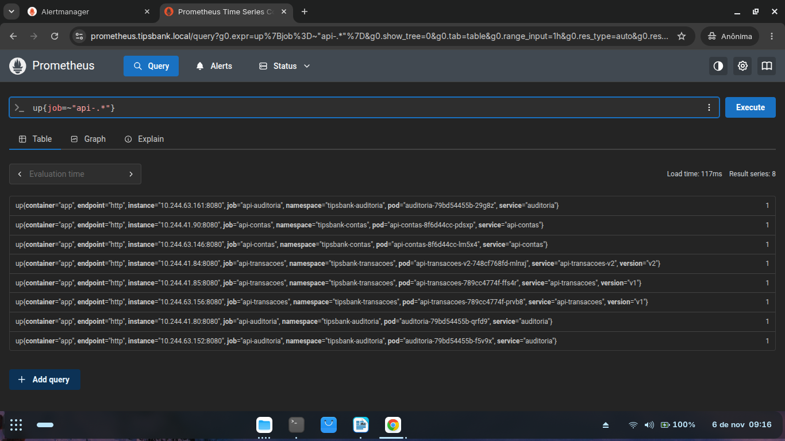

```console
$ kubectl get --raw /api/v1/namespaces/tipsbank-monitoring/services/kps-prometheus:9090/proxy/api/v1/targets?state=active | ...
api-auditoria  tipsbank-auditoria   auditoria-79bd54455b-29g8z          -   up  http://10.244.63.161:8080/metrics
api-auditoria  tipsbank-auditoria   auditoria-79bd54455b-f5v9x          -   up  http://10.244.63.152:8080/metrics
api-auditoria  tipsbank-auditoria   auditoria-79bd54455b-qrfd9          -   up  http://10.244.41.80:8080/metrics
api-contas     tipsbank-contas      api-contas-8f6d44cc-lm5x4           -   up  http://10.244.63.146:8080/metrics
api-contas     tipsbank-contas      api-contas-8f6d44cc-pdsxp           -   up  http://10.244.41.90:8080/metrics
api-transacoes tipsbank-transacoes  api-transacoes-789cc4774f-ffs4r     v1  up  http://10.244.41.85:8080/metrics
api-transacoes tipsbank-transacoes  api-transacoes-789cc4774f-prvb8     v1  up  http://10.244.63.156:8080/metrics
api-transacoes tipsbank-transacoes  api-transacoes-v2-748cf768fd-mlnxj  v2  up  http://10.244.41.84:8080/metrics
```

Os demais alvos (apiserver, coredns, kubelet ×12, node-exporter ×4, kube-state-metrics e os do próprio stack) também estão `up`.

### Critério 2 — Dashboard Grafana com dados reais

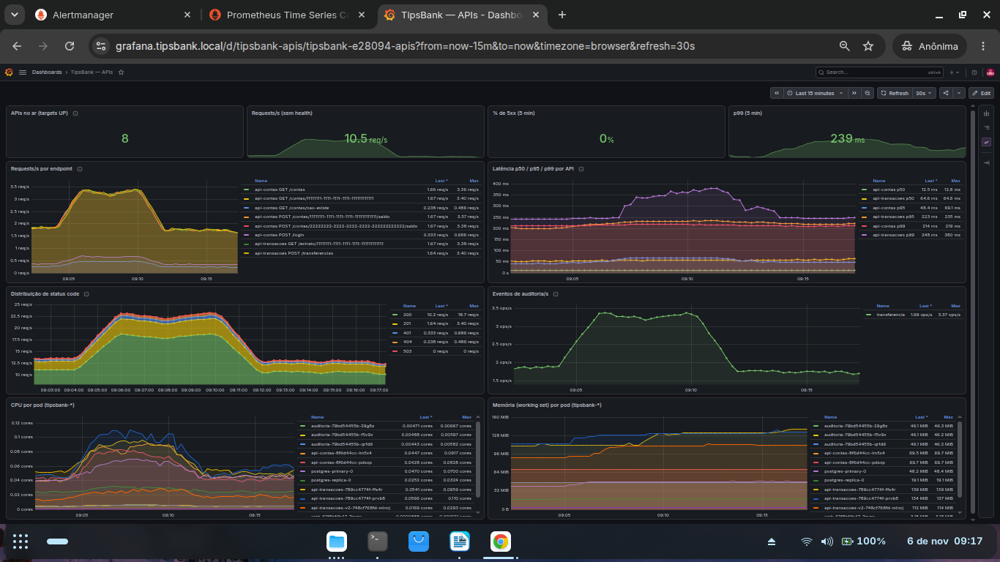

O que se lê no print (09:02–09:17):

- **8** alvos UP, **10,5 req/s** sem health checks, **0%** de 5xx, **p99 de 239 ms**.
- **Requests/s por endpoint:** a carga dobra entre 09:04 e 09:10 (dois laços de tráfego sobrepostos) e aparecem as chamadas **internas** `POST /contas/{id}/saldo`, que a api-transacoes faz na api-contas a cada transferência.
- **Latência:** a api-transacoes (p50 ~65 ms) é mais lenta que a api-contas (p50 ~12 ms): cada transferência chama a api-contas duas vezes e a auditoria uma.
- **Status:** 200, 201 (transferências), 401 (login errado), 404 (conta inexistente) e 503 = 0.
- **Memória:** o container `app` da api-transacoes chegou a **138,7 MiB** sob carga, acima do request de 128Mi (limit 256Mi). Isso é dado para a 3.7.

### Critério 3 — Alertmanager funcional

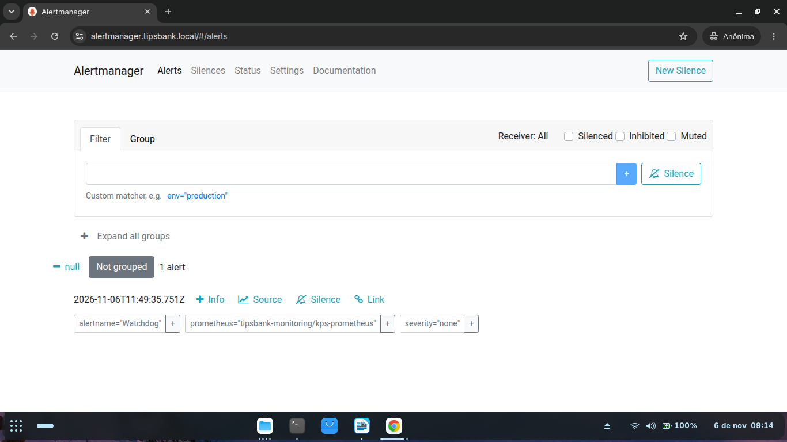

```console
$ kubectl get --raw /api/v1/namespaces/tipsbank-monitoring/services/kps-alertmanager:9093/proxy/api/v2/status
cluster: disabled | versão: 0.34.2
$ ... /api/v2/alerts
active      Watchdog       severity=none      # sempre disparando: prova que Prometheus → Alertmanager funciona
suppressed  InfoInhibitor  (3 namespaces)     # inibe alertas "info"
```

Alertas `info` pendentes no Prometheus: `CPUThrottlingHigh` no sidecar `log-forwarder` (limit de 50m do manual; ~63% dos períodos com throttling, com média de 5m de uso), nos sidecars do Grafana, no node-exporter e no `calico-kube-controllers`. É o efeito de limit de CPU baixo com uso em rajadas (3.4). A reavaliação fica para a 3.6, junto com os alertas.

### Observações para as próximas etapas

| Achado | Impacto | Quando |
|---|---|---|
| `/metrics` acessível de fora pelo Ingress (`https://api.tipsbank.local/contas/metrics`) | expõe nomes de rotas e contadores para a internet | Semana 4 (bloquear no Ingress) |
| Label `path` com o UUID da conta (`/contas/1111…`, `/extrato/…`) | 1 série por conta: alta cardinalidade em produção. O correto é o template da rota (`/contas/{conta_id}`), o que exige mudar a app | registrado |
| Imagens `quay.io/prometheus*`, `quay.io/kiwigrid`, `docker.io/grafana` | reprovam o compliance #1 | 4.6 (espelhar no ghcr.io) |
| Sidecars do Grafana sem `livenessProbe` | reprovam o compliance #3 | 4.6 |
| `tipsbank-monitoring` sem NetworkPolicy | o Kyverno Generate (4.3) pode criar `default-deny` em `tipsbank-*` e cortar o scrape/Grafana | 4.3 |

### Resultado

| Critério | Status |
|---|---|
| kube-prometheus-stack via Helm, sem Jobs | ✅ revisão 2 `deployed`; webhook com certificado do cert-manager |
| Grafana via Ingress com TLS | ✅ `grafana.tipsbank.local` (e Prometheus/Alertmanager com Basic Auth) |
| ServiceMonitor por API | ✅ 3 ServiceMonitors; 8/8 alvos `UP` (`api-contas`, `api-transacoes` v1/v2, `api-auditoria`) |
| PodMonitor do sidecar | ✅ documentado por que não existe (busybox `tail` sem métricas) |
| Dashboard com dados reais | ✅ 10 painéis: req/s por endpoint, p50/p95/p99, status, CPU/memória por pod |
| Alertmanager funcional | ✅ UI com o `Watchdog` |

---

## Etapa 3.6 — PrometheusRule com alertas de SLO

**Data**: 2026-11-06 · **Arquivo**: [`infra/monitoring/rules/tipsbank-slo.yaml`](../infra/monitoring/rules/tipsbank-slo.yaml) (PrometheusRule `tipsbank-slo` no namespace `tipsbank-monitoring`)

### As 4 regras

| Alerta | Expressão | `for` | Severity |
|---|---|---|---|
| `TipsBankApiDown` | `up{job=~"api-.*"} == 0` | 2m | critical |
| `TipsBankP99Alto` | `histogram_quantile(0.99, sum by (job, le) (rate(http_request_duration_seconds_bucket{job=~"api-.*", path!~"/metrics\|/health/.*"}[5m]))) > 0.5` | 5m | warning |
| `TipsBankErroAltoApi` | `sum by (job) (rate(http_requests_total{…, status=~"5.."}[5m])) / sum by (job) (rate(http_requests_total{…}[5m])) > 0.05` (mesmo filtro de `path`) | 3m | critical |
| `TipsBankPodCrashLoop` | `increase(kube_pod_container_status_restarts_total{namespace=~"tipsbank-.*"}[10m]) > 3` | — | warning |

Decisões:

| Decisão | Por quê |
|---|---|
| Latência e erro **sem** `/metrics` e `/health/*` | esse tráfego é do Prometheus e do kubelet (probes), não do cliente: ele dilui a taxa de erro e puxa o p99 para baixo |
| Agregação `by (job)` | um alerta por API, e não um por pod/path (o label `path` tem UUIDs, ver 3.5) |
| `team: tipsbank` em todos | label para roteamento no Alertmanager (receivers ficam para quando houver canal de notificação) |
| `job` = label `tipsbank.io/job` dos Services (3.5) | é o que dá o prefixo `api-` que o `up{job=~"api-.*"}` do manual espera |
| PrometheusRule sem o label `release` | o Prometheus aceita regras de qualquer namespace (`ruleSelectorNilUsesHelmValues: false`, 3.5) |

### Critério 1 — os 4 alertas em `kubectl get prometheusrule -A`

```console
$ kubectl get prometheusrule -A | grep -E "NAMESPACE|tipsbank-slo"
NAMESPACE             NAME                                               AGE
tipsbank-monitoring   tipsbank-slo                                       33m

$ kubectl -n tipsbank-monitoring get prometheusrule tipsbank-slo \
    -o jsonpath='{range .spec.groups[0].rules[*]}{.alert}{"  for="}{.for}{"  severity="}{.labels.severity}{"\n"}{end}'
TipsBankApiDown  for=2m  severity=critical
TipsBankP99Alto  for=5m  severity=warning
TipsBankErroAltoApi  for=3m  severity=critical
TipsBankPodCrashLoop  for=  severity=warning

# o Prometheus carregou e avalia as 4 (health=ok); estado depois dos testes:
$ kubectl get --raw "/api/v1/namespaces/tipsbank-monitoring/services/kps-prometheus:9090/proxy/api/v1/rules?rule_group[]=tipsbank-slo" | ...
TipsBankApiDown ok inactive
TipsBankP99Alto ok inactive
TipsBankErroAltoApi ok inactive
TipsBankPodCrashLoop ok inactive
```

### Critério 2 — cada alerta disparado provocando a condição

Durante os 4 testes rodou um laço de tráfego de negócio pelo Ingress (o mesmo da 3.5). Linha de base antes do 1º teste: 8 alvos `up=1`, p99 de 215 ms (api-contas) e 249 ms (api-transacoes), nenhum 5xx, nenhum restart.

| Teste | Falha provocada | Início | pending | firing | Desfeito |
|---|---|---|---|---|---|
| ApiDown | NetPol da auditoria sem a regra do Prometheus | 13:42:17 | 13:42:53 | **13:44:46** | 13:47:50 |
| P99Alto | lock `ACCESS EXCLUSIVE` na tabela `contas` (1 s sim, 1 s não) | 13:45:02 | 13:46:28 | **13:51:19** (contas), **13:51:55** (transações) | 13:55:03 (fim do laço) |
| ErroAltoApi | banco `tipsbank` em somente leitura | 13:55:16 | 13:55:56 | **13:59:00** | 14:02:16 |
| PodCrashLoop | rollout da imagem quebrada v1.9.9 (3.2) | 14:03:02 | — | **14:05:25** | 14:08:38 (`rollout undo`) |

#### Teste 1 — `TipsBankApiDown`: alvo existe, mas não responde

"Matar" a API escalando para 0 não serve para esta expressão: sem pod, o alvo some e a série `up` deixa de existir (não vira 0). A falha provocada foi a de rede: tirar o Prometheus da NetworkPolicy da auditoria. Os pods continuam saudáveis e atendendo o Ingress; só o scrape é bloqueado.

```console
$ kubectl -n tipsbank-auditoria patch networkpolicy auditoria-ingress --type=json -p '[
    {"op":"test","path":"/spec/ingress/0/from/2/namespaceSelector/matchLabels/kubernetes.io~1metadata.name","value":"tipsbank-monitoring"},
    {"op":"remove","path":"/spec/ingress/0/from/2"}]'
networkpolicy.networking.k8s.io/auditoria-ingress patched

$ kubectl -n tipsbank-auditoria get pods        # continuam 1/1, 0 restarts
$ curl -sk -o /dev/null -w '%{http_code}\n' https://api.tipsbank.local/auditoria/eventos
200

# Alertmanager (API v2):
TipsBankApiDown critical auditoria-79bd54455b-29g8z active 2026-11-06T16:44:46.182Z
TipsBankApiDown critical auditoria-79bd54455b-qrfd9 active 2026-11-06T16:44:46.182Z
TipsBankApiDown critical auditoria-79bd54455b-f5v9x active 2026-11-06T16:44:46.182Z

$ kubectl apply -f k8s/auditoria/networkpolicy.yaml     # desfaz: volta ao estado do Git
networkpolicy.networking.k8s.io/auditoria-ingress configured
# 40 s depois: up{job="api-auditoria"} = 1 nos 3 pods, alerta resolvido
```

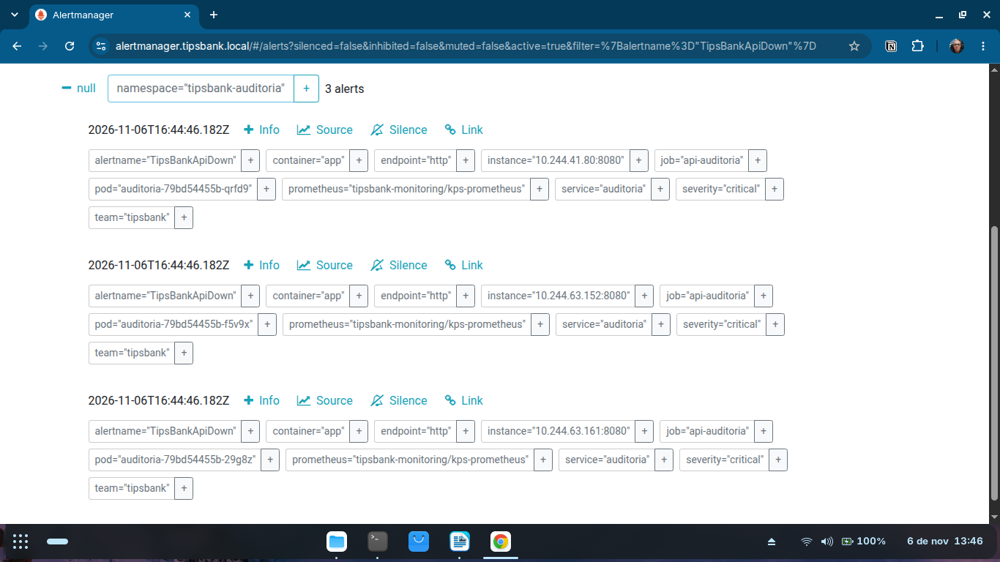

O `test` no patch garante que o item removido é mesmo o do `tipsbank-monitoring` (se a ordem da lista mudar, o patch falha em vez de remover a regra errada).

#### Teste 2 — `TipsBankP99Alto`: contenção de lock no banco

```console
$ kubectl -n tipsbank-contas exec postgres-primary-0 -c postgres -- sh -c '
    fim=$(( $(date +%s) + 600 )); n=0
    while [ $(date +%s) -lt $fim ]; do
      psql -U "$POSTGRES_USER" -d "$POSTGRES_DB" -qAt \
        -c "BEGIN; LOCK TABLE contas IN ACCESS EXCLUSIVE MODE; SELECT pg_sleep(1); COMMIT;" >/dev/null
      n=$((n+1)); sleep 1
    done; echo "locks=$n"'
locks=296
```

Enquanto o lock está preso, toda consulta à tabela `contas` espera na fila. O p99 subiu de ~230 ms para:

```
13:46:28  pending api-contas       p99: api-contas 0,90 s   api-transacoes 0,48 s
13:46:59  pending api-transacoes   p99: api-contas 0,95 s   api-transacoes 1,40 s
13:51:19  firing  api-contas       p99: api-contas 1,99 s   api-transacoes 2,23 s
13:51:55  firing  api-transacoes
```

A api-transacoes sofre mais que a api-contas: cada transferência chama a api-contas duas vezes (débito e crédito) e soma as duas esperas. Nenhuma requisição falhou: o tráfego continuou só com 200/201/401/404 (lento, mas certo).

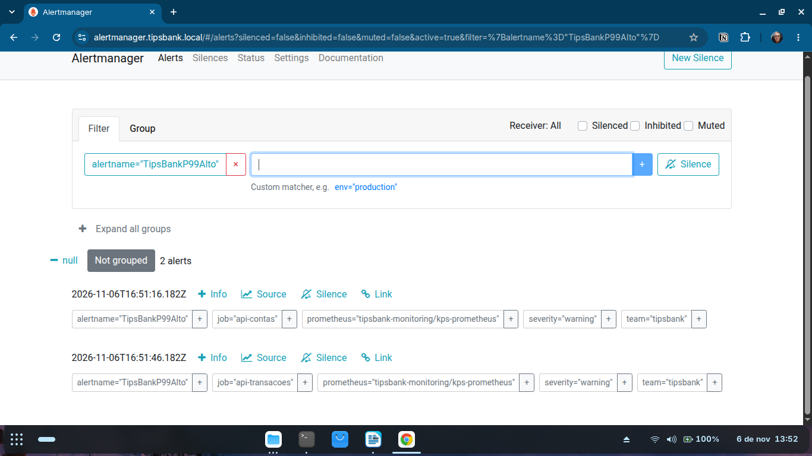

#### Teste 3 — `TipsBankErroAltoApi`: banco sem escrita

Simula um primary que ficou somente leitura (falha de failover, disco cheio etc.): as leituras funcionam, as escritas falham.

```console
$ kubectl -n tipsbank-contas exec postgres-primary-0 -c postgres -- sh -c 'psql -U "$POSTGRES_USER" -d "$POSTGRES_DB" \
    -c "ALTER DATABASE tipsbank SET default_transaction_read_only = on;" \
    -c "SELECT count(pg_terminate_backend(pid)) AS conexoes_derrubadas FROM pg_stat_activity
        WHERE datname = '\''tipsbank'\'' AND backend_type = '\''client backend'\'' AND pid <> pg_backend_pid();" \
    -c "SELECT client_addr, state FROM pg_stat_replication;"'
ALTER DATABASE
 conexoes_derrubadas
---------------------
                  14
 client_addr  |   state
--------------+-----------
 10.244.41.78 | streaming          # a réplica não foi afetada (walsender não é "client backend")
```

O `ALTER DATABASE … SET` só vale para conexões novas: por isso as conexões das APIs foram derrubadas (o pool do SQLAlchemy tem `pool_pre_ping` e reconecta).

```
13:55:56  pending api-transacoes   5xx: 10%
13:59:00  firing  api-transacoes   5xx: 41%
```

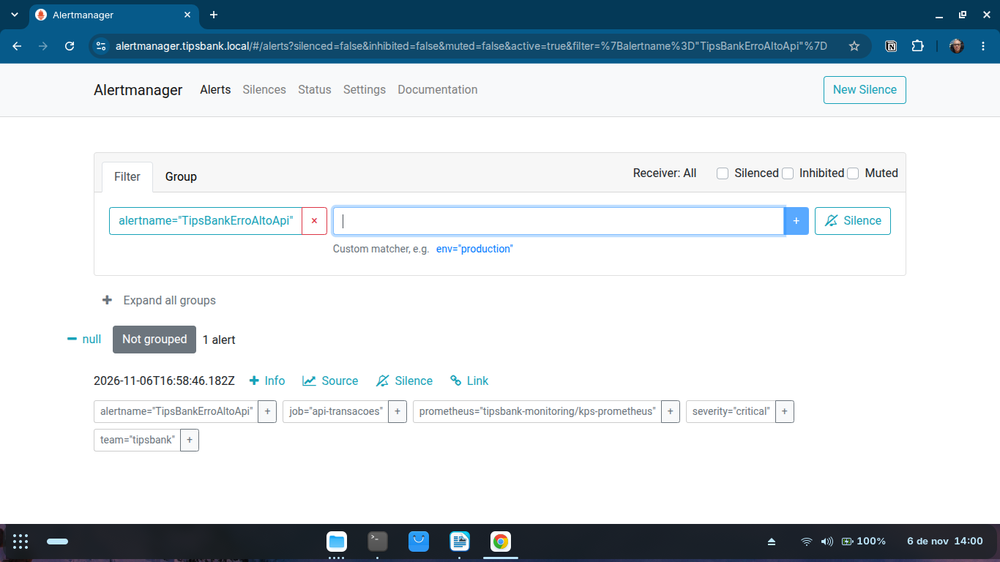

**Achado: a api-contas devolve 500, mas a métrica dela não conta.** O alerta disparou só para a api-transacoes. Requisições nos 2 minutos de falha:

```console
# sum by (job,status) (increase(http_requests_total{path=~"/contas/.*/saldo|/transferencias"}[2m]))
api-transacoes 201 96
api-transacoes 500 64
api-contas     200 194          # nenhum 500 na métrica...

# ...mas o log mostra os 500 (o --tail=-1 é necessário: com -l o padrão é --tail=10 por pod)
$ kubectl -n tipsbank-contas logs -l app.kubernetes.io/name=api-contas -c app --since=2m --tail=-1 --prefix \
    | grep -E "POST /contas/.*/saldo.* 500|ReadOnlySqlTransaction" | tail -6
[pod/api-contas-8f6d44cc-pdsxp/app] INFO:     10.244.41.84:59992 - "POST /contas/11111111-1111-1111-1111-111111111111/saldo HTTP/1.1" 500 Internal Server Error
[pod/api-contas-8f6d44cc-pdsxp/app] psycopg.errors.ReadOnlySqlTransaction: cannot execute SELECT FOR UPDATE in a read-only transaction
[pod/api-contas-8f6d44cc-pdsxp/app] sqlalchemy.exc.InternalError: (psycopg.errors.ReadOnlySqlTransaction) cannot execute SELECT FOR UPDATE in a read-only transaction
...
```

Motivo: em `apps/api-contas/main.py`, o contador é incrementado num middleware **depois** de `await call_next(request)`. Uma exceção **não tratada** (aqui, a do Postgres) sobe pelo `call_next`, o middleware é interrompido antes do `.inc()`, e o 500 é gerado mais acima, pelo `ServerErrorMiddleware` do Starlette. Erros com `HTTPException` (404, 422, 503) são contados normalmente. A api-transacoes conta o 500 porque transforma a resposta da api-contas em `HTTPException(status_code=500)`. A correção é na app (`try/finally` no middleware ou handler de exceção) e fica registrada abaixo.

Desfazer: o próprio `ALTER DATABASE … RESET` falha **dentro** do banco somente leitura (`ERROR: cannot execute ALTER DATABASE in a read-only transaction`). Ele foi rodado a partir do banco de manutenção `postgres`:

```console
$ kubectl -n tipsbank-contas exec postgres-primary-0 -c postgres -- sh -c '
    psql -U "$POSTGRES_USER" -d postgres -c "ALTER DATABASE tipsbank RESET default_transaction_read_only;" \
      -c "SELECT count(pg_terminate_backend(pid)) AS conexoes_derrubadas FROM pg_stat_activity WHERE datname = '\''tipsbank'\'' AND backend_type = '\''client backend'\'';" &&
    psql -U "$POSTGRES_USER" -d "$POSTGRES_DB" -Atc "SHOW default_transaction_read_only;"'
ALTER DATABASE
 conexoes_derrubadas
---------------------
                  14
off
```

Consistência: as transferências falharam no **débito** (o 1º passo), então nenhum saldo foi alterado pela metade. Primary e réplica, depois do teste:

```console
SELECT id, titular, saldo FROM contas ORDER BY 1;
 11111111-1111-1111-1111-111111111111 | Jeferson Fernando | 9616.33
 185b2ed8-1485-4924-bbbc-377607b08c25 | Teste Replica 3.3 |   33.33      # conta de teste da 3.3
 22222222-2222-2222-2222-222222222222 | LinuxTips SA      |  883.67
# 9616.33 + 883.67 = 10500.00, o mesmo total de antes (3.3); réplica com os mesmos valores
```

#### Teste 4 — `TipsBankPodCrashLoop`: imagem que não sobe

A mesma v1.9.9 da 3.2 (`ENTRYPOINT` com `main:aplicacao`, que não existe):

```console
$ kubectl -n tipsbank-transacoes set image deploy/api-transacoes \
    app=ghcr.io/jlui70/tipsbank-api-transacoes:v1.9.9@sha256:7f6533fd0a6d7454363bcb9645313f9b4d4b8f7257b9892ba99280e7aecb4a8a
$ kubectl -n tipsbank-transacoes annotate deploy/api-transacoes \
    kubernetes.io/change-cause="3.6: v1.9.9 QUEBRADA (teste do alerta TipsBankPodCrashLoop)" --overwrite

$ kubectl -n tipsbank-transacoes get pods -l app.kubernetes.io/name=api-transacoes
NAME                                 READY   STATUS             RESTARTS      AGE
api-transacoes-69cf84c-x7d7d         1/2     CrashLoopBackOff   4 (30s ago)   2m27s
api-transacoes-789cc4774f-ffs4r      2/2     Running            0             5h31m
api-transacoes-789cc4774f-prvb8      2/2     Running            0             5h31m
api-transacoes-v2-748cf768fd-mlnxj   2/2     Running            0             5h31m

$ kubectl -n tipsbank-transacoes describe pod -l pod-template-hash=69cf84c | grep -E "Image:|Last State|Reason|Exit Code|Restart Count|BackOff"
    Image:         ghcr.io/jlui70/tipsbank-api-transacoes:v1.9.9@sha256:7f6533fd…
      Reason:       CrashLoopBackOff
    Last State:     Terminated
      Reason:       Error
      Exit Code:    1
    Restart Count:  4
  Warning  BackOff    26s (x12 over 2m14s)  kubelet  spec.containers{app}: Back-off restarting failed container app ...

$ kubectl -n tipsbank-transacoes logs -l pod-template-hash=69cf84c -c app --previous --tail=3
{"ts":"2026-11-06 17:05:00,497","level":"ERROR","service":"api-transacoes","logger":"uvicorn.error","msg":"Error loading ASGI app. Attribute "aplicacao" not found in module "main"."}
```

Restarts ao longo do teste (backoff do kubelet: 10 s, 20 s, 40 s, 80 s…): 1 às 14:03:19, 2 às 14:03:29, 3 às 14:04:01, **4 às 14:05:04 → firing às 14:05:25**.

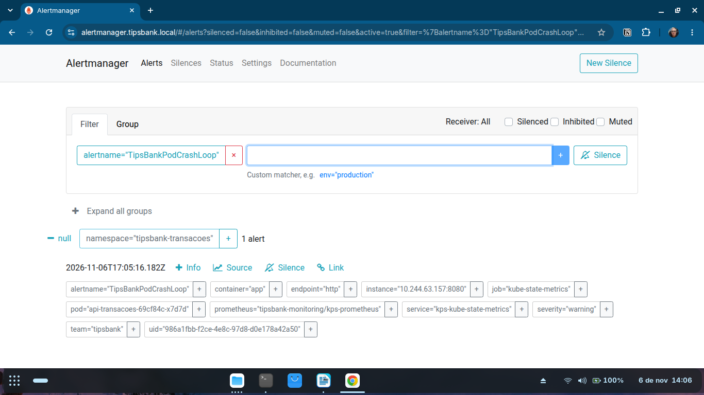

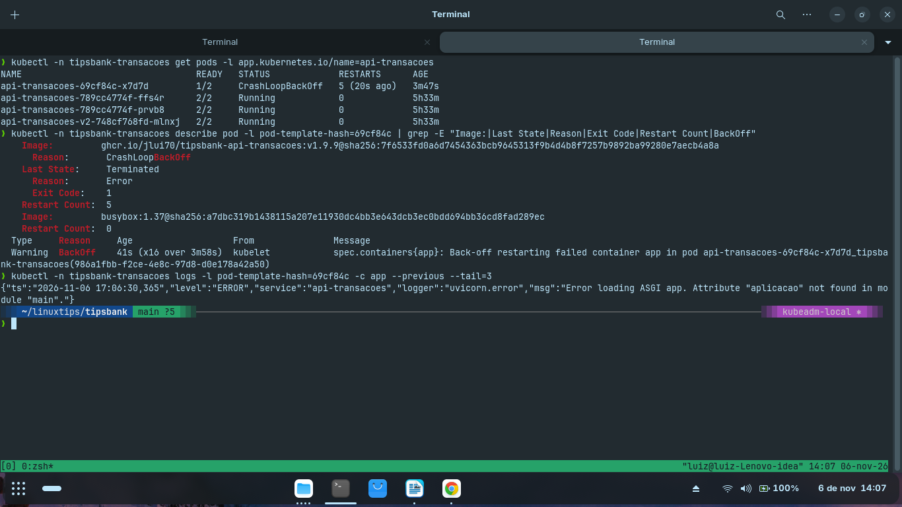

No print do Alertmanager, `job="kube-state-metrics"`, `instance` e `service` são de **quem exporta** a métrica (o kube-state-metrics), não do pod com problema. O que identifica o pod são `namespace`, `pod` e `container`.

Graças ao `maxSurge: 1 / maxUnavailable: 0` da 3.2, o rollout parou no pod novo e os 2 pods da v1.0.0 seguiram atendendo: nenhum 5xx no tráfego durante o teste.

```console
$ kubectl -n tipsbank-transacoes rollout undo deploy/api-transacoes
deployment.apps/api-transacoes rolled back
deployment "api-transacoes" successfully rolled out
$ kubectl -n tipsbank-transacoes rollout history deploy/api-transacoes | tail -3
12        3.3: podAntiAffinity preferred (hostname)
14        3.6: v1.9.9 QUEBRADA (teste do alerta TipsBankPodCrashLoop)
15        3.6: rollback da v1.9.9 (volta para v1.0.0)      # a revisão 13 (3.4) virou a 15: mesmo ReplicaSet 789cc4774f
```

O alerta só saiu de `firing` às **14:13:50**, 5 min depois de o pod quebrado ser apagado. `increase(...[10m])` olha as amostras dos últimos 10 min: a série do pod parou de existir às 14:08, mas as amostras antigas ficam dentro da janela até ela "rolar". É o comportamento normal de alertas com janela: o alerta "lembra" do problema por um tempo.

### Estado final

```console
# todos os TipsBank* inactive às 14:13:50; o que sobra ativo no Alertmanager:
CPUThrottlingHigh info tipsbank-transacoes api-transacoes-789cc4774f-ffs4r active
CPUThrottlingHigh info tipsbank-transacoes api-transacoes-789cc4774f-prvb8 active
CPUThrottlingHigh info tipsbank-transacoes api-transacoes-v2-748cf768fd-mlnxj active
CPUThrottlingHigh info kube-system calico-kube-controllers-55947b86cb-g7rpz suppressed
CPUThrottlingHigh info tipsbank-monitoring kps-prometheus-node-exporter-64j4w suppressed
InfoInhibitor none kube-system  suppressed
InfoInhibitor none tipsbank-monitoring  suppressed
Watchdog none   active
```

Nodes 4/4 `Ready`, todos os pods prontos, 8/8 alvos `up`, banco com `read_only = off`, réplica em `streaming`. Tráfego total do laço nos 4 testes: 9471×200, 2300×201, 631×401, 451×404 e 857×500. Todos os 500 saíram na janela do Teste 3.

### Reavaliação do `CPUThrottlingHigh` (pendência da 3.5)

```console
# fração dos períodos de CPU (100 ms) com throttling, últimos 5 min
log-forwarder  api-transacoes-789cc4774f-ffs4r     0,63
log-forwarder  api-transacoes-789cc4774f-prvb8     0,63
log-forwarder  api-transacoes-v2-748cf768fd-mlnxj  0,65
calico-kube-controllers                            0,64
node-exporter  kps-prometheus-node-exporter-64j4w  0,33
# uso médio real de CPU do log-forwarder: ~2 milicores (limit: 50m)
```

O sidecar usa **4% do limit** e mesmo assim tem throttling em ~63% dos períodos. Não é falta de CPU: o `tail -F` acorda em rajadas curtas a cada linha de log, e o CFS conta como "throttled" qualquer período em que a rajada passou da cota (50m = 5 ms a cada 100 ms), mesmo que dure microssegundos. Com uso médio tão abaixo do limit, o atraso é desprezível.

Decisão: **manter o limit de 50m do manual** e manter a regra padrão (severity `info`, que o `InfoInhibitor` já trata como ruído). Silenciar no Alertmanager seria estado manual fora do Git, e desligar a regra também esconderia throttling real nas APIs. Na 3.7 o mesmo dado será visto sob carga do Locust.

### Observações para as próximas etapas

| Achado | Impacto | Quando |
|---|---|---|
| api-contas não conta no `http_requests_total` os 500 de exceção não tratada | o `TipsBankErroAltoApi` não vê falha de banco na api-contas (só vê pela api-transacoes, que a chama) | correção na app (`try/finally` no middleware); registrado |
| `TipsBankApiDown` não vê Deployment com 0 réplicas (o alvo some, `up` não vira 0) | API "sumida" não alerta por esta regra | coberto pelo `KubeDeploymentReplicasMismatch` do chart; `absent()` por job seria a alternativa |
| Alertmanager só com o receiver `null` | os alertas aparecem na UI, mas ninguém é notificado | quando houver canal (Slack/e-mail); o label `team: tipsbank` já está nas regras para o roteamento |

### Resultado

| Critério | Status |
|---|---|
| Os 4 alertas em `kubectl get prometheusrule -A` | ✅ `tipsbank-slo` com `TipsBankApiDown`, `TipsBankP99Alto`, `TipsBankErroAltoApi`, `TipsBankPodCrashLoop`; `health=ok` no Prometheus |
| Todos disparam quando a condição é provocada | ✅ 4/4 em `firing` no Alertmanager (prints `3.6-01` a `3.6-04`), cada falha desfeita e o alerta resolvido |
